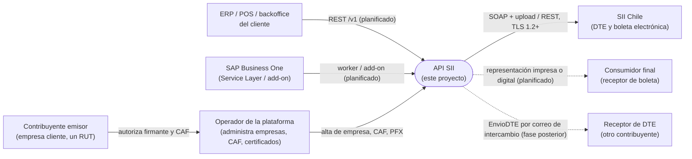

# 01. Visión y alcance

> Documento de ingeniería de diseño. Estado del código revisado sobre el commit `b91f3a1` (rama `master`). Las fuentes de contexto son `README.md` y `docs/01-opciones-arquitectura-y-pruebas.md`.

## 1. Problema

En Chile, los contribuyentes que emiten factura electrónica, guías de despacho, notas de crédito/débito y boletas electrónicas deben:

1. Construir documentos XML (ISO-8859-1) que cumplan los esquemas XSD oficiales del SII.
2. Asignar folios autorizados por el SII (CAF) sin repetirlos ni perderlos, aun con emisión concurrente.
3. Timbrar (TED) y firmar electrónicamente (XMLDSig, RSA-SHA1, C14N) con el certificado digital de un firmante autorizado.
4. Enviar los documentos al SII por dos canales técnicos distintos (SOAP + upload para DTE; API REST para boletas) y seguir su estado hasta la aceptación, el aceptado con reparos o el rechazo.
5. Hacerlo por cada RUT emisor (la certificación es por RUT), custodiando certificados y CAF de varios clientes.

Los ERP, POS y SAP Business One de los clientes no deberían reimplementar nada de esto. El proyecto ofrece una **API REST multiempresa** que encapsula ese motor, más una **integración posterior con SAP Business One**.

## 2. Objetivos

| Id | Objetivo | Estado |
|---|---|---|
| OBJ-1 | Motor DTE propio, determinista y verificable contra los XSD oficiales (dominio puro, sin IO) | Implementado (`apps/api/src/dte-core`) |
| OBJ-2 | Clientes del SII (REST boletas y SOAP/upload DTE) con token en caché, reintentos y errores tipados | Implementado como librería (`apps/api/src/sii-gateway`), sin cablear a Nest |
| OBJ-3 | Modelo de datos multiempresa y asignación de folios segura bajo concurrencia | Implementado (modelo y `FoliosService`) |
| OBJ-4 | API pública `/v1` para emitir, consultar, reenviar y descargar documentos | Planificado |
| OBJ-5 | Envío asíncrono al SII con colas, reintentos y polling de estados | Planificado |
| OBJ-6 | Representación impresa (PDF con PDF417) y entrega digital de boletas | Planificado |
| OBJ-7 | Certificación ante el SII por RUT (DTE y boleta) | Planificado (nada se ha probado contra el SII real) |
| OBJ-8 | Integración con SAP Business One (worker sobre Service Layer, luego add-on UI API) | Planificado |
| OBJ-9 | Resistir cambios normativos 2026 (Res. Ex. 121/2026, 144/2026, nuevos campos de impuestos) sin reescribir el motor | Parcial (XSD versionado en el repo; ver `02-requisitos.md`) |

## 3. Actores y sistemas externos

| Actor | Rol | Interacción |
|---|---|---|
| **Contribuyente emisor** | Dueño del RUT; designa un firmante con certificado digital y obtiene CAF del SII. Su `ambiente_sii` (certificación/producción) se guarda en `empresas` | Indirecta, a través del ERP/POS y del operador |
| **ERP / POS** | Origen de las ventas; pide emitir y consulta estados | Cliente de la API `/v1` (planificado) |
| **SAP Business One** | ERP objetivo: facturas, notas, guías y boletas salen de B1 | Fase 4: worker sobre Service Layer, luego add-on en C# (planificado) |
| **SII** | Autoridad: entrega semilla/token, recibe envíos, responde Track ID y estados | `sii-gateway`; hosts `maullin`/`palena` (DTE) y `apicert`/`api` (boletas) |
| **Consumidor final** | Recibe la boleta (impresa o digital, "verifique en www.sii.cl") | Planificado (PDF/PDF417, enlace, correo) |
| **Receptor de DTE** | Otro contribuyente que recibe facturas y responde acuse, recibo y aceptación | Fase posterior (módulo `intercambio`) |
| **Operador** | Equipo que administra empresas, certificados y CAF, y acompaña la certificación | Hoy sólo vía base de datos y servicios Nest; sin API ni backoffice |

## 4. Alcance

### 4.1 Versión actual (lo que existe en el repositorio)

- **Andamiaje**: NestJS 12, ESM, TypeScript estricto, Vitest, oxlint, `GET /` y `GET /health`, configuración validada con Joi (`apps/api/src/config`), prefijo global `/v1` (`apps/api/src/main.ts`).
- **Núcleo de dominio** `dte-core`: parseo de CAF, TED, firma XMLDSig, utilidades XML/ISO-8859-1/RUT, validación XSD, carga de PFX, cálculo de totales, constructores de DTE y de sobres `EnvioDTE`/`EnvioBOLETA`.
- **Clientes del SII** `sii-gateway`: `BoletaApiClient` y `DteSiiClient`, caché de token, reintentos con backoff y errores tipados.
- **Persistencia**: entidades TypeORM, una migración inicial y esquema multiempresa (`empresas`, `certificados`, `cafs`, `documentos`, `envios`, `envio_documentos`).
- **Servicios**: `FoliosService` (registro de CAF, asignación transaccional de folios, resumen de disponibilidad) y `CifradoService` (AES-256-GCM).
- **Calidad**: 184 pruebas unitarias en 17 archivos y 5 pruebas e2e (1 sin base de datos, 4 con PostgreSQL). Ver `15-estado-y-roadmap.md`.

### 4.2 Fuera de la versión actual (planificado)

| Fase | Contenido | Referencia |
|---|---|---|
| 1 | Caso de uso de emisión (folio + XML + TED + firma), API `/v1/empresas/{rut}/documentos`, envío y estados en certificación | `docs/01-…` sección 6, fases 1 y 2 |
| 2 | PDF/PDF417, entrega digital de boletas, webhooks, administración de CAF y certificados por API, autenticación | idem |
| 3 | Certificación SII de la primera empresa (DTE y boleta) | idem |
| 4 | Integración SAP Business One | idem |
| 5 | Guías con traslado (Res. 144/2026), exportación, intercambio y recepción de compras, aceptación y reclamo | idem |

### 4.3 Fuera de alcance explícito

- Libros contables (CAL/COCERTIF) y contabilidad. Los libros de compras, ventas y guías (IECV) **sí están implementados** (`apps/api/src/libros`, `src/dte-core/libros`).
- Ser proveedor de certificados digitales o de CAF: los entrega el SII y una entidad acreditada.
- Reemplazar al ERP: la API emite y consulta; no gestiona inventario ni cobranza.

## 5. Supuestos y restricciones

### 5.1 Normativa y operación del SII

- **Certificación por RUT**: cada empresa emisora debe pasar el set de pruebas, simulación, intercambio, muestras impresas y declaración de cumplimiento. La boleta electrónica tiene un proceso separado (`docs/01-…` sección 4.3). El código no sustituye ese proceso.
- **Certificado digital** de un firmante autorizado, en PFX. Firma el DTE, el sobre y la semilla de autenticación.
- **CAF** por tipo de documento; los de documentos con crédito fiscal vencen a los 6 meses (Res. Ex. 58/2017). Los CAF reales usan RSA de 1024 bits; el código es agnóstico al tamaño.
- **Firma**: RSA-SHA1, digest SHA1, C14N 1.0. Es lo que exige el SII aunque sea criptografía débil; no se puede cambiar (ver ADR-005 en `12-decisiones-adr.md`).
- **XSD como fuente de verdad**: paquete oficial del 2026-02-19 más `EnvioBOLETA_v11.xsd`, en `apps/api/resources/sii/xsd/`. El PDF de formato publicado está desactualizado.
- **Encoding**: los documentos viajan en ISO-8859-1; los caracteres fuera de Latin-1 se sustituyen o se reemplazan por `?`.
- **Normativa 2026 en movimiento**: Res. Ex. 121/2026 (tres estados de recepción y validaciones por fases sin fechas), Res. Ex. 144/2026 (traslado en guías y facturas), campos nuevos de impuestos específicos aún ausentes del XSD. Ver `docs/01-…` sección 1.6.
- **Datos por verificar en fuente oficial**: fecha de obligación de entrega digital de boletas, eliminación del RVD/RCOF, plazo de conservación de XML (6 años, a verificar).

### 5.2 Restricciones técnicas del SII

| Restricción | Detalle | Dónde se refleja |
|---|---|---|
| TLS 1.2 o superior | Obligatorio en el canal de boletas | Runtime Node 24 (`fetch`); no hay configuración explícita en el código |
| Límite de envío de boletas | Máximo 500 por `EnvioBOLETA`; el SII recomienda 50 | `BOLETAS_POR_SOBRE_RECOMENDADO` en `apps/api/src/dte-core/envio/envio.ts`; el gateway no lo valida |
| Límite de DTE por envío | 2000 por `EnvioDTE`; 60 líneas de detalle por DTE y 1000 por boleta | Validación en `dte-core` según XSD |
| HTTP 405 | Significa límite excedido; se reintenta con backoff | `apps/api/src/sii-gateway/comun/http.ts` |
| Token | Boletas: semilla 2 min, token 1 h, distinto al de DTE; caché de 50 min | `GestorToken` en `apps/api/src/sii-gateway/comun/http.ts` |
| `User-Agent` fijo | Exigido en el upload de DTE y en el envío de boletas | `USER_AGENT_SII` en `apps/api/src/sii-gateway/ambientes.ts` |
| Hosts temporales | `pangal`/`rahue` sólo para el POST de envío de boletas | opción `usarHostEnvioAlternativo` |
| Sin actividad | El SII elimina del ambiente de certificación a quien no registra actividad en 6 meses | Mitigación planificada: smoke test diario |

### 5.3 Supuestos del proyecto

- Un único proceso de la API por ahora; la caché de token vive en memoria del proceso (ver `03-arquitectura.md`).
- Node.js 24 y PostgreSQL 16 (el `docker-compose.yml` usa `postgres:16-alpine`). `gen_random_uuid()` requiere PostgreSQL 13 o superior.
- La emisión debe ser síncrona (folio + XML + firma en menos de un segundo para que el POS imprima) y el envío al SII asíncrono. La emisión síncrona y la cola aún no existen.
- Nada de lo implementado ha sido probado contra el ambiente de certificación real (`README.md`). Los formatos de respuesta del SII y el `KeyInfo` de la firma están por verificar.
