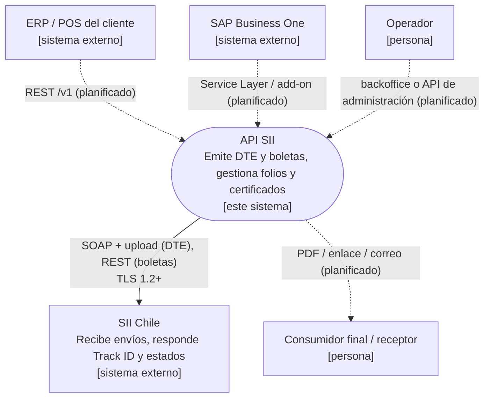
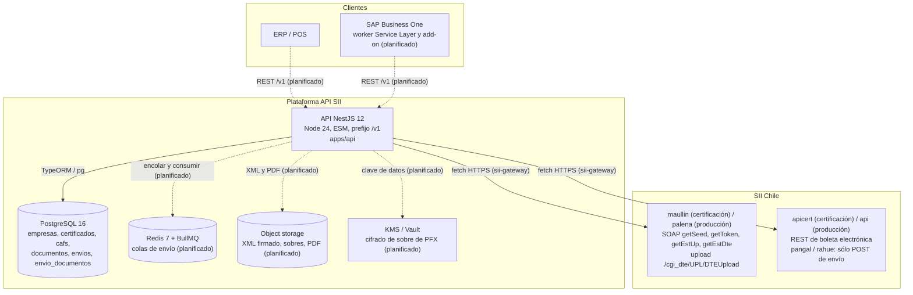
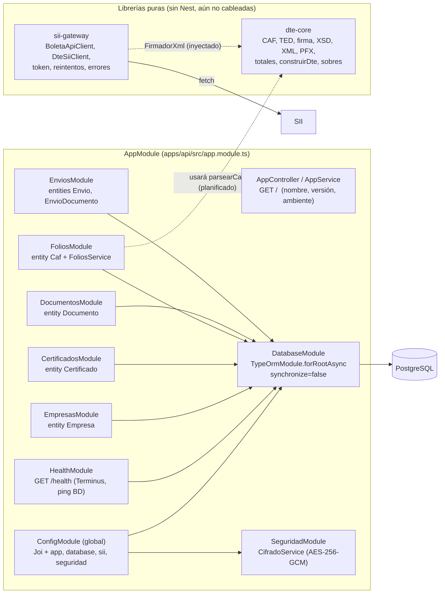
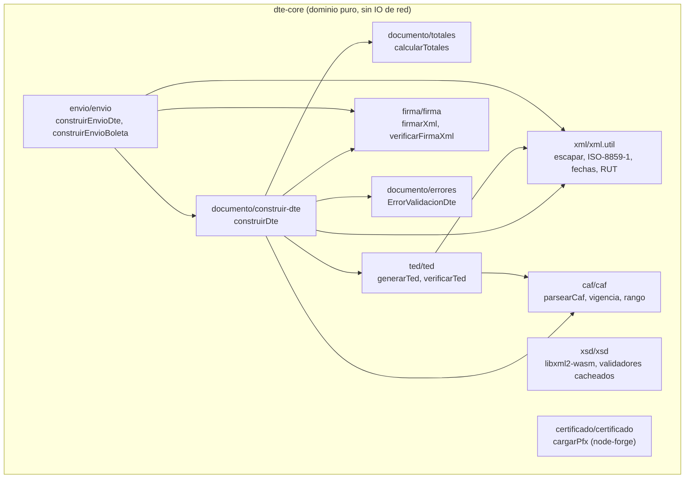
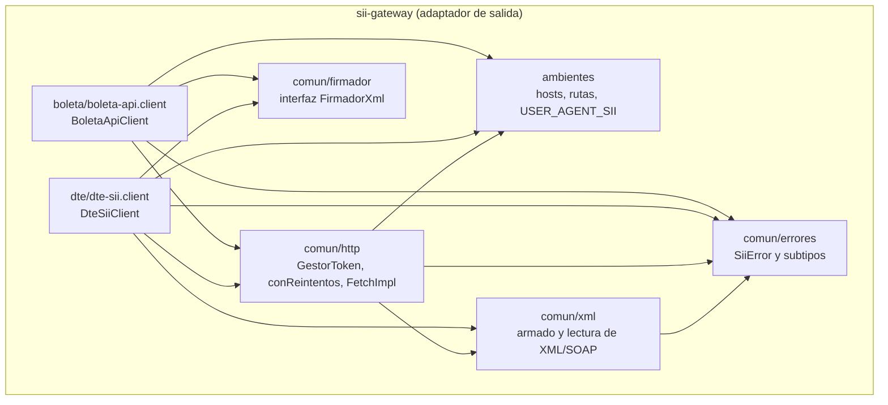
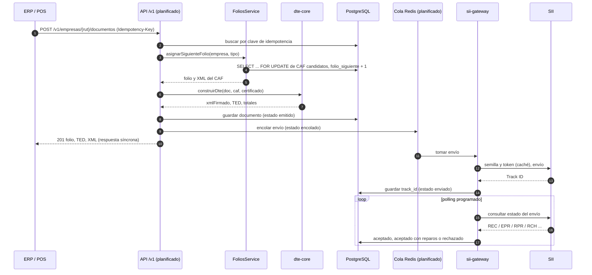
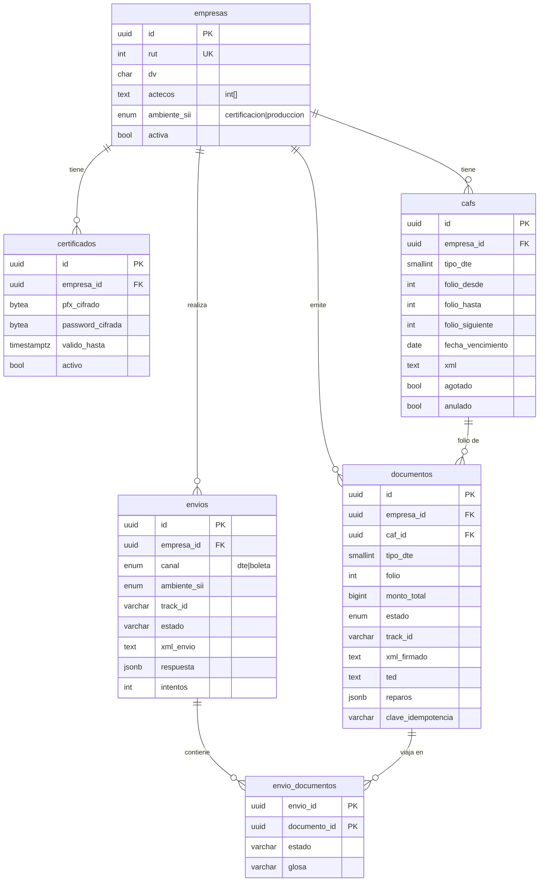
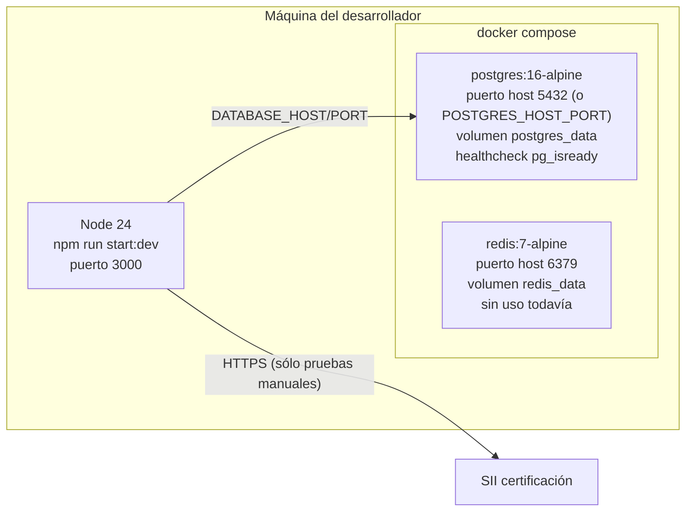
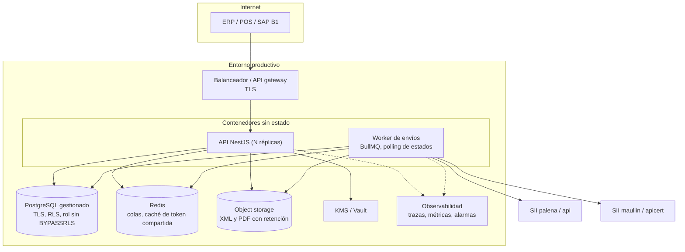

# 03. Arquitectura

Modelo en niveles C4 (contexto, contenedores, componentes) más vista de despliegue. Convención de los diagramas: **línea continua y borde normal = existe hoy; línea punteada y nodo con la etiqueta "(planificado)" = no existe aún.**

## 1. Contexto (C4 nivel 1)

## 2. Contenedores (C4 nivel 2)

| Contenedor | Tecnología | Estado | Notas |
|---|---|---|---|
| API NestJS | NestJS 12, Express (`@nestjs/platform-express`), TypeScript 6, ESM | Implementado (parcial) | Expone `GET /` y `GET /health`; ningún endpoint de negocio |
| PostgreSQL | 16-alpine en Docker | Implementado | Esquema inicial por migración; XML guardado como `text` en la BD |
| Redis | 7-alpine en `docker-compose.yml` | Planificado | Levantado en compose pero ninguna dependencia lo usa (no hay BullMQ en `package.json`) |
| Object storage | S3 o compatible | Planificado | Hoy `documentos.xml_firmado` y `envios.xml_envio` van en la BD |
| KMS / Vault | n/a | Planificado | Hoy: clave maestra única en `CERTIFICADOS_MASTER_KEY` |
| SII DTE | SOAP + upload | Implementado como cliente | `apps/api/src/sii-gateway/dte/dte-sii.client.ts` |
| SII boletas | REST con OpenAPI 1.0.5 | Implementado como cliente | `apps/api/src/sii-gateway/boleta/boleta-api.client.ts`; spec en `apps/api/resources/sii/openapi/` |
| SAP B1 | Service Layer / UI API | Planificado | Fase 4 |

## 3. Componentes de la API (C4 nivel 3)

### 3.1 Módulos Nest tal como están en `apps/api/src/app.module.ts`

`AppModule` importa `ConfigModule`, `DatabaseModule`, `HealthModule`, `EmpresasModule`, `CertificadosModule`, `FoliosModule`, `DocumentosModule`, `EnviosModule` y `SeguridadModule`; declara `AppController` y `AppService`. **Ningún módulo de negocio importa a otro**: los módulos de persistencia sólo se comunican por las relaciones entre entidades TypeORM. Ni `dte-core` ni `sii-gateway` son módulos Nest todavía.

Lectura del diagrama:

- `ConfigModule` es global (`isGlobal: true`), carga `.env` y `.env.local` y valida con Joi (`apps/api/src/config/env.validation.ts`). `SeguridadModule` importa `ConfigModule.forFeature(seguridadConfig)` y exporta `CifradoService`.
- `DatabaseModule` usa `TypeOrmModule.forRootAsync` con `autoLoadEntities: true`; cada módulo registra sus entidades con `TypeOrmModule.forFeature([...])` y las re-exporta.
- `FoliosModule` es el único con un servicio de negocio (`FoliosService`, que inyecta `DataSource`) y lo exporta junto con `TypeOrmModule`.
- `HealthModule` usa `TerminusModule` y `TypeOrmHealthIndicator` (consulta la conexión del `DatabaseModule`).
- `CifradoService` no es consumido todavía por ningún módulo (se usará al cargar certificados).
- Duplicación detectada: el tipo `AmbienteSii` existe en `apps/api/src/config/sii.config.ts` y en `apps/api/src/sii-gateway/ambientes.ts` con el mismo contenido (ver `15-estado-y-roadmap.md`).

### 3.2 Organización interna de `dte-core`

Las flechas indican imports reales entre archivos (`construir-dte.ts`, `envio.ts`, `ted.ts`). `certificado/` y `xsd/` son independientes: `firma.ts` obtiene el certificado embebido con `node:crypto` y quien las combina es el llamador. El único acceso a disco es la lectura de los XSD en `xsd/xsd.ts` (carpeta por `SII_XSD_DIR` o búsqueda hacia arriba de `resources/sii/xsd`).

### 3.3 Organización interna de `sii-gateway`

El firmador es una **interfaz** (`firmarXml(xml, idReferencia?)`); la dependencia es hacia el contrato, no hacia `dte-core`. `fetchImpl` es inyectable (por defecto `globalThis.fetch`), de modo que las 85 pruebas del gateway (ver `15-estado-y-roadmap.md`) no tocan la red.

## 4. Estilo arquitectónico

Combina **arquitectura hexagonal ligera** con módulos Nest:

| Capa | Piezas | Regla |
|---|---|---|
| **Dominio puro** | `apps/api/src/dte-core` | Sin decoradores de Nest, sin red. Entradas y salidas son tipos TypeScript, strings y `Buffer`. Es el módulo con más pruebas (90 pruebas en `dte-core`) y utilidades de prueba propias (`testing/`, que no se exportan desde `index.ts`) |
| **Adaptador de salida (SII)** | `apps/api/src/sii-gateway` | Clases puras con dependencias inyectables por constructor (`fetchImpl`, `firmador`, caché, `esperar`, `ahora`); el integrador las envuelve en un módulo Nest |
| **Módulos de persistencia** | `empresas`, `certificados`, `folios`, `documentos`, `envios` | Módulos Nest con TypeORM; entidades en `src/<modulo>/entities/*.entity.ts`; terminología SII en español |
| **Transversales** | `config`, `database`, `seguridad`, `health` | Configuración validada, conexión, cifrado y salud |
| **Aplicación (caso de uso)** | `emision`, `envios` (worker) | Planificada: orquestará folios + `dte-core` + persistencia + `sii-gateway` |

Reglas de dependencia pretendidas: `dte-core` no importa nada de Nest ni de `sii-gateway`; `sii-gateway` no importa `dte-core` (usa la interfaz `FirmadorXml`); los módulos de persistencia no contienen lógica de XML; el caso de uso es el único que une las piezas. Hoy esto se cumple por construcción porque ninguna pieza está cableada con otra.

### Flujo objetivo de emisión y envío (planificado)

Este flujo es el de `docs/01-…` sección 3. Hoy sólo existen los participantes `FoliosService`, `dte-core`, `sii-gateway` y `PostgreSQL`; faltan la API, la orquestación y la cola.

## 5. Modelo de datos

Fuente: `apps/api/src/database/migrations/1794643366818-Inicial.ts` y `apps/api/src/database/README.md`.

Restricciones relevantes: único `(empresa_id, tipo_dte, folio_desde)` en `cafs`; único `(empresa_id, tipo_dte, folio)` en `documentos`; índice único parcial `(empresa_id, clave_idempotencia)` cuando no es nulo; todas las FK `ON DELETE RESTRICT`. Estados de `documentos`: `emitido`, `encolado`, `enviado`, `aceptado`, `aceptado_con_reparos`, `rechazado`, `anulado`.

## 6. Vista de despliegue

### 6.1 Actual (desarrollo local)

Definido en `docker-compose.yml`:

- La API corre fuera de Docker (no hay `Dockerfile` ni servicio `api` en el compose).
- Las credenciales por defecto (`api_sii/api_sii`) y la clave maestra de `apps/api/.env.example` son **sólo de desarrollo**.
- Las migraciones se ejecutan a mano (`npm run migration:run`); `migrationsRun` está en `false`.

### 6.2 Objetivo (planificado)

Consecuencias de pasar a varias réplicas: la caché de token en memoria (`GestorToken`) deja de ser compartida y habrá que usar el parámetro `almacen` (Redis) para no pedir tokens de más; la asignación de folios ya es correcta entre réplicas porque usa bloqueos de base de datos.

## 7. Decisiones transversales

| Tema | Decisión | Dónde |
|---|---|---|
| **ESM** | `"type": "module"`, `module: nodenext`; los imports relativos terminan en `.js`; no existe `__dirname` (se usa `import.meta.dirname`) | `apps/api/package.json`, `apps/api/tsconfig.json`, `apps/api/AGENTS.md` |
| **TypeScript estricto** | `strict: true`; `strictPropertyInitialization: false` por las entidades TypeORM; `emitDecoratorMetadata` y `experimentalDecorators` por Nest | `apps/api/tsconfig.json` |
| **Prefijo `/v1`** | `app.setGlobalPrefix('v1', { exclude: ['health', '/'] })`: los recursos de negocio vivirán bajo `/v1`; `/` y `/health` quedan sin prefijo | `apps/api/src/main.ts` |
| **Configuración** | Variables de entorno validadas con Joi al arrancar; `registerAs` por área (`app`, `database`, `sii`, `seguridad`) | `apps/api/src/config/` |
| **Esquema de BD** | Sólo migraciones (`synchronize: false`, `migrationsRun: false`), `gen_random_uuid()`, enums con nombre explícito | `apps/api/src/database/` |
| **Pruebas** | Vitest con `globals: true`; pruebas unitarias `*.spec.ts` junto al código y e2e en `apps/api/test/` con configuración aparte | `apps/api/vitest.config.ts`, `apps/api/vitest.config.e2e.ts` |
| **Calidad** | oxlint con `--type-aware` (regla `no-floating-promises` en error), prettier | `apps/api/.oxlintrc.json` |
| **Nomenclatura** | Tablas, columnas, entidades y servicios en español (términos del SII) | `apps/api/src/database/README.md` |
| **Montos y fechas** | Montos `bigint` en BD y enteros en CLP en el dominio; fechas de calendario como `date`/string `YYYY-MM-DD`, instantes `timestamptz`; zona `America/Santiago` para fechas SII | `apps/api/src/database/README.md`, `apps/api/src/dte-core/xml/xml.util.ts` |
| **Errores tipados** | `ErrorValidacionDte`, `SiiError` y subtipos, `SinFoliosDisponiblesError`, `CafInvalidoError`; aún sin filtro HTTP que los traduzca | `dte-core`, `sii-gateway`, `apps/api/src/folios/folios.errors.ts` |

Las razones de cada decisión están en `12-decisiones-adr.md`.
