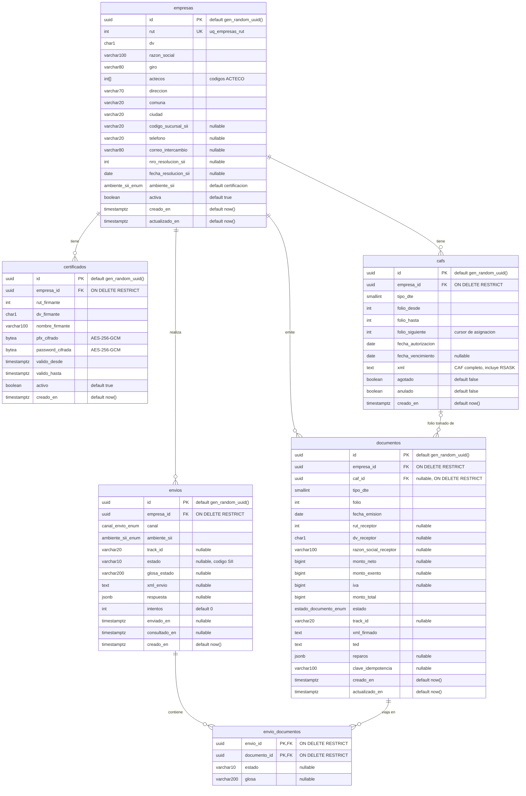
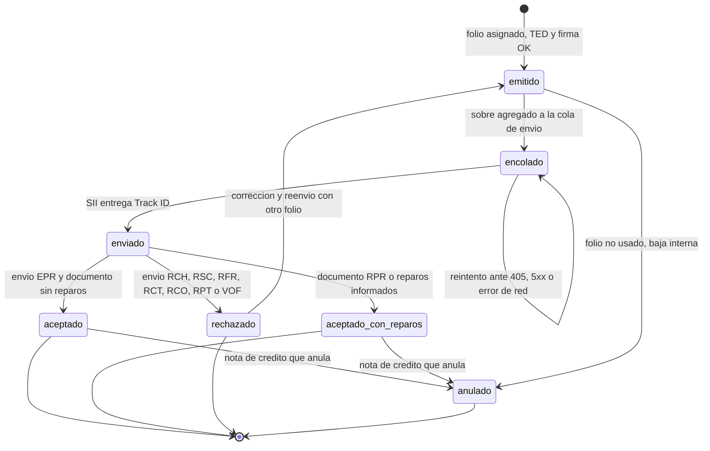
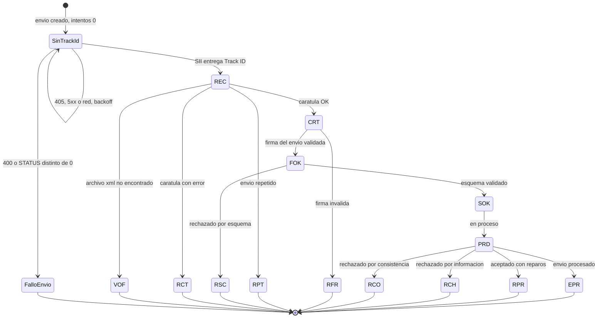

# 04. Modelo de datos

Este documento describe el esquema PostgreSQL de la API tal como lo crea la migración
`apps/api/src/database/migrations/1794643366818-Inicial.ts` y lo declaran las entidades TypeORM en
`apps/api/src/*/entities/*.entity.ts`. Es la fuente de verdad del esquema; el resumen operativo vive en
`apps/api/src/database/README.md`.

Estado: el **esquema** y el servicio de folios (`apps/api/src/folios/folios.service.ts`) están
**implementados**. Las tablas `empresas`, `certificados`, `documentos`, `envios` y `envio_documentos` tienen entidad y
migración, pero **todavía no hay servicios, controladores ni casos de uso** que las escriban (sólo `cafs` tiene un
servicio). Las máquinas de estado de las secciones 6 y 7 describen el diseño objetivo; el código actual no ejecuta
transiciones.

## 1. Diagrama entidad-relación

Notas de lectura del diagrama:

- Mermaid no admite paréntesis ni espacios en los tipos, por lo que `varchar100` equivale a `character varying(100)` y
  `char1` a `character(1)`.
- `documentos.caf_id` es nullable en el esquema (relación opcional), aunque todo documento emitido por el flujo normal
  proviene de un CAF.
- Entre `empresas` y el resto de las tablas de negocio la relación es siempre 1:N; `empresa_id` está presente en toda
  tabla de negocio salvo en `envio_documentos`, que hereda la empresa vía `envios` y `documentos`.

## 2. Tipos enumerados

| Enum PostgreSQL | Valores | Usado por |
|---|---|---|
| `ambiente_sii_enum` | `certificacion`, `produccion` | `empresas.ambiente_sii` (default `certificacion`) y `envios.ambiente_sii` (sin default). Es **un único tipo compartido** por ambas tablas. |
| `estado_documento_enum` | `emitido`, `encolado`, `enviado`, `aceptado`, `aceptado_con_reparos`, `rechazado`, `anulado` | `documentos.estado` (sin default: lo fija quien inserta). |
| `canal_envio_enum` | `dte`, `boleta` | `envios.canal`. `dte` = SOAP + upload (`maullin`/`palena`); `boleta` = API REST (`apicert`/`api`). |

El documento de investigación (`docs/01-opciones-arquitectura-y-pruebas.md`, sección 3) menciona un estado inicial
`borrador`. **No existe** en `estado_documento_enum`: el primer estado persistible es `emitido`.

## 3. Diccionario de datos

Convención de las tablas: **Nulo** indica si la columna admite NULL; la columna **Tipo SQL** es la declarada en la
migración.

### 3.1 `empresas`

Contribuyente emisor; es el tenant del sistema. Entidad: `apps/api/src/empresas/entities/empresa.entity.ts`.

| Columna | Tipo SQL | Nulo | Default | Descripción |
|---|---|---|---|---|
| `id` | `uuid` | no | `gen_random_uuid()` | PK. |
| `rut` | `integer` | no | | Cuerpo del RUT sin puntos ni DV. **Único** (`uq_empresas_rut`). |
| `dv` | `character(1)` | no | | Dígito verificador. |
| `razon_social` | `varchar(100)` | no | | Razón social (largo máximo del XSD: `RznSoc`). |
| `giro` | `varchar(80)` | no | | Giro (`GiroEmis`, 80). |
| `actecos` | `integer[]` | no | | Códigos de actividad económica (hasta 4 en el XSD; obligatorio al menos uno en facturas). |
| `direccion` | `varchar(70)` | no | | Dirección de origen (`DirOrigen`). |
| `comuna` | `varchar(20)` | no | | `CmnaOrigen`. |
| `ciudad` | `varchar(20)` | no | | `CiudadOrigen`. |
| `codigo_sucursal_sii` | `varchar(20)` | sí | | `CdgSIISucur`. |
| `telefono` | `varchar(20)` | sí | | Teléfono del emisor. |
| `correo_intercambio` | `varchar(80)` | sí | | Correo de intercambio registrado en el SII. |
| `nro_resolucion_sii` | `integer` | sí | | Número de resolución de autorización (carátula `NroResol`). |
| `fecha_resolucion_sii` | `date` | sí | | Fecha de resolución (`FchResol`). Se maneja como string `YYYY-MM-DD`. |
| `ambiente_sii` | `ambiente_sii_enum` | no | `'certificacion'` | Ambiente del SII al que apunta esta empresa (sandbox real vs. producción). |
| `activa` | `boolean` | no | `true` | Baja lógica. |
| `creado_en` | `timestamptz` | no | `now()` | Auditoría básica. |
| `actualizado_en` | `timestamptz` | no | `now()` | Actualizada por TypeORM (`@UpdateDateColumn`). |

Los largos de texto replican los máximos de `DTE_v10.xsd`, de modo que un dato guardado no falla al construir el XML
(el constructor además trunca; ver `apps/api/src/dte-core/README.md`).

### 3.2 `certificados`

Certificado digital del firmante (PFX) de una empresa. Entidad: `apps/api/src/certificados/entities/certificado.entity.ts`.

| Columna | Tipo SQL | Nulo | Default | Descripción |
|---|---|---|---|---|
| `id` | `uuid` | no | `gen_random_uuid()` | PK. |
| `empresa_id` | `uuid` | no | | FK a `empresas(id)`, `ON DELETE RESTRICT`. |
| `rut_firmante` | `integer` | no | | RUT (cuerpo) del titular del certificado; es el `RutEnvia` de la carátula. |
| `dv_firmante` | `character(1)` | no | | DV del firmante. |
| `nombre_firmante` | `varchar(100)` | no | | Common Name del certificado. |
| `pfx_cifrado` | `bytea` | no | | Archivo PFX cifrado con `CifradoService` (AES-256-GCM, blob `versión\|iv\|tag\|ciphertext`). |
| `password_cifrada` | `bytea` | no | | Contraseña del PFX, cifrada igual. |
| `valido_desde` | `timestamptz` | no | | Inicio de vigencia (extraído del certificado). |
| `valido_hasta` | `timestamptz` | no | | Fin de vigencia. |
| `activo` | `boolean` | no | `true` | Certificado en uso; permite rotación sin borrar. |
| `creado_en` | `timestamptz` | no | `now()` | |

Índice: `idx_certificados_empresa_activo (empresa_id, activo)`, para ubicar el certificado activo de una empresa.
No hay restricción que impida varios certificados activos por empresa: es una regla que deberá aplicar la capa de
servicio (ver sección 9).

### 3.3 `cafs`

Código de Autorización de Folios y su cursor de asignación. Entidad: `apps/api/src/folios/entities/caf.entity.ts`.

| Columna | Tipo SQL | Nulo | Default | Descripción |
|---|---|---|---|---|
| `id` | `uuid` | no | `gen_random_uuid()` | PK. |
| `empresa_id` | `uuid` | no | | FK a `empresas(id)`, `ON DELETE RESTRICT`. |
| `tipo_dte` | `smallint` | no | | Tipo de documento (33, 34, 39, 41, 52, 56, 61...). |
| `folio_desde` | `integer` | no | | Primer folio del rango (`RNG/D`). |
| `folio_hasta` | `integer` | no | | Último folio del rango (`RNG/H`). |
| `folio_siguiente` | `integer` | no | | Próximo folio a entregar. Parte en `folio_desde` y supera `folio_hasta` al agotarse. |
| `fecha_autorizacion` | `date` | no | | Campo `FA` del CAF. |
| `fecha_vencimiento` | `date` | sí | | Autorización + 6 meses (regla del SII para documentos con crédito fiscal). Lo calcula `parsearCaf` y lo entrega quien registra; NULL = sin vencimiento. |
| `xml` | `text` | no | | Archivo CAF completo tal como lo entregó el SII. **Contiene la clave privada del CAF (`RSASK`) en texto plano**; ver `08-seguridad.md`. |
| `agotado` | `boolean` | no | `false` | Se marca cuando `folio_siguiente > folio_hasta`. |
| `anulado` | `boolean` | no | `false` | CAF dado de baja (no se usa ni cuenta para solapamientos). |
| `creado_en` | `timestamptz` | no | `now()` | |

Restricciones e índices:

- `uq_cafs_empresa_tipo_desde`: **UNIQUE** `(empresa_id, tipo_dte, folio_desde)`.
- `idx_cafs_empresa_tipo_agotado`: índice `(empresa_id, tipo_dte, agotado)`, usado por la búsqueda de candidatos de
  `asignarSiguienteFolio`.
- El solapamiento de rangos **no** está en el esquema: lo valida `registrarCaf` bajo un advisory lock (sección 5).

### 3.4 `documentos`

DTE emitido (con su XML firmado y TED). Entidad: `apps/api/src/documentos/entities/documento.entity.ts`.

| Columna | Tipo SQL | Nulo | Default | Descripción |
|---|---|---|---|---|
| `id` | `uuid` | no | `gen_random_uuid()` | PK. |
| `empresa_id` | `uuid` | no | | FK a `empresas(id)`, `ON DELETE RESTRICT`. |
| `caf_id` | `uuid` | sí | | FK a `cafs(id)`, `ON DELETE RESTRICT`. CAF del que salió el folio. |
| `tipo_dte` | `smallint` | no | | Tipo de documento. |
| `folio` | `integer` | no | | Folio asignado. |
| `fecha_emision` | `date` | no | | `FchEmis`, string `YYYY-MM-DD`. |
| `rut_receptor` | `integer` | sí | | RUT del receptor (cuerpo). |
| `dv_receptor` | `character(1)` | sí | | DV del receptor. |
| `razon_social_receptor` | `varchar(100)` | sí | | Razón social del receptor. |
| `monto_neto` | `bigint` | sí | | `MntNeto`; NULL si el documento no lo informa. |
| `monto_exento` | `bigint` | sí | | `MntExe`. |
| `iva` | `bigint` | sí | | `IVA`. |
| `monto_total` | `bigint` | no | | `MntTotal` (el único monto obligatorio). |
| `estado` | `estado_documento_enum` | no | | Estado de ciclo de vida (sección 6). |
| `track_id` | `varchar(20)` | sí | | Track ID del último envío aceptado a trámite por el SII (10 dígitos en DTE, 15 en boleta). |
| `xml_firmado` | `text` | no | | `<DTE>` firmado (XMLDSig). |
| `ted` | `text` | no | | `<TED>` generado con la clave del CAF; sirve para el PDF417. |
| `reparos` | `jsonb` | sí | | Reparos/rechazos informados por el SII para este documento. |
| `clave_idempotencia` | `varchar(100)` | sí | | Clave enviada por el cliente (`Idempotency-Key`) para reintentos seguros. |
| `creado_en` | `timestamptz` | no | `now()` | |
| `actualizado_en` | `timestamptz` | no | `now()` | |

Restricciones e índices:

- `uq_documentos_empresa_tipo_folio`: **UNIQUE** `(empresa_id, tipo_dte, folio)`. Segunda línea de defensa contra
  folios duplicados (la primera es el bloqueo de `cafs`).
- `uq_documentos_empresa_idempotencia`: **UNIQUE parcial** `(empresa_id, clave_idempotencia) WHERE clave_idempotencia IS NOT NULL`.
- `idx_documentos_empresa_estado`: índice `(empresa_id, estado)`, para listar pendientes de envío o de consulta.

### 3.5 `envios`

Un sobre `EnvioDTE` o `EnvioBOLETA` enviado al SII, con su Track ID. Entidad: `apps/api/src/envios/entities/envio.entity.ts`.

| Columna | Tipo SQL | Nulo | Default | Descripción |
|---|---|---|---|---|
| `id` | `uuid` | no | `gen_random_uuid()` | PK. |
| `empresa_id` | `uuid` | no | | FK a `empresas(id)`, `ON DELETE RESTRICT`. |
| `canal` | `canal_envio_enum` | no | | `dte` o `boleta`. |
| `ambiente_sii` | `ambiente_sii_enum` | no | | Ambiente efectivo al que se envió (queda fijo aunque la empresa cambie después). |
| `track_id` | `varchar(20)` | sí | | Track ID asignado por el SII. |
| `estado` | `varchar(10)` | sí | | Código de estado del SII (REC, EPR, RPR, RCH...). Es `varchar` y no enum a propósito: los catálogos del SII difieren por canal y pueden crecer. |
| `glosa_estado` | `varchar(200)` | sí | | Descripción del estado. |
| `xml_envio` | `text` | sí | | Sobre firmado enviado (para reenvío y auditoría). |
| `respuesta` | `jsonb` | sí | | Última respuesta cruda del SII (estado y detalle por documento). |
| `intentos` | `integer` | no | `0` | Contador de intentos de envío. |
| `enviado_en` | `timestamptz` | sí | | Momento del envío efectivo. |
| `consultado_en` | `timestamptz` | sí | | Última consulta de estado. |
| `creado_en` | `timestamptz` | no | `now()` | |

No hay índices adicionales (por ejemplo por `track_id` o por `estado`); se agregarán cuando exista el worker de
consulta (ver sección 9).

### 3.6 `envio_documentos`

Relación N:M entre envíos y documentos, con el resultado por documento. Entidad:
`apps/api/src/envios/entities/envio-documento.entity.ts`.

| Columna | Tipo SQL | Nulo | Default | Descripción |
|---|---|---|---|---|
| `envio_id` | `uuid` | no | | PK compuesta y FK a `envios(id)`, `ON DELETE RESTRICT`. |
| `documento_id` | `uuid` | no | | PK compuesta y FK a `documentos(id)`, `ON DELETE RESTRICT`. |
| `estado` | `varchar(10)` | sí | | Estado del documento dentro del envío. |
| `glosa` | `varchar(200)` | sí | | Detalle o reparo. |

La PK `(envio_id, documento_id)` impide registrar dos veces el mismo documento en el mismo envío. Un documento sí
puede aparecer en varios envíos (reenvío tras un rechazo del sobre).

## 4. Convenciones

| Convención | Detalle |
|---|---|
| Nombres | `snake_case` y en español, con la terminología del SII (`folio`, `razon_social`, `tipo_dte`). Entidades, propiedades TypeScript y servicios también en español (camelCase en código). |
| Claves primarias | `uuid` con `DEFAULT gen_random_uuid()` (nativo de PostgreSQL 13+, sin extensión `uuid-ossp`). En las entidades se declara `@PrimaryColumn({ type: 'uuid', default: () => 'gen_random_uuid()' })` y **no** `@PrimaryGeneratedColumn('uuid')`, que generaría `uuid_generate_v4()`. |
| Fechas de calendario | Columnas `date` (`fecha_emision`, `fecha_autorizacion`, `fecha_vencimiento`, `fecha_resolucion_sii`). En TypeScript son `string` `YYYY-MM-DD`, para evitar corrimientos de zona horaria. `FoliosService` usa `aFechaSql(fecha: Date)` con el calendario local. |
| Instantes | `timestamptz`. `creado_en` con `@CreateDateColumn`, `actualizado_en` con `@UpdateDateColumn`. |
| Montos | `bigint` (CLP enteros). `pg` devuelve `bigint` como `string`, por lo que `documentos` aplica un `transformer` (`bigintNumero`) que convierte a `number` al leer. Es seguro mientras los montos no superen `Number.MAX_SAFE_INTEGER` (9.007.199.254.740.991 pesos, muy por encima de cualquier documento real). |
| Multiempresa | Toda tabla de negocio lleva `empresa_id`. Además del filtrado en la aplicación, PostgreSQL aplica RLS forzada por empresa (ver `08-seguridad.md` §4.9). |
| Enums | Con nombre explícito (`enumName`) y creados con `CREATE TYPE` en la migración. Cambiar sus valores exige una migración con `ALTER TYPE ... ADD VALUE`. |
| Esquema | `synchronize` está **desactivado** en `database.module.ts` y `data-source.ts`. Todo cambio va por migración. |

## 5. Reglas de integridad

1. **`ON DELETE RESTRICT` en todas las FK** (7 claves foráneas: `certificados.empresa_id`, `cafs.empresa_id`,
   `documentos.empresa_id`, `documentos.caf_id`, `envios.empresa_id`, `envio_documentos.envio_id` y
   `envio_documentos.documento_id`). Un documento tributario y su trazabilidad no se pierden por borrado en cascada:
   para retirar una empresa hay que usar la baja lógica (`empresas.activa = false`) o archivar explícitamente.
2. **Unicidad de folio**: `(empresa_id, tipo_dte, folio)` único en `documentos`; `(empresa_id, tipo_dte, folio_desde)`
   único en `cafs`.
3. **Unicidad parcial de idempotencia**: un mismo `clave_idempotencia` sólo puede existir una vez por empresa, pero
   la restricción **no aplica** cuando es NULL (documentos sin clave), gracias al índice parcial
   `WHERE "clave_idempotencia" IS NOT NULL`.
4. **Asignación atómica de folios** (`FoliosService.asignarSiguienteFolio`): transacción con `SELECT ... FOR UPDATE`
   (`pessimistic_write`) sobre todos los CAF candidatos; ver `05-flujos.md`, flujo (b).
5. **No solapamiento de rangos** (`FoliosService.registrarCaf`): bajo `pg_advisory_xact_lock(hashtext('caf:<empresa>:<tipo>'))`
   se rechaza el CAF si su rango intersecta otro CAF **no anulado** de la misma empresa y tipo. El esquema no puede
   expresar esto con un `UNIQUE`; una alternativa futura es una restricción `EXCLUDE` con `int4range`.
6. **Rango válido**: `registrarCaf` exige enteros, `folioDesde >= 1` y `folioHasta >= folioDesde` (`CafInvalidoError`).
7. **Restricciones no declaradas en el esquema** (responsabilidad de la capa de aplicación): que `folio_desde <= folio_hasta`,
   que `folio_siguiente` esté en `[folio_desde, folio_hasta + 1]` y que haya un solo `certificados.activo = true` por empresa.

## 6. Máquina de estados del documento

El enum define siete estados. El diseño objetivo de las transiciones (**Planificado**: aún no hay código que cambie
`documentos.estado`) es:

| Estado | Significado | Quién lo fija (objetivo) |
|---|---|---|
| `emitido` | Tiene folio, TED y XML firmado, pero no ha salido hacia el SII. | Caso de uso de emisión. |
| `encolado` | Está en la cola/outbox esperando que el worker lo envíe. | Emisión asíncrona. |
| `enviado` | El SII entregó Track ID (`documentos.track_id`); se espera el resultado. | Worker de envío. |
| `aceptado` | El SII lo procesó sin observaciones. | Worker de consulta. |
| `aceptado_con_reparos` | Aceptado con reparos (`documentos.reparos` guarda el detalle). Res. Ex. 121/2026 define tres estados de recepción: Aceptado, Aceptado con reparos y Rechazado. | Worker de consulta. |
| `rechazado` | El SII lo rechazó; el folio queda consumido y no se reutiliza. | Worker de consulta. |
| `anulado` | Documento dejado sin efecto (normalmente por nota de crédito) o folio no usado. | Caso de uso de anulación. |

Reglas de diseño:

- **El folio nunca se reutiliza**, ni siquiera tras un rechazo: se corrige emitiendo un documento nuevo con otro folio.
  Por eso la arista `rechazado -> emitido` representa un documento nuevo (otra fila), no el mismo registro; se muestra
  como ciclo de proceso, no como cambio de estado del mismo `id`.
- Un rechazo del **sobre** (por ejemplo, firma o esquema inválido) afecta a todos los documentos del envío; un
  reparo o rechazo de **un documento** afecta sólo a esa fila y queda en `envio_documentos` y `documentos.reparos`.
- `anulado` no se obtiene del SII por un estado de envío: una boleta/factura se neutraliza con otro documento
  (nota de crédito) o, para boletas, con los códigos de estado de documento `AND/ANC` (ver sección 7).

## 7. Máquina de estados del envío

`envios.estado` guarda el código textual del SII. Los códigos del canal **boleta** están implementados en
`apps/api/src/sii-gateway/boleta/tipos.ts` (`GLOSAS_ESTADO_ENVIO`, `ESTADOS_ENVIO_FINALES`) y el cliente marca
`esFinal` al consultar. Para el canal **dte**, `DteSiiClient` devuelve `estado` y `glosa` tal cual los entrega el SII
(`SII:RESP_HDR`) sin catálogo propio; sus códigos están en los PDF de `docs/referencias-sii/` (verificar contra
certificación real).

Códigos del canal boleta (glosas oficiales, `GLOSAS_ESTADO_ENVIO`):

| Código | Glosa | Final | Efecto objetivo en `documentos.estado` |
|---|---|---|---|
| `REC` | Envío recibido | no | `enviado` |
| `CRT` | Carátula OK | no | `enviado` |
| `FOK` | Firma de envío validada | no | `enviado` |
| `SOK` | Schema validado | no | `enviado` |
| `PRD` | Envío en proceso | no | `enviado` |
| `EPR` | Envío procesado | sí | `aceptado` (o `aceptado_con_reparos` según el detalle por documento) |
| `RPR` | Aceptado con reparos | sí | `aceptado_con_reparos` |
| `RCH` | Rechazado por errores en información | sí | `rechazado` |
| `RCO` | Rechazado por consistencia | sí | `rechazado` |
| `RFR` | Rechazado por error en firma | sí | `rechazado` |
| `RSC` | Rechazado por schema | sí | `rechazado` |
| `RCT` | Rechazado por error en carátula | sí | `rechazado` |
| `RPT` | Envío repetido rechazado | sí | `rechazado` (o conservar el envío original) |
| `VOF` | No se encontró el archivo .xml | sí | `rechazado` |

El diagrama muestra un camino representativo: el SII no garantiza un orden estricto entre los estados intermedios
(`CRT`, `FOK`, `SOK`, `PRD`), por lo que el worker debe tratar cualquier estado no final como "seguir consultando" y
guardar siempre la última respuesta en `envios.respuesta`.

Estado de **documento individual** de boleta (consulta `consultarEstadoBoleta`, no se persiste en `envios`): `DOK`,
`DNK`, `FAU`, `FNA`, `FAN`, `EMP`, `TMD`, `TMC`, `MMD`, `MMC`, `AND`, `ANC` (ver `GLOSAS_ESTADO_BOLETA`).

Tras un envío conviene esperar unos 10 minutos antes de consultar estados (`apps/api/src/sii-gateway/README.md`).

## 8. Correspondencia entidades y módulos Nest

| Entidad | Módulo | Servicio |
|---|---|---|
| `Empresa` | `EmpresasModule` | ninguno aún |
| `Certificado` | `CertificadosModule` | ninguno aún (`CifradoService` existe en `SeguridadModule` pero nadie lo invoca todavía) |
| `Caf` | `FoliosModule` | `FoliosService` (`registrarCaf`, `asignarSiguienteFolio`, `foliosDisponibles`) |
| `Documento` | `DocumentosModule` | ninguno aún |
| `Envio`, `EnvioDocumento` | `EnviosModule` | ninguno aún |

Las entidades se registran con `autoLoadEntities: true`; el `DataSource` de la CLI las descubre por el patrón
`**/*.entity{.ts,.js}`, por lo que cualquier entidad nueva debe llamarse `*.entity.ts`.

## 9. Pendientes

Todo lo siguiente es **Planificado** (detalle de seguridad en `08-seguridad.md`):

- **Retención**: política de conservación legal de DTE y envíos (6 años, *a verificar*), y purga o archivado de
  `envios.xml_envio` y `envios.respuesta`.
- **Object storage** para XML firmado, XML de envío y PDF: hoy `documentos.xml_firmado` y `envios.xml_envio` son
  `text` dentro de la base. Mover a S3 compatible y guardar sólo la referencia (clave y hash).
- **Cifrado de la clave del CAF**: `cafs.xml` guarda el `RSASK` en claro. Separarlo y cifrarlo (cifrado de sobre).
- **Cifrado de sobre con KMS/Vault** en lugar de la clave maestra única (el byte de versión del blob permite rotar).
- **Índices de operación** para el worker: `envios(track_id)`, `envios(estado)` parcial para no finales y
  `documentos(track_id)`.
- **Restricciones de dominio** en SQL: `CHECK (folio_desde <= folio_hasta)`, `EXCLUDE` de rangos solapados,
  índice único parcial de un certificado activo por empresa.
- **Particionado** de `documentos` si el volumen lo exige, y **auditoría de cambios** (quién cambió qué).
- **Estado `borrador`** si se decide persistir documentos antes de asignar folio.
