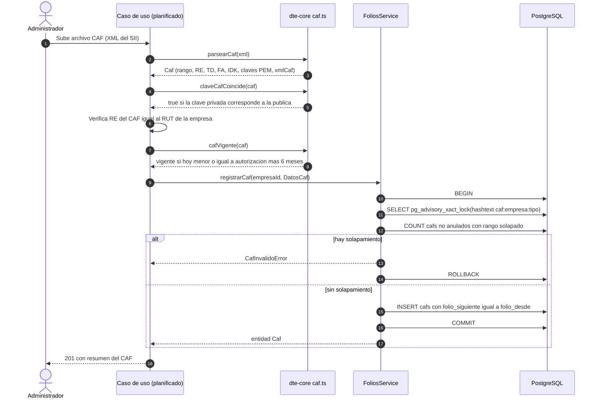
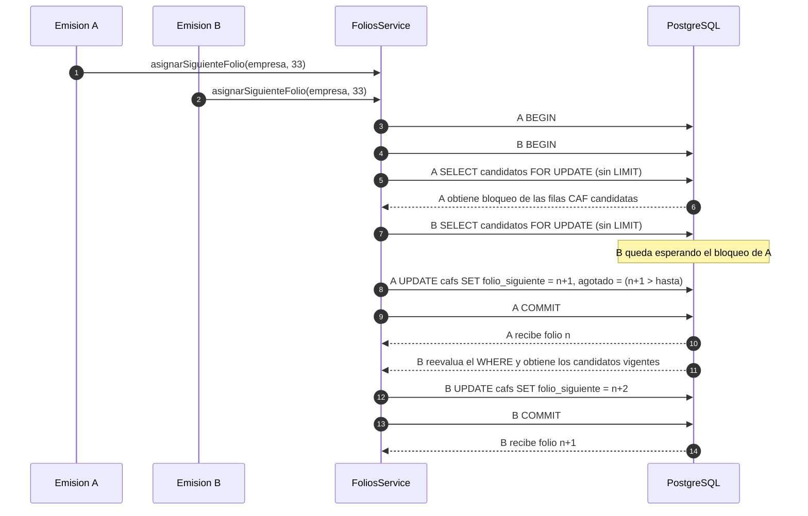
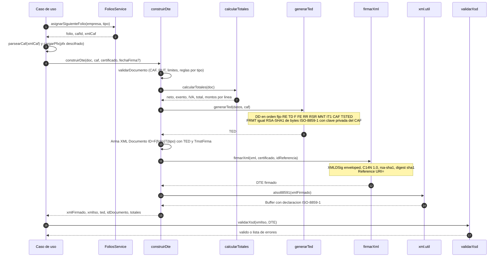
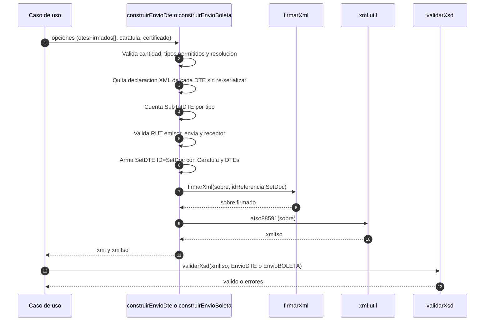
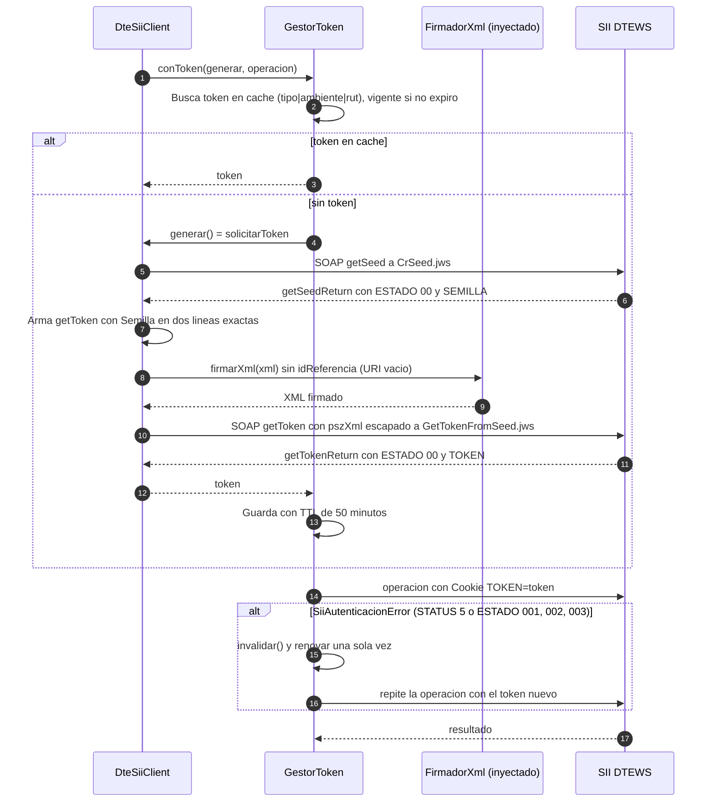
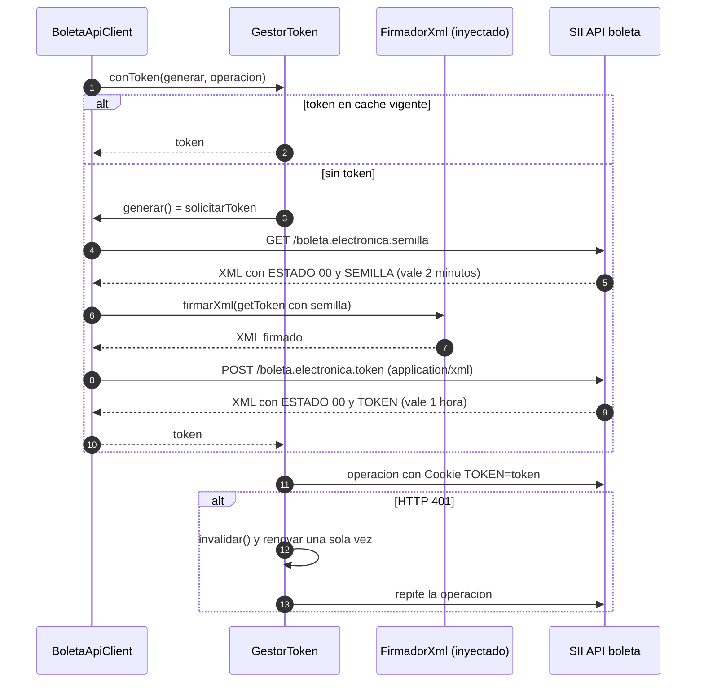
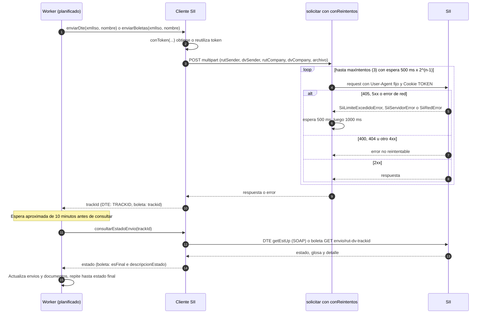
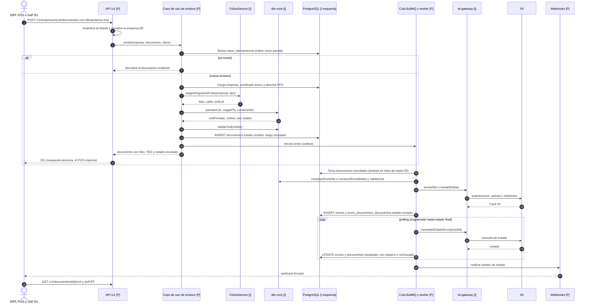

# 05. Flujos

Este documento explica, paso a paso, los flujos principales del sistema con diagramas de secuencia. Cada flujo indica
qué parte está **Implementada** (existe en el código y tiene pruebas) y qué parte es **Planificada** (diseño objetivo,
aún sin código). En el diseño actual no existe todavía ninguna API HTTP de negocio: sólo `GET /` y `GET /health`
(`apps/api/src/app.controller.ts`, `apps/api/src/health/health.controller.ts`). Por eso los "actores" de los diagramas
que dicen *Caso de uso* son el código que hoy invocan las pruebas y mañana invocará la capa de emisión.

Mapa de abreviaturas usadas en los diagramas:

| Alias | Código |
|---|---|
| `FoliosService` | `apps/api/src/folios/folios.service.ts` |
| `parsearCaf` | `apps/api/src/dte-core/caf/caf.ts` |
| `construirDte` | `apps/api/src/dte-core/documento/construir-dte.ts` |
| `generarTed` | `apps/api/src/dte-core/ted/ted.ts` |
| `firmarXml` | `apps/api/src/dte-core/firma/firma.ts` |
| `validarXsd` | `apps/api/src/dte-core/xsd/xsd.ts` |
| `construirEnvioDte` / `construirEnvioBoleta` | `apps/api/src/dte-core/envio/envio.ts` |
| `BoletaApiClient` | `apps/api/src/sii-gateway/boleta/boleta-api.client.ts` |
| `DteSiiClient` | `apps/api/src/sii-gateway/dte/dte-sii.client.ts` |
| `GestorToken`, `solicitar`, `conReintentos` | `apps/api/src/sii-gateway/comun/http.ts` |

## (a) Carga de un CAF y su registro

El CAF (Código de Autorización de Folios) es el archivo XML que el SII entrega por empresa y tipo de documento.
Contiene el rango de folios, la clave privada RSA del CAF (`RSASK`) y la firma del SII.

**Estado**: la validación (`parsearCaf`, `claveCafCoincide`, `cafVigente`) y el registro (`registrarCaf`) están
implementados. El endpoint `POST /v1/empresas/{rut}/caf` y el cifrado del CAF son **planificados**.

Paso a paso:

1. **Parseo** (`parsearCaf`). Usa `fast-xml-parser` con valores como texto. Exige `AUTORIZACION/CAF/DA` y los campos
   `RE`, `RS`, `TD`, `RNG/D`, `RNG/H`, `FA`, `IDK`, `RSAPK/M`, `RSAPK/E`, `RSASK` y `RSAPUBK`; si falta alguno lanza
   `Error('CAF inválido: ...')`. Extrae el elemento `<CAF>...</CAF>` **textualmente** (sin reformatear), porque se incrusta
   idéntico dentro del TED de cada documento y cualquier cambio de espacios invalidaría el timbre. Calcula
   `fechaVencimiento = FA + 6 meses` (parámetro `mesesVigencia`).
2. **Coherencia de claves** (`claveCafCoincide`): firma 32 bytes aleatorios con la clave privada y los verifica con
   la pública. Detecta un CAF corrupto o con claves mezcladas antes de usarlo.
3. **Validaciones de pertenencia** (a cargo del caso de uso, **planificado**): que `RE` coincida con el RUT de la
   empresa y que el CAF esté vigente. `parsearCaf` **no verifica la firma `FRMA` del SII** (requeriría la clave
   pública del SII identificada por `IDK`); está anotado como pendiente en `apps/api/src/dte-core/README.md`.
4. **Registro** (`FoliosService.registrarCaf`):
   - Valida el rango: enteros, `folioDesde >= 1`, `folioHasta >= folioDesde` (`CafInvalidoError`).
   - Abre una transacción y toma `pg_advisory_xact_lock(hashtext('caf:<empresaId>:<tipoDte>'))`, que serializa los
     registros simultáneos de la misma empresa y tipo (el lock se libera solo al terminar la transacción).
   - Cuenta CAF no anulados con `folio_desde <= :hasta AND folio_hasta >= :desde`. Si hay alguno, lanza
     `CafInvalidoError` (rango solapado).
   - Inserta con `folio_siguiente = folio_desde`, `agotado = false`, `anulado = false`.
5. La unicidad `(empresa_id, tipo_dte, folio_desde)` queda como última defensa en la base.

Cosas a tener presentes:

- `DatosCaf.xml` es el **archivo CAF completo** (con `RSASK`), porque `asignarSiguienteFolio` lo devuelve como
  `xmlCaf` y el emisor lo vuelve a parsear para obtener la clave de timbraje. Hoy se guarda en `cafs.xml` en texto
  plano (riesgo en `08-seguridad.md`).
- `fechaVencimiento` es opcional en `DatosCaf`; si el llamador no lo informa, el CAF queda sin vencimiento y la
  asignación no lo excluirá nunca. El caso de uso debe pasar el valor calculado por `parsearCaf`.

## (b) Asignación concurrente de folio

**Estado**: Implementado y cubierto por `apps/api/test/folios.e2e-spec.ts` (requiere PostgreSQL con migraciones) y por
`apps/api/src/folios/folios.service.spec.ts`.

Requisito: dos emisiones simultáneas de la misma empresa y tipo **jamás** pueden recibir el mismo folio, y si un CAF
se agota debe pasarse al siguiente sin errores ni folios perdidos.

Paso a paso (`asignarSiguienteFolio(empresaId, tipoDte, fecha = ahora)`):

1. Calcula `hoy` con `aFechaSql(fecha)` (calendario local, formato `YYYY-MM-DD`).
2. Abre `dataSource.transaction(...)`.
3. Selecciona los **CAF candidatos** con `setLock('pessimistic_write')` (`SELECT ... FOR UPDATE`) y estas condiciones:
   `empresa_id`, `tipo_dte`, `agotado = false`, `anulado = false`, `folio_siguiente <= folio_hasta` y
   `(fecha_vencimiento IS NULL OR fecha_vencimiento >= :hoy)`. Orden: `fecha_autorizacion ASC, folio_desde ASC`
   (se consume primero el CAF más antiguo, que es el que vence antes).
4. Toma el primer candidato. Si no hay ninguno lanza `SinFoliosDisponiblesError(empresaId, tipoDte)`.
5. Entrega `folio = folio_siguiente` y actualiza `folio_siguiente = folio + 1`; marca `agotado = true` cuando
   `folio + 1 > folio_hasta`.
6. Devuelve `{ folio, cafId, xmlCaf }`. El `COMMIT` libera el bloqueo.

**Por qué el `SELECT ... FOR UPDATE` va sin `LIMIT`**. La intuición dice "bloquear sólo el primer CAF
(`LIMIT 1`)", pero eso tiene una falla con concurrencia. En PostgreSQL, cuando una transacción B espera el bloqueo de
una fila y la transacción A que la tenía hace `COMMIT`, B **vuelve a evaluar el `WHERE` sobre la fila ya actualizada**.
Si A consumió el último folio del CAF, esa fila deja de cumplir `folio_siguiente <= folio_hasta`, y como la consulta
tenía `LIMIT 1`, B obtiene **cero filas** aunque exista otro CAF con folios libres. El resultado sería un
`SinFoliosDisponiblesError` falso. Al bloquear **todos** los candidatos (sin `LIMIT`):

- B, tras esperar, reevalúa cada fila candidata y recibe las que sigan cumpliendo la condición (el siguiente CAF
  incluido), por lo que el cambio de CAF funciona bajo concurrencia.
- El orden de bloqueo es estable (`ORDER BY fecha_autorizacion, folio_desde`), lo que evita interbloqueos entre
  transacciones que toman varias filas.
- El costo es mínimo: una empresa tiene pocos CAF vigentes por tipo (el índice `idx_cafs_empresa_tipo_agotado` los
  ubica directamente).

Consideraciones de diseño relacionadas:

- El folio se consume dentro de la transacción de asignación; si la **emisión posterior falla** (por ejemplo el
  TED o la firma), el folio ya fue entregado y no se devuelve. Es la política correcta para un SII que exige
  trazabilidad de folios: un folio fallido se informa, no se reutiliza. Para que no queden folios "perdidos" cuando
  el caso de uso real exista, la asignación y el `INSERT` en `documentos` deberían ejecutarse en una **misma
  transacción** (**planificado**; `asignarSiguienteFolio` hoy abre su propia transacción).
- `foliosDisponibles(empresaId, tipoDte)` devuelve un `ResumenCaf` por CAF (disponibles, vencido, agotado, anulado)
  para alertas por umbral y por vencimiento.

## (c) Construcción de un DTE

**Estado**: Implementado en `dte-core` (dominio puro, sin red ni base). Las pruebas `integracion.spec.ts` y
`construir-dte.spec.ts` lo validan contra `DTE_v10.xsd` y el viaje por ISO-8859-1.

Paso a paso (`construirDte(doc, { caf, certificado, fechaFirma? })`):

1. **Validación de negocio** (`validarDocumento`, lanza `ErrorValidacionDte`): tipo soportado; folio entero positivo;
   fechas `yyyy-mm-dd`; **el CAF debe ser del mismo tipo, contener el folio y pertenecer al RUT del emisor**; DV de
   RUT correcto; boletas sin `Acteco` y facturas con al menos uno (máximo 4); RUT genérico `66666666-6` sólo en
   boletas; máximo de líneas (60 en DTE, 1000 en boleta), de descuentos/recargos (20) y de referencias (40); notas
   56/61 con referencia real y `codRef`; 33/39 con al menos un ítem afecto. Detalle completo en
   `apps/api/src/dte-core/README.md`.
2. **Totales** (`calcularTotales`): aritmética entera con mitades hacia arriba. Facturas, guías y notas: neto,
   exento, IVA 19 % y adicionales. Boletas: precios con IVA incluido y neto = `round(afecto/1,19)`. Tipos 34 y 41:
   todo exento.
3. **TED** (`generarTed`): arma el `<DD>` con `RE, TD, F, FE, RR, RSR, MNT, IT1, CAF, TSTED` sin espacios entre
   etiquetas (`RSR` e `IT1` truncados a 40 caracteres **antes** de escapar; sólo se escapan `& < >`), incrusta el
   `<CAF>` textual y firma los **bytes ISO-8859-1** del string exacto `<DD>...</DD>` con la **clave privada del CAF**
   (RSA-SHA1, PKCS#1 v1.5), en base64, dentro de `<FRMT algoritmo="SHA1withRSA">`. `verificarTed` extrae el `<DD>`
   textualmente para verificar.
4. **Ensamblado del XML**: `<DTE>` declara `xmlns` y `xmlns:xsi` (igual que el sobre) para que la canonización, y por
   tanto la firma, sea idéntica dentro y fuera del sobre. `Documento` lleva `ID="F{folio}T{tipo}"`. Los textos se
   sanean a Latin-1, se truncan al máximo del XSD y se escapan. El orden de tags depende del tipo (boleta
   distinta de DTE; ver README de `dte-core`).
5. **Firma XMLDSig** (`firmarXml`): firma el elemento con `ID = idReferencia` con transformación única
   `enveloped-signature`, C14N 1.0, `rsa-sha1` y digest `sha1`. La `<Signature>` queda como último hijo de la raíz y
   `KeyInfo` contiene `KeyValue/RSAKeyValue` y `X509Data/X509Certificate`. `idReferencia` se valida con
   `^[A-Za-z_][\w.-]*$` antes de usarlo en el XPath (defensa contra inyección, ver `08-seguridad.md`).
6. **Codificación** (`aIso88591`): antepone `<?xml version="1.0" encoding="ISO-8859-1"?>` y convierte a Latin-1. Los
   caracteres fuera de Latin-1 se sustituyen por equivalentes o `?`.
7. **Validación XSD**: `validarXsd(xmlIso, 'DTE')` (libxml2 compilado a WASM, validadores cacheados, carpeta
   `resources/sii/xsd` o `SII_XSD_DIR`). **Importante**: `construirDte` **no** invoca el XSD por sí mismo; la
   validación es un paso del llamador (las pruebas lo hacen siempre). El caso de uso de emisión deberá validar antes de
   persistir. Para boletas el esquema aplicable es `EnvioBOLETA`, que valida el documento dentro del sobre.

Pendientes conocidos del núcleo (de su README): validación de vigencia del CAF dentro de `construirDte`, campos de
proveedor de software (`RutProvSW`) de boletas v4.2, guías con datos de traslado (Res. 144/2026), exportación y
liquidaciones.

## (d) Armado y firma del sobre EnvioDTE / EnvioBOLETA

**Estado**: Implementado (`apps/api/src/dte-core/envio/envio.ts`).

Paso a paso:

1. **Entradas**: `dtesFirmados` (cada `<DTE>` ya firmado), `caratula` (`rutEmisor`/`dvEmisor`, `rutEnvia`/`dvEnvia`
   del titular del certificado, `fechaResolucion`, `numeroResolucion`, `rutReceptor` opcional, `fechaFirma`) y el
   `certificado` (PEM de certificado y clave).
2. **Límites y tipos**: al menos un documento; máximo **2000** DTE por `EnvioDTE` (tipos 33/34/46/52/56/61) y **500**
   boletas por `EnvioBOLETA` (tipos 39/41; el SII recomienda 50 por envío, constante `BOLETAS_POR_SOBRE_RECOMENDADO`).
   `numeroResolucion` entero entre 0 y 999999. Hasta 20 tipos distintos en `EnvioDTE` y 2 en `EnvioBOLETA`.
3. **Inserción textual**: a cada DTE sólo se le quita la declaración `<?xml ...?>`; **no se re-serializa**, para
   no alterar los bytes que respaldan su firma. El tipo se lee con una expresión regular sobre `IdDoc/TipoDTE`, y se
   exige que contenga `<Signature`.
4. **Carátula**: `RutEmisor`, `RutEnvia`, `RutReceptor` (por defecto `60803000-K`, el SII; en intercambio con un
   cliente se pasa el RUT de éste), `FchResol`, `NroResol`, `TmstFirmaEnv` (hora de Chile sin zona) y un
   `SubTotDTE(TpoDTE, NroDTE)` por tipo, ordenados.
5. **Sobre**: `<EnvioDTE|EnvioBOLETA xmlns ... xsi:schemaLocation ... version="1.0"><SetDTE ID="SetDoc">Caratula + DTEs</SetDTE>`.
6. **Firma**: `firmarXml(sobre, { ...certificado, idReferencia: 'SetDoc' })` firma el `SetDTE`. El resultado
   contiene entonces **N firmas de DTE + 1 firma del set**; `verificarFirmaXml` las verifica todas.
7. **Codificación y XSD**: `aIso88591` y, a cargo del llamador, `validarXsd(xmlIso, 'EnvioDTE' | 'EnvioBOLETA')`.

## (e) Autenticación con el SII

**Estado**: Implementado en `DteSiiClient` (SOAP) y `BoletaApiClient` (REST); el token se cachea con `GestorToken`.
Es el mismo ciclo semilla, firma y token en ambos canales, pero con transportes y respuestas distintos, y **los
tokens de DTE y boleta no se mezclan** (la clave de caché incluye el tipo).

### e.1 Canal DTE (SOAP, hosts `maullin` y `palena`)

### e.2 Canal boleta (REST, hosts `apicert` y `api`)

Detalles comunes:

1. **Semilla**: DTE `getSeed` (SOAP) y boleta `GET .../boleta.electronica.semilla`. Se valida `ESTADO = '00'`; si no,
   `SiiAutenticacionError` con la glosa. La semilla de boleta vale 2 minutos.
2. **Documento de token**: exactamente dos líneas, sin salto final:
   `<?xml version="1.0" encoding="UTF-8"?>` y `<getToken><item><Semilla>…</Semilla></item></getToken>`.
3. **Firma**: `firmador.firmarXml(xml)` sin `idReferencia`, es decir, firma del documento completo (`URI=""`) con
   rsa-sha1, c14n 2001 y enveloped-signature. El `FirmadorXml` (`comun/firmador.ts`) lo inyecta el integrador y se
   implementa con `firmarXml` de `dte-core` y el PFX descifrado.
4. **Token**: en DTE se envía como `pszXml` escapado dentro del envelope SOAP; en boleta, el XML firmado va como
   cuerpo `application/xml`.
5. **Caché** (`GestorToken`): clave `tipo|ambiente|rutEmpresa`, en memoria del proceso, TTL 50 minutos (el SII lo da
   por 1 hora). Las peticiones concurrentes de token se **deduplican** (`enCurso`). Se desactiva con `cacheToken: false`.
   **Consecuencia operativa**: la caché es por proceso; con varias réplicas cada una pide su propio token. Un almacén
   compartido (Redis) es posible vía `cacheToken.almacen` (hoy `Map`; ver `07-diseno-sii-gateway.md`).
6. **Uso del token**: cabecera `Cookie: TOKEN=<token>`. En SOAP de consulta además se envía el parámetro `Token`.
7. **Renovación**: `GestorToken.conToken` captura `SiiAutenticacionError` (HTTP 401, STATUS 5 del upload, ESTADO
   001/002/003 en consultas DTE), invalida la caché, obtiene un token nuevo y **repite una sola vez**. Un segundo fallo
   se propaga.
8. **Límite**: `obtenerSemilla` y `obtenerToken` pasan por `solicitar` y por lo tanto también reintentan ante 405/5xx.

## (f) Envío y consulta de estado con reintentos

**Estado**: Implementado en los clientes; la orquestación (cola, worker, polling programado) es **planificada**.

Paso a paso:

1. **Entrada**: el XML ya firmado y validado (sección d). Los strings XML se codifican según el encoding declarado
   en el prólogo (ISO-8859-1 o UTF-8) y un `Buffer` se envía tal cual (`comun/xml.ts`).
2. **Multipart** (`construirMultipartEnvio`): campos `rutSender`/`dvSender` (titular del certificado),
   `rutCompany`/`dvCompany` (empresa emisora) y `archivo` (`.xml`). Cabeceras (`headersEnvio`): `User-Agent` fijo del
   SII (`Mozilla/4.0 (compatible; PROG 1.0; Windows NT 5.0; YComp 5.0.2.4)`), `Cookie: TOKEN=...` y `Accept`.
3. **Destinos**: DTE `POST {host}/cgi_dte/UPL/DTEUpload`; boleta `POST {base}/boleta.electronica.envio`, opcionalmente
   por el host temporal `pangal`/`rahue` con `usarHostEnvioAlternativo: true`.
4. **Política de reintentos** (`conReintentos`/`esReintentable`): `maxIntentos = 3` (cuenta el primero),
   `esperaBaseMs = 500`, `factor = 2`; esperas de 500 ms y 1000 ms. Se reintenta **sólo** `SiiLimiteExcedidoError`
   (HTTP 405, "Límite excedido"), `SiiServidorError` (5xx) y `SiiRedError` (fallo de `fetch`). No se reintenta 400,
   404 ni otros 4xx, ni 401 (para 401 actúa la renovación del token, flujo e). `esperar` es inyectable en tests.
   **No** se respetan aún las cabeceras `X-Retry-After`/`X-RateLimit-*` (pendiente).
5. **Interpretación del upload DTE** (`interpretarRecepcion`): `STATUS = 0` entrega `TRACKID`; `STATUS = 5` se
   mapea a `SiiAutenticacionError` (dispara renovación); cualquier otro lanza `SiiEnvioDteError` con `status`, glosa
   (`GLOSAS_STATUS_UPLOAD`: 1 sin permiso, 2 tamaño, 3 archivo cortado, 6 empresa no autorizada, 7 esquema inválido,
   8 firma inválida, 9 sistema bloqueado, 99 error interno) y `errores[]`.
6. **Interpretación del envío de boleta**: JSON con `trackid`; si falta se lanza `SiiError`.
   El `trackId` se devuelve como string.
7. **Consulta de estado**:
   - Boleta: `consultarEstadoEnvio(trackId)` (`GET .../boleta.electronica.envio/{rut}-{dv}-{trackid}`; `trackId`
     numérico de hasta 15 dígitos) devuelve `descripcionEstado` y `esFinal` (estados finales: `EPR`, `RCH`, `RCO`,
     `RFR`, `RPR`, `RPT`, `RSC`, `RCT`, `VOF`). Además `consultarEstadoBoleta` consulta una boleta individual.
   - DTE: `consultarEstadoEnvio` (`getEstUp`, SOAP) y `consultarEstadoDte` (`getEstDte`, con `fechaEmision` en
     formato `ddmmyyyy`). Estados negativos (-3, -4...) se devuelven como `estado`/`glosa` sin lanzar excepción.
8. **Envío duplicado**: el upload DTE también se reintenta ante 405/5xx; si el primer intento sí llegó al SII, el
   reintento será rechazado como envío repetido. La idempotencia efectiva debe resolverse aguas arriba (estado
   `encolado` y `envios.intentos`, flujo g).

## (g) Flujo extremo a extremo de emisión (objetivo)

Leyenda: **[I]** implementado, **[P]** planificado.

Estado por paso:

| # | Paso | Estado |
|---|---|---|
| 1 | API REST `/v1/empresas/{rut}/documentos`, autenticación de clientes, `Idempotency-Key` | **Planificado**. Hoy el prefijo `/v1` está configurado en `main.ts` pero no hay controladores de negocio. La columna `clave_idempotencia` y su índice único parcial ya existen. |
| 2 | Cargar empresa, certificado y descifrar PFX | Esquema y `CifradoService` **implementados**; el caso de uso que los une es **planificado**. |
| 3 | Asignar folio | **Implementado** (`FoliosService`). |
| 4 | Parsear CAF, cargar PFX, construir, timbrar, firmar, ISO-8859-1 | **Implementado** (`dte-core`). |
| 5 | Validar XSD antes de persistir | Función **implementada**; su uso dentro del flujo de emisión es **planificado**. |
| 6 | Persistir `documentos` en una transacción única con el folio | **Planificado** (tablas listas). |
| 7 | Cola/outbox (BullMQ sobre Redis) y worker de envío | **Planificado**. `docker-compose.yml` ya define el servicio `redis`, sin uso todavía. |
| 8 | Armar sobre y firmarlo | **Implementado** (`envio.ts`). |
| 9 | Autenticación, upload, reintentos y consulta | **Implementado** (`sii-gateway`), **no probado contra el ambiente de certificación real**. |
| 10 | Polling programado, actualización de estados, reparos | **Planificado**. |
| 11 | Webhooks y entrega digital de boletas | **Planificado**. |
| 12 | PDF con PDF417 (usa `documentos.ted`) | **Planificado**. |

Decisiones de diseño del flujo objetivo (de `docs/01-opciones-arquitectura-y-pruebas.md`, sección 3):

- **Emisión síncrona, envío asíncrono**: la respuesta al POS incluye folio, XML y TED en menos de un segundo; el envío
  al SII sale por cola con reintentos, de modo que una caída del SII no bloquea la caja.
- **Prioridad** para guías y facturas que amparan traslado: deben estar recibidas por el SII antes del traslado.
- **Ambiente por empresa**: `empresas.ambiente_sii` decide qué hosts usa el cliente (`maullin`/`apicert` en
  certificación, `palena`/`api` en producción). `envios.ambiente_sii` guarda el ambiente efectivo de cada envío.
- Los clientes del SII son **clases puras** (sin decoradores Nest): el integrador crea una instancia por empresa y
  ambiente con su `firmador` y su `FetchImpl`, y los envuelve en un módulo.
