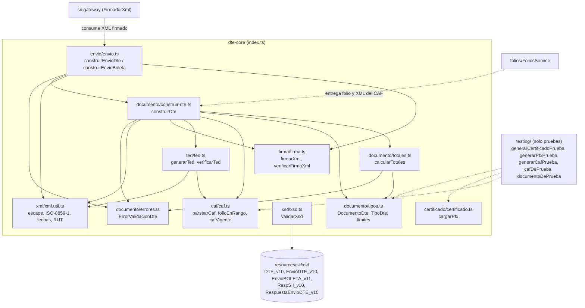
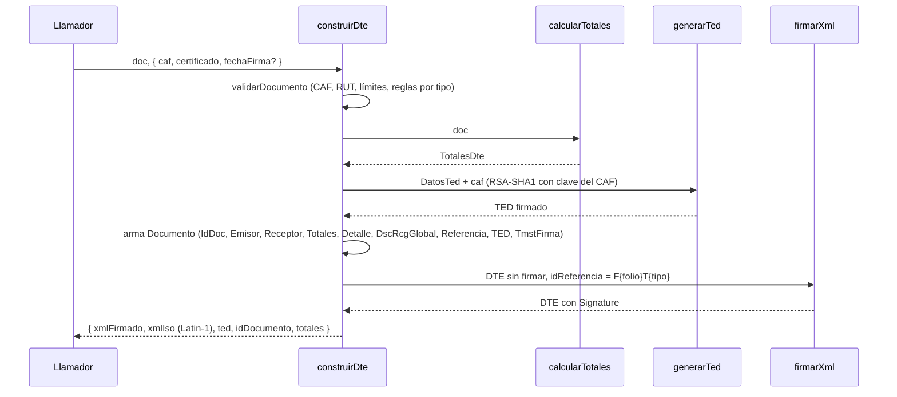

# 06 - Diseño detallado de `dte-core`

Estado: **implementado** (salvo lo marcado como *Planificado*). Código en `apps/api/src/dte-core/`. Este documento refleja el código real a la fecha de redacción (2026-11-17); ante discrepancia manda el código y los XSD oficiales de `apps/api/resources/sii/xsd/`.

## 1. Responsabilidades

`dte-core` es el **dominio puro** de la emisión: no usa decoradores de NestJS, no hace red ni acceso a base de datos. Recibe un modelo tipado (`DocumentoDte`), un CAF parseado y un certificado, y devuelve el XML firmado y timbrado. Es el módulo con más pruebas unitarias del proyecto.

| Responsabilidad | Submódulo | Estado |
|---|---|---|
| Parseo y uso del CAF (rango, vigencia, par de claves) | `caf/` | Implementado |
| Timbre electrónico (TED) firmado con la clave del CAF | `ted/` | Implementado |
| Firma XMLDSig *enveloped* con el certificado del firmante | `firma/` | Implementado |
| Utilidades XML: escape, ISO-8859-1, fechas Chile, RUT | `xml/` | Implementado |
| Validación contra los XSD oficiales del SII | `xsd/` | Implementado |
| Carga de PFX (certificado y clave, RUT del SAN) | `certificado/` | Implementado |
| Modelo, totales y armado de DTE (33, 34, 39, 41, 52, 56, 61) | `documento/` | Implementado |
| Sobres `EnvioDTE` y `EnvioBOLETA` firmados | `envio/` | Implementado |
| Utilidades de prueba (certificados y CAF sintéticos) | `testing/` | Solo pruebas, **no** se exporta desde `index.ts` |
| PDF y PDF417, parsers de respuestas del SII, intercambio | - | Planificado (no existe) |

Fuera de alcance de `dte-core` (viven en otros módulos): folios transaccionales (`folios/`), cifrado de PFX (`seguridad/`), comunicación con el SII (`sii-gateway/`).

## 2. Diagrama de módulos



Flujo interno de `construirDte`:



## 3. API pública por submódulo

`apps/api/src/dte-core/index.ts` re-exporta (`export *`) `caf`, `ted`, `firma`, `xml.util`, `xsd`, `certificado`, `documento/{errores,tipos,totales,construir-dte}` y `envio`. Las firmas siguientes están copiadas del código.

### 3.1 `caf/caf.ts`

```ts
export interface Caf {
  rutEmisor: string;            // campo RE
  razonSocial: string;          // RS
  tipoDte: number;              // TD
  folioDesde: number;           // RNG/D
  folioHasta: number;           // RNG/H
  fechaAutorizacion: string;    // FA, yyyy-mm-dd
  fechaVencimiento: Date;       // FA + mesesVigencia (UTC, 00:00)
  idk: number;                  // IDK (id de clave pública del SII)
  modulo: string;               // RSAPK/M (base64)
  exponente: string;            // RSAPK/E (base64)
  clavePrivadaPem: string;      // RSASK
  clavePublicaPem: string;      // RSAPUBK
  xmlCaf: string;               // <CAF ...>...</CAF> textual, se incrusta en el TED
}
export interface OpcionesParseoCaf { mesesVigencia?: number }  // por defecto 6

export function sumarMeses(fechaIso: string, meses: number): Date
export function parsearCaf(xml: string, opciones?: OpcionesParseoCaf): Caf
export function folioEnRango(caf: Pick<Caf, 'folioDesde' | 'folioHasta'>, folio: number): boolean
export function cafVigente(caf: Pick<Caf, 'fechaVencimiento'>, fecha?: Date): boolean
export function claveCafCoincide(caf: Pick<Caf, 'clavePrivadaPem' | 'clavePublicaPem'>): boolean
```

| Función | Parámetros y retorno | Errores |
|---|---|---|
| `sumarMeses` | Suma meses a `yyyy-mm-dd` en UTC; si el día no existe en el mes destino usa el último día del mes. Devuelve `Date`. | No lanza. |
| `parsearCaf` | `xml` del archivo CAF del SII. Usa `fast-xml-parser` y extrae `<CAF>...</CAF>` con regex para conservar el texto exacto. Calcula `fechaVencimiento = FA + (mesesVigencia ?? 6)`. | `Error` con prefijo `CAF inválido: ...` si el XML está mal formado, falta `AUTORIZACION/CAF/DA`, falta algún campo obligatorio o `FA` no es `yyyy-mm-dd`. |
| `folioEnRango` | `true` si `folio` es entero y está en `[folioDesde, folioHasta]`. | No lanza. |
| `cafVigente` | `true` si `fecha` (por defecto ahora) <= vencimiento + 24 h - 1 ms (el día de vencimiento cuenta como vigente). | No lanza. |
| `claveCafCoincide` | Firma y verifica 32 bytes aleatorios (RSA-SHA1 PKCS#1 v1.5) para comprobar que la privada corresponde a la pública. | Captura excepciones y devuelve `false`. |

Nota: `parsearCaf` **no** verifica la firma `FRMA` del SII (requeriría la clave pública del SII según `IDK`).

### 3.2 `ted/ted.ts`

```ts
export interface DatosTed {
  rutEmisor: string; tipoDte: number; folio: number;
  fechaEmision: string;            // yyyy-mm-dd
  rutReceptor: string; razonSocialReceptor: string;
  monto: number;
  itemPrimero: string;             // IT1
  timestamp?: Date | string;       // TSTED; string se usa tal cual
}
export function generarTed(datos: DatosTed, caf: Caf): string
export function verificarTed(tedXml: string, clavePublicaPem: string): boolean
```

- `generarTed`: devuelve `<TED version="1.0"><DD>...</DD><FRMT algoritmo="SHA1withRSA">base64</FRMT></TED>`. Lanza los errores de `node:crypto` si la clave privada del CAF es inválida (no los envuelve).
- `verificarTed`: extrae `<DD>...</DD>` textualmente (de la primera `<DD>` a la última `</DD>`), sin re-serializar, y verifica `FRMT`. Devuelve `false` (no lanza) ante TED mal formado, firma alterada o clave ajena.

### 3.3 `firma/firma.ts`

```ts
export const NS_XMLDSIG = 'http://www.w3.org/2000/09/xmldsig#';
export interface OpcionesFirma {
  certificadoPem: string;
  clavePrivadaPem: string;        // PKCS#1 o PKCS#8
  idReferencia: string;           // valor del atributo ID a firmar (F33T1, SetDoc)
}
export interface ResultadoVerificacionFirma { valida: boolean; errores: string[] }

export function certificadoABase64(pem: string): string
export function firmarXml(xml: string, opciones: OpcionesFirma): string
export function verificarFirmaXml(xmlFirmado: string): ResultadoVerificacionFirma
```

- `certificadoABase64`: DER del certificado en base64 sin cabeceras ni saltos.
- `firmarXml`: firma *enveloped* del elemento con `ID = idReferencia`; la `<Signature>` queda como **último hijo de la raíz**. Lanza `Error` si `idReferencia` no cumple `^[A-Za-z_][\w.-]*$`, si el certificado no tiene clave pública RSA o si el XPath `//*[@ID='...']` no encuentra el nodo (error de `xml-crypto`).
- `verificarFirmaXml`: verifica **todas** las `Signature` (p. ej. `SetDTE` y cada DTE) con el certificado embebido en `KeyInfo`. `valida` es `true` solo si hay al menos una firma y todas verifican. **No valida la cadena de confianza ni la vigencia** del certificado. No lanza: acumula `errores`.

### 3.4 `xml/xml.util.ts`

```ts
export const DECLARACION_XML_ISO = '<?xml version="1.0" encoding="ISO-8859-1"?>';
export function escaparXml(texto: string): string
export function sanearLatin1(texto: string): string
export function aIso88591(xml: string): Buffer
export function desdeIso88591(buffer: Buffer | Uint8Array): string
export function formatearFechaSii(fecha: Date): string        // yyyy-mm-dd, America/Santiago
export function formatearTimestampSii(fecha: Date): string    // yyyy-mm-ddThh:mm:ss, sin zona
export function calcularDv(numero: number | string): string
export function formatearRut(numero: number | string, dv: string): string   // '12345678-9'
export function validarDv(numero: number | string, dv: string): boolean
export function validarRut(rut: string): boolean
export function separarRut(rut: string): { numero: string; dv: string } | undefined
```

- `escaparXml` escapa `& < > " '`.
- `sanearLatin1`: caracteres con code point > 0xFF se reemplazan por un equivalente (comillas tipográficas, guiones, `…`→`...`, `€`→`EUR`, `™`→`TM`, `Š/š/Ž/ž/Œ/œ`) o por `?`.
- `aIso88591`: elimina BOM y cualquier declaración XML previa, antepone `<?xml version="1.0" encoding="ISO-8859-1"?>\n`, sanea y codifica con `iconv-lite`.
- `calcularDv`: módulo 11 (resultado 11 → `0`, 10 → `K`). `validarRut` admite puntos y exige `^\d{1,9}-[\dkK]$`.

### 3.5 `xsd/xsd.ts`

```ts
export type EsquemaSii = 'DTE' | 'EnvioDTE' | 'EnvioBOLETA' | 'RespSII' | 'RespuestaEnvioDTE';
export interface ResultadoXsd { valido: boolean; errores: string[] }
export function directorioXsdSii(): string
export function validarXsd(xml: string | Buffer, esquema: EsquemaSii): ResultadoXsd
export function liberarValidadoresXsd(): void
```

| Esquema | Archivo |
|---|---|
| `DTE` | `DTE_v10.xsd` |
| `EnvioDTE` | `EnvioDTE_v10.xsd` |
| `EnvioBOLETA` | `EnvioBOLETA_v11.xsd` |
| `RespSII` | `RespSII_v10.xsd` |
| `RespuestaEnvioDTE` | `RespuestaEnvioDTE_v10.xsd` |

- Motor: `libxml2-wasm` (no `libxmljs2`, como sugería el doc 01). Los validadores compilados se cachean por ruta; los `include`/`import` se resuelven con la URL `file://` del XSD.
- `directorioXsdSii`: usa `SII_XSD_DIR` si está definida (lanza si no existe) o busca hacia arriba `resources/sii/xsd` desde `import.meta.dirname` (funciona desde `src/` y `dist/`). Lanza `Error` si no lo encuentra.
- `validarXsd` **no lanza** por XML inválido ni mal formado: devuelve `{ valido: false, errores }` con `línea N [xpath]: mensaje`. Sí lanza si el XSD no se encuentra o el esquema es desconocido.
- `liberarValidadoresXsd`: libera la memoria WASM de los validadores (tests y apagado).

### 3.6 `certificado/certificado.ts`

```ts
export const OID_RUT_SAN = '1.3.6.1.4.1.8321.1';
export interface CertificadoFirmante {
  certificadoPem: string;
  clavePrivadaPem: string;                 // PKCS#8
  sujeto: string | undefined;              // CN
  validoDesde: Date;
  validoHasta: Date;
  rutFirmante: string | undefined;         // del SAN, '12345678-9'
  vigente(fecha?: Date): boolean;
}
export function extraerRutDeSan(cert: forge.pki.Certificate): string | undefined
export function cargarPfx(pfx: Buffer, password: string): CertificadoFirmante
export function certificadoEsValido(certificadoPem: string): boolean
```

- `cargarPfx` (node-forge): busca claves en `pkcs8ShroudedKeyBag` y `keyBag`; elige el certificado cuya clave pública coincide con la privada (los demás serían la cadena y no se devuelven). Lanza `Error` si la contraseña es incorrecta o el archivo es inválido (`No se pudo abrir el PFX ...`), si no hay clave privada o si no hay certificados.
- `extraerRutDeSan`: nunca lanza; devuelve `undefined` si el SAN no trae el `otherName` con el OID del RUT.
- Solo RSA. Los certificados intermedios no se devuelven.

### 3.7 `documento/` (tipos, errores, totales, construcción)

```ts
export class ErrorValidacionDte extends Error {}   // datos de negocio inválidos

export type TipoDte = 33 | 34 | 39 | 41 | 52 | 56 | 61;
export const TIPOS_DTE: readonly TipoDte[];
export function esBoleta(tipo: TipoDte): boolean            // 39 o 41
export function esTipoExento(tipo: TipoDte): boolean        // 34 o 41
export const TASA_IVA = 19;
export const MAX_LINEAS_DETALLE_DTE = 60;
export const MAX_LINEAS_DETALLE_BOLETA = 1000;
export const MAX_DESCUENTOS_RECARGOS = 20;
export const MAX_REFERENCIAS = 40;
export const MAX_ACTECOS = 4;
```

Modelo de entrada (resumen; ver `documento/tipos.ts`):

| Interfaz | Campos principales |
|---|---|
| `DocumentoDte` | `idDoc: IdDocDte`, `emisor: EmisorDte`, `receptor: ReceptorDte`, `detalle: DetalleDte[]`, `descuentosRecargos?: DescuentoRecargoGlobal[]`, `referencias?: ReferenciaDte[]`, `impuestosAdicionales?: ImpuestoAdicionalDte[]` |
| `IdDocDte` | `tipoDte`, `folio`, `fechaEmision`, `fechaVencimiento?`, `formaPago?` (1/2/3), `indTraslado?` (1-9, solo 52), `indServicio?` (1-4), `medioPago?` (1-5, boletas), `medioPagoDte?` (CH, LT, EF, PE, TC, CF, OT), `periodoDesde?`, `periodoHasta?` |
| `EmisorDte` | `rut`, `dv`, `razonSocial`, `giro`, `actecos?: number[]`, `direccion`, `comuna`, `ciudad`, `codigoSucursalSii?: number`, `correo?`, `telefono?` |
| `ReceptorDte` | `rut`, `dv`, `razonSocial`, `giro?`, `direccion?`, `comuna?`, `ciudad?`, `correo?`, `telefono?` |
| `DetalleDte` | `nombre`, `descripcion?`, `codigoItem?` (string o `{tipo, valor}`), `cantidad`, `unidad?`, `precioUnitario`, `descuentoPorcentaje?`, `descuentoMonto?`, `exento?` |
| `DescuentoRecargoGlobal` | `tipo: 'D' \| 'R'`, `glosa?`, `tipoValor: '%' \| '$'`, `valor`, `exento?` |
| `ReferenciaDte` | `tipoDocRef`, `folioRef`, `fechaRef`, `codRef?` (1/2/3), `razonRef?`, `indGlobal?` |
| `ImpuestoAdicionalDte` | `codigo`, `tasa?`, `monto` |
| `TotalesDte` | `mntNeto`, `mntExe`, `tasaIva`, `iva`, `mntImpAdicionales`, `mntTotal`, `montosLineas[]`, `montosGlobales[]` |

Totales:

```ts
export function redondear(valor: number): number
export function calcularIva(neto: number): number
export function netoDesdeBruto(bruto: number): number
export function calcularMontoLinea(linea: DetalleDte, numeroLinea?: number): number
export function calcularTotales(doc: DocumentoDte): TotalesDte
```

| Función | Descripción | Errores (`ErrorValidacionDte`) |
|---|---|---|
| `redondear` | Mitades hacia arriba; normaliza a 6 decimales (`toFixed(6)`) para absorber ruido de coma flotante. | - |
| `calcularIva` | `floor((neto*19 + 50) / 100)`, aritmética entera. | - |
| `netoDesdeBruto` | `round(bruto / 1,19)` en aritmética entera. | - |
| `calcularMontoLinea` | `round(cantidad*precio) - descuento`; el descuento `%` se redondea sobre el bruto de la línea. | Cantidad <= 0, precio < 0, descuento `%` y `$` a la vez, `%` fuera de (0, 100], `descuentoMonto` no entero positivo, descuento mayor que la línea. |
| `calcularTotales` | Ver sección 4.1. | Descuentos globales que superan los ítems, valor global <= 0 o `%` > 100, impuesto adicional con monto no entero o negativo. |

Construcción:

```ts
export interface OpcionesConstruirDte {
  caf: Caf;
  certificado: { certificadoPem: string; clavePrivadaPem: string };
  fechaFirma?: Date;               // TmstFirma y TSTED; por defecto ahora
}
export interface DteConstruido {
  xmlFirmado: string;              // <DTE> firmado, sin declaración XML
  xmlIso: Buffer;                  // con declaración ISO-8859-1, codificado Latin-1
  ted: string;
  idDocumento: string;             // F{folio}T{tipo}
  totales: TotalesDte;
}
export const NS_SII = 'http://www.sii.cl/SiiDte';
export const NS_XSI = 'http://www.w3.org/2001/XMLSchema-instance';
export function numeroXml(n: number, decimales?: number): string
export function construirDte(doc: DocumentoDte, opciones: OpcionesConstruirDte): DteConstruido
```

`construirDte` lanza `ErrorValidacionDte` ante datos inválidos (lista en 4.6) y propaga errores de firma (`Error`) si el certificado o la clave son inválidos.

### 3.8 `envio/envio.ts`

```ts
export const RUT_SII = '60803000-K';
export const MAX_DTE_POR_SOBRE = 2000;
export const MAX_BOLETAS_POR_SOBRE = 500;
export const BOLETAS_POR_SOBRE_RECOMENDADO = 50;

export interface CaratulaEnvio {
  rutEmisor: string | number; dvEmisor: string;
  rutEnvia: string | number;  dvEnvia: string;     // titular del certificado
  rutReceptor?: string;                             // por defecto RUT_SII
  fechaResolucion: Date | string;
  numeroResolucion: number;
  fechaFirma?: Date;                                // TmstFirmaEnv
}
export interface OpcionesEnvio {
  dtesFirmados: string[];
  caratula: CaratulaEnvio;
  certificado: { certificadoPem: string; clavePrivadaPem: string };
}
export interface EnvioConstruido { xml: string; xmlIso: Buffer }

export function construirEnvioDte(opciones: OpcionesEnvio): EnvioConstruido
export function construirEnvioBoleta(opciones: OpcionesEnvio): EnvioConstruido
```

Errores (`ErrorValidacionDte`): sobre vacío; más de 2000 DTE (o 500 boletas); `numeroResolucion` fuera de 0-999999; elemento que no es `<DTE>` o sin `IdDoc/TipoDTE`; DTE sin `<Signature`; tipo no permitido en el sobre; más de 20 tipos distintos en `EnvioDTE` (o más de 2 en `EnvioBOLETA`); RUT inválido; `rutReceptor` inválido; `fechaResolucion` mal formada.

## 4. Reglas de negocio implementadas

### 4.1 Totales y redondeo

- Todos los montos son **enteros en CLP**. Redondeo comercial (mitades hacia arriba) con aritmética entera para IVA y neto.
- `MontoItem = round(cantidad * precio) - descuento`.
- Descuentos y recargos globales: se calculan sobre la suma de líneas de **su base** (afecta, o exenta si `exento: true`) y se aplican **de forma independiente** (no encadenada). Un global en `%` usa la base de líneas, no el acumulado tras otros globales.

| Tipo | Precios | Cálculo |
|---|---|---|
| 33, 56, 61, 52 (afectos) | Netos | `MntNeto` = afectos; `MntExe` = exentos (`IndExe=1`); `TasaIVA=19`; `IVA = round(MntNeto*19%)`; `MntTotal = MntNeto + MntExe + IVA + impuestos adicionales` |
| 34 | Netos | Todo exento: sin `MntNeto`, `TasaIVA` ni `IVA`; `MntExe` = suma |
| 39 | **IVA incluido** | `MntTotal` = suma de líneas (± globales); `MntNeto = round(afecto/1,19)`; `IVA = afecto - MntNeto` (por diferencia) |
| 41 | IVA incluido | Todo exento, igual que el 34 |

- Totales en cero **no se informan** (excepto `MntTotal`). Una nota con monto cero (corrección de texto, `CodRef=2`) es válida.
- `impuestosAdicionales` solo **suma al total** y se emite como `ImptoReten` (`TipoImp`, `TasaImp`, `MontoImp`); no modela retenciones ni `IVANoRet`. Las boletas no admiten impuestos adicionales.

### 4.2 Diferencias factura / boleta

| Aspecto | Factura, nota, guía (`DTE_v10.xsd`) | Boleta (`EnvioBOLETA_v11.xsd`) |
|---|---|---|
| Emisor | `RznSoc`, `GiroEmis`, `Telefono`, `CorreoEmisor`, `Acteco` (1 a 4, **obligatorio**) | `RznSocEmisor`, `GiroEmisor`; `Acteco` **prohibido** (lo rechaza el SII) |
| Receptor | `GiroRecep`, `Contacto`, `CorreoRecep` | `CorreoRecep`, `TelefonoRecep` (formato v4.2); admite RUT genérico `66666666-6` |
| `IdDoc` | `IndTraslado` (52), `FmaPago`, `MedioPago` (alfanumérico), `FchVenc` después | `IndServicio` **obligatorio** (por defecto 3), `FchVenc` **antes** de `MedioPago` (1 a 5) |
| Precios | Netos | Con IVA incluido |
| Totales | `TasaIVA` informada | No informa `TasaIVA`; `MntNeto`/`IVA` solo si hay base afecta |
| `Referencia` | Con `FchRef`, `IndGlobal` | Sin `FchRef` ni `IndGlobal` |
| Límite de líneas | 60 | 1000 |
| RUT genérico | Prohibido | Permitido |

### 4.3 Límites

| Concepto | Máximo | Dónde se valida |
|---|---|---|
| `Detalle` en 33/34/52/56/61 | 60 | `construirDte` |
| `Detalle` en 39/41 | 1000 | `construirDte` |
| `DscRcgGlobal` | 20 | `construirDte` |
| `Referencia` | 40 | `construirDte` |
| `Acteco` | 4 | `construirDte` |
| DTE por `EnvioDTE` | 2000 | `construirEnvioDte` |
| Boletas por `EnvioBOLETA` | **500** (recomendado 50, constante `BOLETAS_POR_SOBRE_RECOMENDADO`) | `construirEnvioBoleta` |

`sii-gateway` **no** valida el máximo de boletas: la autoridad es `dte-core`. La política de "lotes de 50" es responsabilidad de la capa de envíos (aún no implementada).

### 4.4 Truncados y codificación ISO-8859-1

- Todo texto se **sanea a Latin-1 antes de firmar** (la firma se calcula sobre lo que realmente se transmite), luego se trunca por *code points* y se escapa. Se omiten los elementos vacíos.
- Máximos aplicados: `NmbItem` 80, `DscItem` 1000, `UnmdItem` 4, `TpoCodigo` 10, `VlrCodigo` 35, `RznSoc`/`RznSocEmisor`/`RznSocRecep` 100, `GiroEmis`/`GiroEmisor` 80, `GiroRecep` 40, `DirOrigen`/`DirRecep` 70, `CmnaOrigen`/`CiudadOrigen`/`CmnaRecep`/`CiudadRecep` 20, `Telefono` 20, `CorreoEmisor`/`CorreoRecep` 80, `Contacto` 80, `GlosaDR` 45, `TpoDocRef` 3, `FolioRef` 18, `RazonRef` 90.
- `aIso88591` produce los bytes que se envían; `xmlFirmado` (string JS) sirve para inspección e inserción en sobres.
- La firma sigue verificando tras el viaje `string -> ISO-8859-1 -> string` (cubierto en `integracion.spec.ts`).

### 4.5 TED

- Orden fijo y sin espacios entre tags: `RE, TD, F, FE, RR, RSR, MNT, IT1, CAF, TSTED`.
- `RSR` e `IT1` se truncan a **40** caracteres *antes* de escapar. En texto solo se escapan `& < >`: el TED se firma textualmente y viaja en el PDF417.
- `FRMT` = RSA-SHA1 (PKCS#1 v1.5) con la clave privada del CAF sobre los bytes ISO-8859-1 del string exacto `<DD>...</DD>`, en base64, `algoritmo="SHA1withRSA"`.
- `xmlCaf` (el `<CAF>` del archivo) se incrusta tal cual, sin re-serializar.
- `TSTED` y `TmstFirma` usan la misma marca (`fechaFirma`), en hora de Chile sin zona.

### 4.6 Validaciones de negocio de `construirDte` (`ErrorValidacionDte`)

1. Tipo no soportado; folio no entero positivo; fechas que no son `yyyy-mm-dd` válidas.
2. CAF de otro tipo; folio fuera del rango del CAF; CAF de otro emisor.
3. RUT inválido o con DV incorrecto (emisor y receptor); RUT de más de 10 caracteres.
4. Boleta con `Acteco`; factura/nota/guía sin `Acteco`, con más de 4 o con valor inválido.
5. Emisor sin razón social o giro; receptor sin razón social (salvo boleta con RUT genérico).
6. RUT genérico `66666666-6` fuera de boletas.
7. Sin líneas, o más de 60 / 1000; más de 20 globales; más de 40 referencias; boleta con impuestos adicionales.
8. Campos exclusivos: `indTraslado` solo en 52; `medioPago` numérico solo en boletas; boleta con `formaPago` o `medioPagoDte`; `indServicio` 4 solo en boletas.
9. 33 o 39 sin ítems afectos (para ventas exentas se exige 34 / 41).
10. Referencias: `tipoDocRef` vacío o de más de 3 caracteres; `folioRef` vacío o de más de 18; notas 56/61 sin referencia real (una referencia `SET` no cuenta) o con referencias sin `codRef`.

**No se valida** la vigencia del CAF (`cafVigente` existe pero `construirDte` no la invoca; el filtro por vencimiento lo hace `FoliosService`).

### 4.7 Algoritmos de firma y `KeyInfo`

| Elemento | Valor |
|---|---|
| Canonicalización | C14N 1.0 (`http://www.w3.org/TR/2001/REC-xml-c14n-20010315`) |
| Firma | `http://www.w3.org/2000/09/xmldsig#rsa-sha1` |
| Digest | `http://www.w3.org/2000/09/xmldsig#sha1` |
| Transform | único: `enveloped-signature` |
| `Reference URI` | `#{idReferencia}` (siempre referencia por ID; no soporta `URI=""`) |
| `Signature` | `xmlns="http://www.w3.org/2000/09/xmldsig#"`, sin prefijo, **último hijo de la raíz** |
| `KeyInfo` | `KeyValue/RSAKeyValue(Modulus, Exponent)` **y luego** `X509Data/X509Certificate` (orden exigido por `xmldsignature_v10.xsd`), generado con `getKeyInfoContent` |
| Referencias | `F{folio}T{tipo}` para el `Documento`; `SetDoc` para el `SetDTE` del sobre |

El `<DTE>` se emite con `xmlns` y `xmlns:xsi` (igual que el sobre) para que la canonización, y por tanto el digest, sea idéntica dentro y fuera del sobre.

### 4.8 Inserción textual de DTE en sobres

`construirEnvioDte` / `construirEnvioBoleta`:

1. Quitan solo la declaración `<?xml ...?>` y espacios externos de cada DTE; **no re-serializan** (cualquier cambio rompería la firma del DTE).
2. Leen `TipoDTE` por regex sobre `<IdDoc><TipoDTE>` y agrupan `SubTotDTE` por tipo, ordenados.
3. Arman `Caratula` (`RutEmisor`, `RutEnvia`, `RutReceptor`, `FchResol`, `NroResol`, `TmstFirmaEnv`, `SubTotDTE*`) dentro de `SetDTE ID="SetDoc"` y firman `SetDoc`.
4. `rutReceptor` por defecto es `60803000-K` (SII); en intercambio se entrega el RUT del cliente.
5. `EnvioDTE` admite 33, 34, 46, 52, 56, 61; `EnvioBOLETA` solo 39 y 41.
6. Devuelven `xml` (sin declaración) y `xmlIso` (Latin-1 con declaración).

## 5. Puntos de extensión ante cambios normativos

Principio de diseño del doc 01 (sección 1.6): el XSD vigente es la fuente de verdad y el builder debe poder incorporar campos sin reescribirse. Hoy el XML se arma con funciones por sección (`xmlIdDoc`, `xmlEmisor`, `xmlReceptor`, `xmlTotales`, `xmlDetalle`, ...) en `documento/construir-dte.ts`, con un helper `tag(nombre, valor, max?)` que sanea, trunca y escapa. **No** existe aún una "definición versionada de formato": el orden de los tags está codificado en esas funciones.

| Cambio normativo | Qué hay que tocar | Estado |
|---|---|---|
| **Res. Ex. 121/2026** y **Instructivo de validaciones (jun-2026)**: `TIEBase`, `TIEVariable` en `ImptoReten` (encabezado); `TpoImpD`, `TasaImpD`, `IEBase`, `IEVariable` en `Detalle` (IEC combustibles, ILA/IABA), con consistencia detalle/encabezado | 1) Ampliar `ImpuestoAdicionalDte` y `DetalleDte` en `tipos.ts`; 2) emitirlos en `xmlTotales` y `xmlDetalle` respetando el orden del XSD actualizado; 3) agregar reglas de consistencia en `validarDocumento`/`calcularTotales`; 4) reemplazar el XSD en `resources/sii/xsd/` (aún **no** figuran en el paquete 2026-02-19) | Planificado |
| Tres estados de recepción (Aceptado, Aceptado con reparos, Rechazado) y validaciones por fases | Afecta la capa de envíos/estados (`documentos.estado`, `reparos` jsonb), no a `dte-core`; el core debe poder validar contra el XSD vigente (`validarXsd`) | Planificado |
| **Res. Ex. 144/2026**: guía 52 con datos de traslado (`Transporte`: patente, RUT transportista, chofer, destino; `IndTraslado` ampliado) | Agregar el bloque `Transporte` al modelo (`DocumentoDte`), emitirlo en el armado de `Encabezado` de `construirDte` entre `Receptor` (y el opcional `RUTSolicita`) y `Totales`, orden confirmado en `DTE_v10.xsd`, y validar obligatoriedad por `indTraslado` en `validarDocumento` (hoy `indTraslado` ya existe, 1 a 9) | Planificado (README: pendiente) |
| **Res. Ex. 36/2024**: calidad de `NmbItem` | Validación de glosas en `validarDocumento` (el SII valida el texto) | Planificado |
| Nuevo paquete XSD | Reemplazar archivos en `apps/api/resources/sii/xsd/` (o fijar `SII_XSD_DIR`); correr `npm test` para detectar el cambio de orden/obligatoriedad; ver `docs/referencias-sii/README.md` | Proceso manual |
| Otros tipos (46 factura de compra, 110/111/112 exportación, liquidaciones) | Ampliar `TipoDte`, `TIPOS_DTE`, reglas por tipo y el set de tipos de `construirEnvioDte` (ya admite 46 en el sobre, pero `TipoDte` no) | Planificado |
| Vigencia de CAF en el core | Invocar `cafVigente` en `validarDocumento` con una fecha inyectable | Planificado |

Recomendación de diseño para la próxima iteración (no implementada): extraer el orden de elementos a una tabla declarativa por esquema/versión (`DTE_v10`, `EnvioBOLETA_v11`) y generar el XML recorriéndola, de modo que un cambio de XSD sea un cambio de datos y no de código.

## 6. Limitaciones conocidas

1. **CAF de prueba**: `FRMA` aleatorio (no tenemos la clave del SII); jamás sería aceptado por el SII. `parsearCaf` no verifica `FRMA`.
2. **Tamaño de clave del CAF**: los CAF reales usan RSA de 1024 bits; los tests usan 2048. El código es agnóstico al tamaño.
3. **Firma no validada contra el SII real**: el formato exacto de `KeyInfo` y espacios en blanco está pendiente de verificar en certificación.
4. **`firmarXml` solo firma por `#ID`**: no soporta `Reference URI=""` (documento completo), que es lo que exige el SII para el `getToken` de semilla. El `FirmadorXml` que consume `sii-gateway` (`firmarXml(xml, idReferencia?)`) **no está implementado** en `dte-core`; falta un adaptador (ver doc 07, sección 4).
5. **Certificados**: solo RSA; de un PFX con cadena solo se devuelve el certificado del firmante; `verificarFirmaXml` no valida cadena ni vigencia.
6. **Tipos soportados**: 33, 34, 39, 41, 52, 56, 61. Faltan exportación, liquidaciones, factura de compra (46), retenciones/`IVANoRet`, `SubTotInfo`, `Comisiones`, `OtraMoneda`, ítem espectáculo/`InfoTicket` de boletas, `Transporte` de guías.
7. **Guía 52**: sin datos de traslado de la Res. 144/2026; `indTraslado` es opcional en el modelo.
8. **Vigencia del CAF** no se valida en `construirDte` (solo en `FoliosService`).
9. **Impuestos adicionales**: solo suman al total; sin retenciones ni consistencia por ítem.
10. **Descuentos globales**: independientes entre sí; no se prueba el comportamiento del SII ante globales múltiples en la misma base.
11. **Sin PDF ni PDF417**, sin parsers de respuestas del SII, sin intercambio (`RecepcionDTE`, `EnvioRecibos`, `ResultadoDTE`).
12. **Texto**: caracteres fuera de Latin-1 se degradan (equivalente o `?`); no se advierte al llamador.
13. **Zona horaria**: fechas y marcas en `America/Santiago` por `Intl`; requiere ICU completo en el runtime.
14. **`xsd`**: el estado del módulo es global (caché de validadores y directorio); en tests de larga duración conviene `liberarValidadoresXsd()`.
