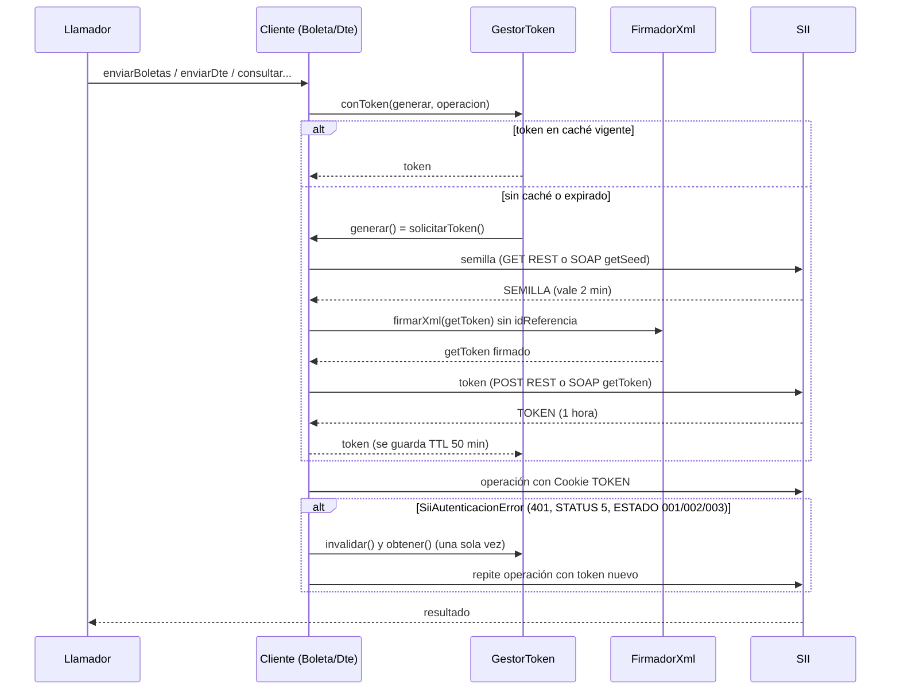
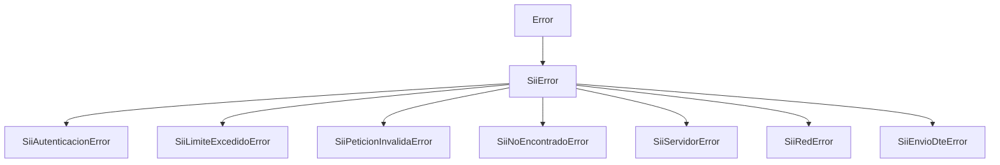

# 07 - Diseño detallado de `sii-gateway`

Estado: **implementado** (clientes y política HTTP, validados solo con `fetch` simulado). **Ninguna** operación ha sido probada contra el SII real. Código en `apps/api/src/sii-gateway/`.

`sii-gateway` son clases puras (sin decoradores de NestJS) que encapsulan los dos canales técnicos del SII:

- **DTE**: SOAP (autenticación y consultas) + upload HTTP del `EnvioDTE` (`DteSiiClient`).
- **Boleta electrónica**: API REST con OpenAPI oficial "API SII - V1" 1.0.5 (`BoletaApiClient`).

Un cliente se instancia **por empresa y ambiente** (lleva RUT de la empresa, RUT del firmante y un firmador). El módulo NestJS que los envuelva (inyección, ciclo de vida) aún no existe.

## 1. Hosts por ambiente

Definidos en `ambientes.ts`.

| Canal | Certificación | Producción |
|---|---|---|
| DTE (SOAP + upload) `HOSTS_DTE` | `https://maullin.sii.cl` | `https://palena.sii.cl` |
| Boleta, todos los recursos `BASES_BOLETA` | `https://apicert.sii.cl/recursos/v1` | `https://api.sii.cl/recursos/v1` |
| Boleta, solo `POST /boleta.electronica.envio` (temporal) `BASES_ENVIO_BOLETA_ALTERNATIVO` | `https://pangal.sii.cl/recursos/v1` | `https://rahue.sii.cl/recursos/v1` |

- `AmbienteSii = 'certificacion' | 'produccion'`.
- El host alternativo de boletas se activa con `usarHostEnvioAlternativo: true` (por defecto `false`, usa apicert/api).
- Rutas DTE (`RUTAS_DTE`): `/DTEWS/CrSeed.jws`, `/DTEWS/GetTokenFromSeed.jws`, `/DTEWS/QueryEstUp.jws`, `/DTEWS/QueryEstDte.jws`, `/cgi_dte/UPL/DTEUpload`.
- `USER_AGENT_SII = 'Mozilla/4.0 (compatible; PROG 1.0; Windows NT 5.0; YComp 5.0.2.4)'` (obligatorio en upload DTE y en envío de boletas).
- Helpers: `hostDte`, `urlDte`, `baseBoleta`, `baseEnvioBoleta(ambiente, usarHostAlternativo?)`.
- El ambiente se define **por empresa** (`empresas.ambiente_sii`); `SII_AMBIENTE` del `.env` es solo el valor por defecto de la aplicación.

## 2. Diagrama de clases

```mermaid
classDiagram
    direction LR
    class FirmadorXml {
        <<interface>>
        +firmarXml(xml: string, idReferencia?: string) string
    }
    class GestorToken {
        -clave: string
        -ttlMs: number
        -almacen: AlmacenToken
        -enCurso?: Promise~string~
        +obtener(generar) Promise~string~
        +invalidar() void
        +conToken(generar, operacion) Promise~T~
    }
    class BoletaApiClient {
        +obtenerSemilla() Promise~string~
        +obtenerToken() Promise~string~
        +enviarBoletas(envioXml, nombreArchivo) Promise~ResultadoEnvio~
        +consultarEstadoEnvio(trackId) Promise~EstadoEnvioBoleta~
        +consultarEstadoBoleta(params) Promise~EstadoBoleta~
    }
    class DteSiiClient {
        +obtenerSemilla() Promise~string~
        +obtenerToken() Promise~string~
        +enviarDte(envioXml, nombreArchivo) Promise~ResultadoEnvioDte~
        +consultarEstadoEnvio(trackId) Promise~RespuestaConsultaSii~
        +consultarEstadoDte(params) Promise~RespuestaConsultaSii~
    }
    class SiiError {
        +statusHttp?: number
        +cuerpo?: string
    }
    class SiiAutenticacionError
    class SiiLimiteExcedidoError
    class SiiPeticionInvalidaError
    class SiiNoEncontradoError
    class SiiServidorError
    class SiiRedError
    class SiiEnvioDteError {
        +status: string
        +glosa: string
        +errores: string[]
    }
    class FetchImpl {
        <<function type>>
        (input, init?) Promise~Response~
    }

    BoletaApiClient --> FirmadorXml : firma getToken
    DteSiiClient --> FirmadorXml : firma getToken
    BoletaApiClient *-- GestorToken : tipo boleta
    DteSiiClient *-- GestorToken : tipo dte
    BoletaApiClient ..> FetchImpl : inyectable
    DteSiiClient ..> FetchImpl : inyectable
    Error <|-- SiiError
    SiiError <|-- SiiAutenticacionError
    SiiError <|-- SiiLimiteExcedidoError
    SiiError <|-- SiiPeticionInvalidaError
    SiiError <|-- SiiNoEncontradoError
    SiiError <|-- SiiServidorError
    SiiError <|-- SiiRedError
    SiiError <|-- SiiEnvioDteError
```

Archivos: `comun/firmador.ts`, `comun/http.ts` (GestorToken, reintentos, multipart), `comun/errores.ts`, `comun/xml.ts` (parseo y codificación), `boleta/`, `dte/`. `comun/testing.ts` es solo para pruebas (usa `vi` global) y no se exporta.

## 3. Opciones de los clientes

```ts
interface BoletaApiClientOpciones {
  ambiente: AmbienteSii;
  rutEmpresa: RutLike; dvEmpresa: string;      // emisor, sin DV en rut
  rutUsuario: RutLike; dvUsuario: string;      // titular del certificado
  firmador: FirmadorXml;
  fetchImpl?: FetchImpl;                       // por defecto globalThis.fetch
  reintentos?: OpcionesReintento;
  cacheToken?: OpcionesCacheToken | false;
  usarHostEnvioAlternativo?: boolean;
}
// DteSiiClientOpciones: igual, sin usarHostEnvioAlternativo.

interface OpcionesReintento { maxIntentos?: number; esperaBaseMs?: number; factor?: number; esperar?: (ms: number) => Promise<void> }
interface OpcionesCacheToken { ttlMs?: number; almacen?: AlmacenToken; ahora?: () => number }
type AlmacenToken = Map<string, { token: string; expiraEn: number }>;
type RutLike = string | number;
```

Los RUT se normalizan con `normalizarRut` (quita puntos, guiones y espacios) y los DV se pasan a mayúscula.

## 4. `FirmadorXml` inyectable

```ts
export interface FirmadorXml {
  firmarXml(xml: string, idReferencia?: string): string;
}
```

- Sin `idReferencia` debe firmar el **documento completo** (`Reference URI=""`) con rsa-sha1, C14N 2001 y enveloped-signature. Es lo que ambos clientes necesitan para el XML `getToken`.
- El gateway no importa `dte-core`: el integrador inyecta la implementación (diseño desacoplado).
- **Brecha conocida**: `dte-core` no ofrece hoy un firmador compatible. Su `firmarXml(xml, { certificadoPem, clavePrivadaPem, idReferencia })` tiene otra firma y solo soporta referencia por `#ID` (valida `idReferencia` con regex y no admite `URI=""`). Para conectar ambos módulos hay que (a) extender `dte-core` para firmar el documento completo cuando no hay ID y (b) escribir un adaptador que cierre sobre el certificado de la empresa (descifrado con `CifradoService` y `cargarPfx`). Pendiente.

## 5. Tabla de operaciones

Notación: `{base}` = base boleta (apicert/api); `{baseEnvio}` = base boleta o host alternativo; `{rut}` y `{dv}` = empresa emisora.

### 5.1 Boleta electrónica (`BoletaApiClient`, REST)

| Método del cliente | HTTP y ruta | Headers | Cuerpo | Respuesta | Errores |
|---|---|---|---|---|---|
| `obtenerSemilla()` | `GET {base}/boleta.electronica.semilla` | `Accept: application/xml` | - | XML con `ESTADO` y `SEMILLA` (vale 2 min). Devuelve `string` con la semilla | `SiiAutenticacionError` si `ESTADO` != `00` o falta `SEMILLA`; errores HTTP (5.4) |
| `obtenerToken()` | `POST {base}/boleta.electronica.token` | `Content-Type: application/xml`, `Accept: application/xml` | Dos líneas exactas firmadas: `<?xml version="1.0" encoding="UTF-8"?>\n<getToken><item><Semilla>...</Semilla></item></getToken>` (sin salto final) | XML con `ESTADO` y `TOKEN`. Devuelve el token (con caché) | `SiiAutenticacionError` si `ESTADO` != `00` o falta `TOKEN`; HTTP |
| `enviarBoletas(envioXml, nombreArchivo)` | `POST {baseEnvio}/boleta.electronica.envio` | `User-Agent` fijo, `Cookie: TOKEN=...`, `Accept: application/json` | `multipart/form-data`: `rutSender`, `dvSender` (firmante), `rutCompany`, `dvCompany` (empresa), `archivo` (`.xml`, `application/xml`) | JSON `ResultadoEnvioPost`: `rut_emisor`, `rut_envia`, `trackid` (hasta 15 dígitos), `fecha_recepcion`, `estado: "REC"`, `file?`. Devuelve `ResultadoEnvio` = JSON + `trackId: string` | `SiiError` si falta `trackid` o el JSON es inválido; HTTP 400/401/405/5xx |
| `consultarEstadoEnvio(trackId)` | `GET {base}/boleta.electronica.envio/{rut}-{dv}-{trackid}` | `Cookie: TOKEN=...`, `Accept: application/json` | - | `RespuestaEstadoEnvioJson` + `trackId`, `descripcionEstado`, `esFinal` | `SiiError` si `trackId` no cumple `^\d{1,15}$`; `SiiNoEncontradoError` (404); HTTP |
| `consultarEstadoBoleta(params)` | `GET {base}/boleta.electronica/{rut}-{dv}-{tipo}-{folio}/estado?rut_receptor&dv_receptor&monto&fechaEmision` | `Cookie: TOKEN=...`, `Accept: application/json` | - | `EstadoBoleta` `{ codigo, descripcion }` | `SiiError` si `fechaEmision` no es `DD-MM-YYYY`; HTTP |

Notas:
- `enviarBoletas` acepta `Buffer` (se envía tal cual) o `string` (se codifica según el encoding declarado en el prólogo: ISO-8859-1 o UTF-8). El `Content-Type` multipart con *boundary* lo fija `fetch`.
- Los parámetros de `consultarEstadoBoleta` (`ParametrosEstadoBoleta`): `tipo`, `folio`, `rutReceptor?`, `dvReceptor?`, `monto?`, `fechaEmision?`. Los opcionales solo se agregan al query si están presentes.
- Todos los recursos autenticados usan el token como cookie (`Cookie: TOKEN=...`), no como `Authorization`.

### 5.2 DTE (`DteSiiClient`, SOAP + upload)

Todas las llamadas SOAP son `POST` a la ruta del servicio con `Content-Type: text/xml; charset=utf-8` y `SOAPAction: ""`, con sobre `soapenv:Envelope` (namespace `http://schemas.xmlsoap.org/soap/envelope/`) y el elemento de la operación **sin namespace** (`<getSeed/>`, etc.).

| Método del cliente | Ruta | Cuerpo SOAP / multipart | Respuesta | Errores |
|---|---|---|---|---|
| `obtenerSemilla()` | `POST /DTEWS/CrSeed.jws` | `<getSeed/>` | `getSeedReturn` (XML escapado, ya des-escapado por el parser) con `ESTADO` y `SEMILLA` | `SiiAutenticacionError` si `ESTADO` != `00` o sin `SEMILLA`; `SiiError` ante SOAP Fault o sin `getSeedReturn` |
| `obtenerToken()` | `POST /DTEWS/GetTokenFromSeed.jws` | `<getToken><pszXml>{getToken firmado, escapado}</pszXml></getToken>` | `getTokenReturn` con `ESTADO` y `TOKEN` | Igual que la semilla |
| `enviarDte(envioXml, nombreArchivo)` | `POST /cgi_dte/UPL/DTEUpload` | multipart: `rutSender`, `dvSender`, `rutCompany`, `dvCompany`, `archivo` (`text/xml`). Headers: `User-Agent` fijo, `Cookie: TOKEN=...`, `Accept: text/xml` | XML `RECEPCIONDTE` con `STATUS`, `TRACKID`. Devuelve `{ trackId, status, mensaje }` | `SiiAutenticacionError` (STATUS 5), `SiiEnvioDteError` (STATUS != 0), `SiiError` (sin `STATUS`, o `STATUS` 0 sin `TRACKID`) |
| `consultarEstadoEnvio(trackId)` | `POST /DTEWS/QueryEstUp.jws` | `<getEstUp><RutCompania/><DvCompania/><TrackId/><Token/></getEstUp>` con `Cookie: TOKEN=...` | `getEstUpReturn` -> `RespuestaConsultaSii` `{ estado, glosa, xmlRespuesta, cabecera, cuerpo? }` | `SiiError` si `trackId` no es numérico; `SiiAutenticacionError` si `ESTADO` en {001, 002, 003} |
| `consultarEstadoDte(params)` | `POST /DTEWS/QueryEstDte.jws` | `<getEstDte>` con `RutConsultante`, `DvConsultante` (firmante), `RutCompania`, `DvCompania` (emisor), `RutReceptor`, `DvReceptor`, `TipoDte`, `FolioDte`, `FechaEmisionDte` (`ddmmyyyy`), `MontoDte`, `Token` | `getEstDteReturn` -> `RespuestaConsultaSii` | `SiiError` si `fechaEmision` no cumple `^\d{8}$`; `SiiAutenticacionError` si `ESTADO` en {001, 002, 003} |

`ParametrosEstadoDte`: `rutEmisor`, `dvEmisor`, `rutReceptor`, `dvReceptor`, `tipoDte`, `folio`, `fechaEmision` (`ddmmyyyy`), `monto`.

Las consultas SOAP envían el token **dos veces**: como parámetro `Token` y como `Cookie`. Los valores se escapan con `escaparXml`.

### 5.3 Flujo de autenticación



## 6. `GestorToken`

Caché en memoria del token por clave `tipo|ambiente|rutEmpresa` (`tipo` = `boleta` o `dte`: los tokens de ambos canales son distintos y nunca se mezclan).

| Aspecto | Comportamiento |
|---|---|
| Caché | `Map<string, { token, expiraEn }>`; por defecto un **almacén global del proceso**; se puede inyectar uno propio (`almacen`) |
| TTL | `ttlMs` por defecto `TTL_TOKEN_POR_DEFECTO_MS` = 50 min (el SII lo da por 1 hora). `cacheToken: false` equivale a `ttlMs: 0`: no se guarda y se pide un token en cada operación |
| Reloj | `ahora` inyectable (pruebas) |
| Deduplicación | Si hay una generación en curso (`enCurso`), las llamadas concurrentes del **mismo gestor** comparten la misma promesa |
| Renovación | `conToken(generar, operacion)`: ejecuta con el token vigente; ante `SiiAutenticacionError` invalida, obtiene uno nuevo y repite **una sola vez**. Si falla de nuevo, el error se propaga |
| Invalidación | `invalidar()` borra la entrada de la clave |

Limitaciones del diseño actual:
- La deduplicación es por **instancia** de `GestorToken`. Dos clientes para la misma empresa en el mismo proceso comparten el caché, pero no la promesa en curso: pueden pedir dos tokens simultáneos.
- La clave no incluye al firmante (`rutUsuario`): si cambia el certificado de una empresa, un token cacheado seguirá usándose hasta 50 min.
- El caché es por proceso: en un despliegue con varias réplicas cada una pide su propio token. Planificado: caché compartido (Redis) con bloqueo.
- Los errores de autenticación al **generar** el token (semilla/token rechazados) no activan el reintento de `conToken`: se propagan directamente.

## 7. Política de reintentos y backoff

`conReintentos(op, opciones)` (`comun/http.ts`):

- `maxIntentos` (por defecto **3**, cuenta el primer intento), `esperaBaseMs` (**500**), `factor` (**2**): esperas de 500 ms y 1000 ms entre los 3 intentos. Sin *jitter* ni tope.
- Se reintenta **solo** `SiiLimiteExcedidoError` (HTTP 405), `SiiServidorError` (5xx) y `SiiRedError` (fallo de `fetch`) (`esReintentable`).
- No se reintenta: 400, 401 (salvo la renovación de token de `conToken`), 404 ni otros 4xx. Tampoco `SiiEnvioDteError` (rechazo de negocio).
- `solicitar(fetchImpl, url, init, contexto, reintentos)` envuelve cada request: convierte excepciones de `fetch` en `SiiRedError` y respuestas no 2xx en el error tipado (`errorDesdeHttp`); cada reintento repite el `fetch` completo.
- Las llamadas SOAP y el upload DTE **también** se reintentan ante 405/5xx. Un reintento tras un 5xx/red del upload podría duplicar un envío si el SII sí lo procesó; el SII rechaza el duplicado como envío repetido (estado `RPT` en boletas). Mitigación futura: consultar estado antes de reenviar.
- Pendiente: respetar `X-Retry-After` y `X-RateLimit-*` que declara el OpenAPI en el `200`; no existe circuit breaker (el doc 01 lo propone).
- La espera es inyectable (`esperar`) para pruebas.

## 8. Jerarquía de errores



`SiiError` tiene `statusHttp?`, `cuerpo?` (respuesta cruda) y `cause` opcional; `name` es el de la subclase.

| Clase | Cuándo se lanza | Reintentable |
|---|---|---|
| `SiiError` (base) | HTTP 4xx no mapeado (p. ej. 403, 429); XML de respuesta inválido; JSON inválido; falta `trackid`/`STATUS`/`TRACKID`; SOAP Fault; respuesta SOAP sin el campo de retorno; `trackId`/fecha con formato inválido (validación local) | No |
| `SiiAutenticacionError` | HTTP 401; semilla/token con `ESTADO` != `00` o sin `SEMILLA`/`TOKEN`; upload con `STATUS` 5; consultas DTE con `ESTADO` 001/002/003 | No directamente: `conToken` renueva el token una vez |
| `SiiLimiteExcedidoError` | HTTP 405 ("Límite excedido") | Sí, con backoff |
| `SiiPeticionInvalidaError` | HTTP 400 | No |
| `SiiNoEncontradoError` | HTTP 404 | No |
| `SiiServidorError` | HTTP >= 500 | Sí |
| `SiiRedError` | `fetch` lanzó (DNS, TLS, timeout, corte) | Sí |
| `SiiEnvioDteError` | Upload DTE con `STATUS` distinto de 0 y de 5. Incluye `status`, `glosa` (de `GLOSAS_STATUS_UPLOAD`) y `errores[]` (elementos `ERROR` de la respuesta) | No |

`errorDesdeHttp(status, cuerpo, contexto)` hace el mapeo HTTP -> clase; el mensaje incluye hasta 500 caracteres del cuerpo.

## 9. Mapeo de estados

### 9.1 `STATUS` de `RECEPCIONDTE` (upload DTE)

`GLOSAS_STATUS_UPLOAD` (de `SII_Envio_Automatico_DTE_Upload_2003.pdf`):

| STATUS | Glosa | Resultado en el cliente |
|---|---|---|
| `0` | Upload OK | `{ trackId, status: '0', mensaje }` (exige `TRACKID`) |
| `1` | El sender no tiene permiso para enviar | `SiiEnvioDteError` |
| `2` | Error en tamaño del archivo (muy grande o muy chico) | `SiiEnvioDteError` |
| `3` | Archivo cortado (tamaño distinto al parámetro size) | `SiiEnvioDteError` |
| `5` | No está autenticado | `SiiAutenticacionError` y renovación de token |
| `6` | Empresa no autorizada a enviar archivos | `SiiEnvioDteError` |
| `7` | Esquema inválido | `SiiEnvioDteError` con `errores[]` |
| `8` | Firma del documento inválida | `SiiEnvioDteError` |
| `9` | Sistema bloqueado | `SiiEnvioDteError` |
| `99` | Error interno | `SiiEnvioDteError` |
| otro | `Error interno (STATUS desconocido)` | `SiiEnvioDteError` |

### 9.2 Estado de un envío de boletas (`GLOSAS_ESTADO_ENVIO`, `ESTADOS_ENVIO_FINALES`)

`consultarEstadoEnvio` agrega `descripcionEstado` (glosa oficial, o `Estado desconocido: X`) y `esFinal`.

| Código | Glosa oficial (OpenAPI 1.0.5) | `esFinal` |
|---|---|---|
| `REC` | Envío recibido | no |
| `SOK` | Schema validado | no |
| `CRT` | Carátula OK | no |
| `FOK` | Firma de envío validada | no |
| `PRD` | Envío en proceso | no |
| `EPR` | Envío procesado | **sí** |
| `RPR` | Aceptado con reparos | **sí** |
| `RCH` | Rechazado por errores en información | **sí** |
| `RCO` | Rechazado por consistencia | **sí** |
| `RFR` | Rechazado por error en firma | **sí** |
| `RPT` | Envío repetido rechazado | **sí** |
| `RSC` | Rechazado por schema | **sí** |
| `RCT` | Rechazado por error en carátula | **sí** |
| `VOF` | No se encontró el archivo .xml | **sí** |

La respuesta puede incluir `estadistica[]` (`tipo`, `informados`, `aceptados`, `rechazados`, `reparos`) y `detalle_rep_rech[]` (`folio`, `tipo`, `estado` DOK/RPR/RCH/RLV, `descripcion`, `error[]` con `seccion`, `linea`, `nivel` 1-3, `codigo`, `descripcion`, `detalle`). Las secciones de error son ENV, CRT, TED, CAF, DTE, HED, DET, REF, DRG. Con la Res. Ex. 121/2026 los reparos (`nivel` 1 y 2) cobran más relevancia: deben persistirse en `documentos.reparos`.

Tras un envío conviene esperar unos 10 minutos antes de consultar estados (README del gateway).

### 9.3 Estado de una boleta individual (`GLOSAS_ESTADO_BOLETA`)

`consultarEstadoBoleta` devuelve `{ codigo, descripcion }` tal cual lo entrega el SII; las glosas oficiales se exponen en `GLOSAS_ESTADO_BOLETA`:

| Código | Glosa |
|---|---|
| `DOK` | Documento recibido por el SII. Datos coinciden con los registrados |
| `DNK` | Documento recibido por el SII pero datos NO coinciden con los registrados |
| `FAU` | Documento no recibido por el SII |
| `FNA` | Documento no autorizado |
| `FAN` | Documento anulado |
| `EMP` | Empresa no autorizada a emitir documentos tributarios electrónicos |
| `TMD` / `TMC` | Existe nota de débito / crédito que modifica el texto del documento |
| `MMD` / `MMC` | Existe nota de débito / crédito que modifica montos del documento |
| `AND` / `ANC` | Existe nota de débito / crédito que anula el documento |

No hay `esFinal` para el estado de boleta (es una consulta puntual, no un proceso).

### 9.4 Consultas DTE (`getEstUp` / `getEstDte`)

> **Uso en la API (implementado):** `POST /v1/documentos/{id}/consultar-estado` y `POST /v1/empresas/{rut}/documentos/consultar-estados` llaman a `getEstDte` (o al estado de boleta) y aplican el mapeo de `apps/api/src/documentos/README.md`; la consulta de un envío DTE con resultado mezclado por tipo consulta automáticamente cada documento afectado.

El cliente **no** clasifica los estados: devuelve `estado`, `glosa`, el XML `SII:RESPUESTA` des-escapado, `cabecera` (`RESP_HDR`) y `cuerpo` (`RESP_BODY`) parseados, sin `esFinal`. Solo `001`, `002`, `003` se tratan como token/cookie inválido. Los estados de salida documentados en `SII_WS_Estado_Envio_QueryEstUp.pdf` incluyen `RSC`, `SOK`, `CRT`, `RFR`, `FOK`, `PRD`, `RCT`, `EPR` y estados de error negativos (-3 a -14); los negativos se devuelven como `estado`/`glosa` sin lanzar excepción. Pendiente: tabla de estados y `esFinal` equivalentes para el canal DTE.

## 10. Codificación y parseo (`comun/xml.ts`)

- `parsearXml` (`fast-xml-parser`): sin atributos, sin prefijos de namespace, valores siempre string (conserva ceros a la izquierda). Lanza `SiiError('Respuesta XML inválida del SII')` si falla.
- `buscarClave` / `buscarTexto`: búsqueda recursiva en profundidad de la primera coincidencia; `comoArreglo` normaliza uno-o-varios.
- `codificarXml`: respeta el encoding del prólogo (`iso-8859-1`/`latin1` -> bytes Latin-1; otro -> UTF-8). `Uint8Array`/`Buffer` se envían tal cual.
- `leerTextoXml`: decodifica la respuesta según el encoding declarado en los primeros 200 bytes.
- Los XML de `getToken` se arman con prólogo `UTF-8`.

## 11. Supuestos no verificados contra el SII real

1. Los PDF de SII solo traen WSDL `rpc/encoded`; los envelopes SOAP se arman **sin namespace del método** (`<getEstUp>...`). Si el SII exigiera `xmlns:m` hay que ajustar `DteSiiClient.consulta`/`soap`.
2. `getEstUp` usa los nombres del WSDL (`RutCompania`, `DvCompania`, `TrackId`, `Token`) con el RUT de la **empresa**; `getEstDte` usa `RutConsultante`/`DvConsultante` (firmante) y `RutCompania`/`DvCompania` (emisor).
3. El token se envía como parámetro `Token` **y** como `Cookie: TOKEN=...` en las consultas SOAP (el PDF lo indica en el header).
4. Estados de error con códigos negativos no lanzan excepción; solo 001/002/003 se tratan como token inválido.
5. `STATUS 5` del upload equivale a "no autenticado" y dispara renovación.
6. Los hosts alternativos `pangal`/`rahue` son temporales según el OpenAPI; su vigencia debe revisarse.
7. Forma de la respuesta de `consultarEstadoBoleta` (`{ codigo, descripcion }`) y de los JSON de envío/estado según el OpenAPI, sin prueba real.
8. Que `Cookie` pueda fijarse explícitamente con el `fetch` de Node (undici) en el runtime objetivo; los tests lo verifican contra un `fetch` simulado, no contra la red.
9. Idempotencia del upload ante reintentos (ver sección 7).
10. Límites de tasa del SII (405) y su recuperación; no se leen `X-RateLimit-*`.
11. La firma del `getToken` (`URI=""`, `KeyInfo`) aceptada por el SII; depende de la brecha del firmador (sección 4).
12. TLS 1.2 o superior para el canal de boletas: lo da el runtime (Node 24), no se fuerza en el cliente.

## 12. Pendientes

- Adaptador `FirmadorXml` sobre `dte-core` y firma de documento completo (`URI=""`).
- Módulo NestJS (`SiiGatewayModule`) con fábrica de clientes por empresa/ambiente y caché de token compartido (Redis).
- `QueryEstDteAv` (consulta avanzada), WS de aceptación/reclamo (`ws1`/`ws2.sii.cl`, REGISTRORECLAMODTE) y consulta de eventos.
- Catálogos `globales/boleta.electronica.{tipo,estado,envio.estado,nivel,seccion}`.
- Respeto de `X-Retry-After` y `X-RateLimit-*`; *jitter* y circuit breaker.
- Registro (auditoría) de cada llamada por Track ID.
- Tabla de estados `esFinal` para el canal DTE.
- Verificación contra certificación real (maullin / apicert / pangal) de todos los formatos de respuesta.
