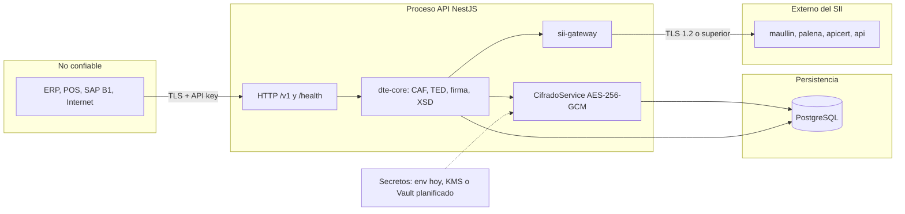
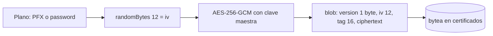

# 08. Seguridad

Este documento identifica qué hay que proteger, de qué amenazas, qué controles **ya existen en el código** y cuáles
están **planificados**. Todo lo marcado como implementado se verificó leyendo el código fuente; lo marcado como
planificado es diseño objetivo sin código.

Contexto que condiciona el modelo: el sistema firma documentos tributarios con valor legal en nombre de empresas
(multiempresa). Quien obtenga el certificado digital de una empresa, o la clave privada de un CAF, puede emitir
documentos válidos ante el SII a nombre de esa empresa. El daño es fiscal, legal y reputacional.

## 1. Activos

| # | Activo | Dónde vive hoy | Sensibilidad | Impacto si se compromete |
|---|---|---|---|---|
| A1 | **PFX del firmante** y su **contraseña** | `certificados.pfx_cifrado` y `certificados.password_cifrada` (`bytea`, AES-256-GCM). En memoria descifrado sólo mientras se firma. | Crítica | Suplantación de la firma electrónica del titular: firmar DTE, sobres y el token de autenticación del SII. |
| A2 | **Clave maestra** `CERTIFICADOS_MASTER_KEY` | Variable de entorno del proceso (32 bytes en base64). | Crítica | Permite descifrar todos los PFX de todas las empresas (una sola clave para todo, ver 4). |
| A3 | **Clave privada de cada CAF** (`RSASK`) | **Texto plano** dentro de `cafs.xml` (el archivo CAF completo). | Crítica | Permite timbrar documentos (TED) con folios autorizados: emisión fraudulenta dentro del rango del CAF. |
| A4 | **Tokens del SII** | Caché en memoria del proceso (`GestorToken`, TTL 50 min). | Alta | Operar contra el SII como la empresa durante hasta 1 hora (enviar, consultar). No se persisten. |
| A5 | **Datos tributarios** | `documentos` (receptor, montos, XML firmado, TED), `envios` (sobre y respuesta), `empresas`. | Alta (confidencial, de retención legal) | Fuga de información comercial y personal (RUT, razón social, montos). Alteración rompe la trazabilidad. |
| A6 | **Credenciales de infraestructura** | `.env` (`DATABASE_PASSWORD`), secretos del orquestador. | Alta | Acceso directo a todos los datos. |
| A7 | **Integridad del esquema y de los folios** | Tablas `cafs`, `documentos`. | Alta | Folios duplicados o saltados generan rechazos y observaciones del SII. |
| A8 | **Disponibilidad de la API y del canal SII** | Servicio y cola (planificada). | Media | Sin emisión no se puede vender (especialmente boletas en POS). |

## 2. Superficie de ataque y fronteras de confianza

Fronteras principales:

1. Cliente a API: hoy sólo existen `GET /` y `GET /health` (sin datos sensibles). Los endpoints de negocio y su
   autenticación son **planificados**.
2. API a base de datos: credenciales por variable de entorno; TLS opcional con `DATABASE_SSL`.
3. API a SII: HTTPS del lado del cliente `fetch` de Node; el SII autentica con token derivado de una firma.
4. API a gestor de secretos: hoy es la variable de entorno; **planificado** KMS/Vault.

## 3. Modelo de amenazas (STRIDE resumido)

| Categoría | Amenaza | Activo | Mitigación implementada | Mitigación planificada |
|---|---|---|---|---|
| **S**poofing | Un cliente se hace pasar por otra empresa y emite en su nombre. | A1, A3, A5 | **Implementado:** API keys (`src/auth/`) con hash SHA-256, permisos atómicos y lista de empresas; 403 en rutas `:rut` ajenas y 404 en recursos ajenos. | RLS como segunda barrera. |
| **S**poofing | Un tercero se hace pasar por el SII (respuesta falsa). | A4 | HTTPS hacia hosts fijos y conocidos (`ambientes.ts`); TLS 1.2 como mínimo (ver 4.6). | Fijar certificado o CA del SII si procede; validar la forma de las respuestas. |
| **T**ampering | Alteración del PFX o del CAF en base de datos. | A1, A3 | GCM autentica el blob del PFX: cualquier modificación hace fallar `descifrar` (`final()` lanza). | Cifrar también `cafs.xml`; hash de integridad de `documentos.xml_firmado`; auditoría. |
| **T**ampering | Inyección de XPath en la referencia de firma para firmar otro nodo. | A5 | `idReferencia` validado con `^[A-Za-z_][\w.-]*$` antes de construir el XPath (`firma.ts`). | Mantener la regla en todo punto que arme XPath. |
| **T**ampering | Folio duplicado o saltado por carrera. | A7 | `FOR UPDATE` sobre todos los CAF candidatos y unique `(empresa_id, tipo_dte, folio)`. | `CHECK` de rangos y `EXCLUDE` de solapamiento. |
| **R**epudiation | Un usuario niega haber emitido o anulado un documento. | A5 | Fechas `creado_en`/`actualizado_en`; `envios` guarda `xml_envio` y `respuesta`. | Auditoría de quién y cuándo (ver `data-audit-logging`), logs inmutables con `request_id` y `track_id`. |
| **I**nformation disclosure | Lectura de PFX o contraseñas en la base o en respaldos. | A1 | Cifrado AES-256-GCM en reposo; IV aleatorio por cifrado. | Cifrado de sobre con KMS (DEK por empresa), respaldos cifrados. |
| **I**nformation disclosure | Lectura de la clave privada del CAF en `cafs.xml`. | A3 | **Ninguna: se guarda en claro.** | Separar `RSASK` del XML y cifrarla igual que el PFX (alta prioridad). |
| **I**nformation disclosure | Fuga de secretos en el repositorio. | A1, A2, A6 | `.gitignore` excluye `*.pfx`, `*.p12`, `*.pem`, `.env`, `.env.*` (salvo `.env.example`). | Escaneo de secretos en CI (por ejemplo gitleaks) y pre-commit. |
| **I**nformation disclosure | Secretos o tokens en logs y mensajes de error. | A4, A1 | El código no registra tokens ni el PFX; `Cookie: TOKEN` sólo viaja en cabeceras. Precaución: `SiiError.cuerpo` conserva el cuerpo de la respuesta del SII y el mensaje incluye hasta 500 caracteres de ese cuerpo. | Lista de campos a ocultar en el logger; no registrar `cuerpo` de las respuestas de token. |
| **I**nformation disclosure | Una empresa lee datos de otra (fallo de aislamiento). | A5 | Toda tabla de negocio tiene `empresa_id`. | RLS con rol de aplicación sin `BYPASSRLS` (hoy el filtrado depende de cada consulta). |
| **D**enial of service | Agotar el límite del SII (HTTP 405) o saturar la API. | A8 | Reintentos con backoff exponencial ante 405/5xx/red; caché de token con deduplicación de solicitudes concurrentes. | Rate limiting por cliente, cola con concurrencia controlada, circuit breaker, respeto de `X-Retry-After`/`X-RateLimit-*`. |
| **D**enial of service | XML malicioso grande que consuma CPU o memoria. | A8 | Los XML que se parsean provienen de fuentes controladas (CAF subido por el administrador, respuestas del SII). | Límite de tamaño de cuerpo y de archivo; si se agrega intercambio de DTE recibidos, deshabilitar DTD y entidades externas y revisar contra XXE. |
| **E**levation of privilege | Un cliente con permisos limitados ejecuta operaciones administrativas (cargar PFX o CAF). | A1, A3 | Ninguna aún. | Autorización por roles y permisos separando administración de emisión. |
| **E**levation of privilege | Compromiso del proceso entrega la clave maestra y la base. | A1, A2 | Ninguna específica. | Separar la base de la clave maestra en distintos dominios de confianza (KMS), mínimo privilegio en el usuario de BD. |

## 4. Controles implementados

### 4.1 Cifrado de certificados con AES-256-GCM

Implementación: `apps/api/src/seguridad/cifrado.service.ts` (`CifradoService`), registrada en `SeguridadModule`.

| Aspecto | Detalle |
|---|---|
| Algoritmo | `aes-256-gcm` de `node:crypto` (cifrado autenticado). |
| Clave | 32 bytes (`LARGO_CLAVE`), tomada de `CERTIFICADOS_MASTER_KEY` en base64. |
| IV | 12 bytes aleatorios (`randomBytes`) por cada cifrado; nunca se reutiliza con la misma clave. |
| Tag | 16 bytes (`getAuthTag`). |
| Formato del blob | `versión (1 byte) \| iv (12) \| tag (16) \| ciphertext`. `VERSION = 1`. |
| Descifrado | Rechaza blobs de menos de 29 bytes y versiones distintas de 1; `decipher.final()` lanza si el tag no coincide (blob alterado o clave distinta). |

El byte de versión existe para rotar algoritmo o clave en el futuro sin romper blobs antiguos: se decide el
descifrado según ese byte.

Estado de uso: el servicio está implementado y probado (`cifrado.service.spec.ts`), pero **ningún caso de uso lo
invoca todavía** (no hay carga de certificados). `CertificadosModule` sólo registra la entidad.

### 4.2 Validación de la clave maestra

Doble validación, para que la aplicación no arranque con una clave inválida:

1. `env.validation.ts` (Joi): `CERTIFICADOS_MASTER_KEY` es **obligatoria** y debe decodificar a exactamente 32 bytes
   (`Buffer.from(value, 'base64').length === 32`); el mensaje de error indica `openssl rand -base64 32`.
2. `CifradoService` (constructor): vuelve a verificar `clave.length === 32` y lanza `Error` si no.

Limitaciones: sólo se valida el **largo**, no la entropía. El valor de `apps/api/.env.example` es una clave de ejemplo
legible y **conocida** (válida para Joi): **no debe usarse nunca fuera del desarrollo local**.

### 4.3 Anti-inyección XPath en la firma

`firmarXml` construye el XPath de la referencia como `//*[@ID='<idReferencia>']`. Antes valida el valor con
`/^[A-Za-z_][\w.-]*$/` y lanza `Error('idReferencia inválido: ...')`. Los valores legítimos son `F{folio}T{tipo}` y
`SetDoc`. Esto evita que un dato manipulado cierre la comilla y firme otro nodo o ejecute una expresión arbitraria.

### 4.4 Integridad criptográfica de los documentos

- TED firmado con la clave del CAF (RSA-SHA1 sobre los bytes ISO-8859-1 del `<DD>`) y `verificarTed`.
- Firma XMLDSig del DTE y del sobre, con `verificarFirmaXml` (verifica todas las firmas con el certificado embebido).
  No valida la cadena de confianza del certificado: sirve para pruebas e integridad, **no** como autenticación del
  emisor de un documento recibido.
- `claveCafCoincide` comprueba que la clave privada y la pública de un CAF correspondan antes de usarlo.
- `cargarPfx` valida contraseña, que haya clave privada y certificado, y devuelve la vigencia. RSA-SHA1 y SHA1 son los
  algoritmos que **exige el SII**; no se pueden cambiar unilateralmente.

### 4.5 Higiene del repositorio y la configuración

- `.gitignore` raíz: `*.pfx`, `*.p12`, `*.pem` (con excepción de `**/test/fixtures/**/*.pem`), `.env`, `.env.*` salvo
  `.env.example`, `*.log`.
- La configuración se valida con Joi al arrancar; sin variables obligatorias la app no inicia.
- Los tests generan certificados y CAF **sintéticos** (`dte-core/testing/`), por lo que no se versionan credenciales reales.

### 4.6 Transporte

- Todos los hosts del SII son HTTPS (`apps/api/src/sii-gateway/ambientes.ts`). La API de boletas exige **TLS 1.2 o
  superior**. El cliente usa `globalThis.fetch` de Node 24, cuyo mínimo por defecto es TLS 1.2; no hay código que lo
  fije explícitamente, así que el control es **implícito** (depende de la versión de Node). Se recomienda no bajar el
  mínimo con opciones de TLS ni `NODE_OPTIONS`.
- `User-Agent` fijo del SII en upload y envío de boletas.
- Base de datos: `DATABASE_SSL=true` activa TLS. **Advertencia**: tanto `database.module.ts` como `data-source.ts`
  usan `{ rejectUnauthorized: false }`, es decir, cifran el canal pero **no verifican el certificado del servidor**
  (vulnerable a un intermediario activo). En producción debe configurarse la CA del servicio gestionado y
  `rejectUnauthorized: true` (cambio **planificado**).

### 4.7 Integridad de datos

`ON DELETE RESTRICT` en todas las FK, unicidad de folio y de idempotencia, y bloqueo pesimista de CAF (ver
`04-modelo-de-datos.md` y `05-flujos.md`).

## 4.8 Autenticación y autorización de clientes (implementado)

Los clientes de la API son sistemas (worker de SAP B1, ERP), por eso se usan **API keys** y no usuarios con contraseña. Detalle en `apps/api/src/auth/README.md`.

- Formato `sk_<test|live>_<prefijo hex>_<secreto base64url de 32 bytes>`; se muestra una sola vez. En la BD (`api_keys`) sólo se guarda el SHA-256 y el prefijo; comparación en tiempo constante.
- Cabeceras `Authorization: Bearer <clave>` o `X-API-Key: <clave>`. 401 con `WWW-Authenticate: Bearer`, mismo mensaje para clave inexistente, revocada o expirada.
- `API_ADMIN_KEY` (variable de entorno, ≥ 32 caracteres) concede todo: sirve para crear empresas y las primeras claves.
- Guards globales fail-closed: `AuthGuard` autentica y `PermisosGuard` exige `@RequierePermisos(...)`; un endpoint sin permisos declarados se deniega. Sólo `GET /` y `GET /health` son `@Publico()`.
- Permisos: `empresas.crear|leer|editar`, `certificados.gestionar`, `cafs.gestionar`, `folios.leer`, `documentos.emitir|leer`, `envios.crear|leer`, `api_keys.gestionar`.
- Aislamiento: ruta con `:rut` fuera del alcance → 403; documento o envío de otra empresa → 404. Una clave no puede crear otra con más permisos o empresas que ella (anti-escalada).
- Revocación inmediata (`DELETE /v1/api-keys/:id`), expiración opcional y `ultimo_uso_en`.
- Pendiente: OAuth2/usuarios con JWT para un futuro backoffice, rate limiting por clave y auditoría de uso.

## 5. Controles planificados

| Control | Descripción | Prioridad |
|---|---|---|
| Cifrar la clave del CAF | Separar `RSASK` de `cafs.xml` y cifrarla con `CifradoService` (o DEK de KMS). Hoy está en claro (A3). | Alta |
| RLS en PostgreSQL | `ROW LEVEL SECURITY` en todas las tablas con `empresa_id`, políticas con `current_setting('app.empresa_id')` fijado por transacción, rol de aplicación sin `BYPASSRLS`. | Alta |
| Cifrado de sobre (KMS/Vault) | Una clave de datos (DEK) por empresa, cifrada con una clave maestra del KMS; el blob ya tiene byte de versión para el cambio de formato. Reemplaza la clave maestra única en variable de entorno. | Alta |
| Rotación | De la clave maestra (re-cifrado por lotes leyendo la versión del blob), del certificado de la empresa (`certificados.activo` y vigencia) y de los CAF (anulación y carga de uno nuevo). | Media |
| Auditoría | Registro de quién cargó certificados y CAF, emitió, anuló o consultó; acceso a secretos; inmutable y con retención. | Media |
| Verificación de TLS a la base | `rejectUnauthorized: true` con CA configurable (ver 4.6). | Media |
| Rate limiting y límites de tamaño | Por cliente y global; tamaño máximo de CAF, PFX y documentos. | Media |
| Cabeceras y endurecimiento HTTP | Helmet, CORS restringido, timeouts. | Media |
| Escaneo de secretos y dependencias | gitleaks, `npm audit`/Dependabot en CI. | Media |
| Retención y borrado | Política de conservación legal de 6 años (*a verificar*) y archivado cifrado en object storage. | Media |
| Alertas | Vencimiento de certificados y CAF, picos de 405/5xx, intentos de autenticación fallidos. | Media |

## 6. Recomendaciones de manejo de certificados y claves

Certificado digital (PFX) del firmante:

1. **Una empresa, un certificado activo**, emitido por una entidad acreditada ante el SII, a nombre de una persona
   natural autorizada como firmante. Cargarlo por un canal TLS; la API debe cifrarlo **al recibirlo** y no guardar
   nunca el PFX ni la contraseña en claro, ni siquiera temporalmente en disco.
2. Descifrar sólo en memoria, justo antes de firmar (`cargarPfx` entrega PEM en memoria) y no mantener el PEM más
   tiempo del necesario. No registrar la contraseña ni los PEM en logs.
3. Verificar al cargar: contraseña correcta, clave privada presente, **vigencia** y que el RUT del SAN
   (`rutFirmante`) coincida con el firmante declarado; guardar `valido_desde`/`valido_hasta` para alertar con
   anticipación (por ejemplo, 30 días).
4. Mantener un solo certificado `activo = true` por empresa (regla de servicio) y conservar los anteriores
   desactivados hasta que no queden envíos pendientes firmados con ellos.
5. Nunca incluir PFX reales en el repositorio, en imágenes de contenedor ni en ejemplos; para pruebas usar los
   generadores sintéticos.

CAF:

6. Tratar el archivo CAF como secreto: su `RSASK` permite timbrar. Cargarlo por canal seguro, cifrar la clave en
   reposo y no reenviarlo por correo.
7. Validar al cargar: `RE` igual al RUT de la empresa, tipo correcto, `claveCafCoincide`, vigencia y no solapamiento
   (hecho en `registrarCaf`).
8. Anular en el SII los folios vencidos sin usar y marcar `anulado` el CAF.

Clave maestra y secretos de infraestructura:

9. Generar con `openssl rand -base64 32`; **una distinta por ambiente** (desarrollo, certificación, producción).
   Nunca usar la del `.env.example`.
10. Entregar la clave por el gestor de secretos del orquestador (o KMS/Vault); nunca en la imagen ni en el
    repositorio. Respaldarla por separado de la base de datos: sin la clave los PFX son irrecuperables, y quien tenga
    ambas puede descifrarlos.
11. Usuario de BD con el mínimo privilegio para la aplicación (sin `SUPERUSER`, y sin `BYPASSRLS` cuando exista RLS);
    un usuario distinto para ejecutar migraciones.
12. Separar certificados de **certificación** y de **producción**; el ambiente se decide por empresa y un error de
    configuración no debe enviar documentos de prueba a producción.

## 7. Resumen de brechas (hoy)

| Brecha | Riesgo | Referencia |
|---|---|---|
| `cafs.xml` guarda `RSASK` en claro. | Emisión fraudulenta ante fuga de la base. | 3, 5 |
| Clave maestra única en variable de entorno; sin rotación. | Un compromiso descifra todo. | 4.1, 5 |
| `rejectUnauthorized: false` en la conexión TLS a la base. | Intermediario activo. | 4.6 |
| Aislamiento multiempresa sólo por convención de consulta (sin RLS). | Fuga entre empresas por error de programación. | 3, 5 |
| `.env.example` trae una clave maestra conocida que Joi acepta. | Uso accidental en producción. | 4.2 |
| Ausencia de auditoría y de límites de tamaño o tasa. | Repudio y DoS. | 3, 5 |
