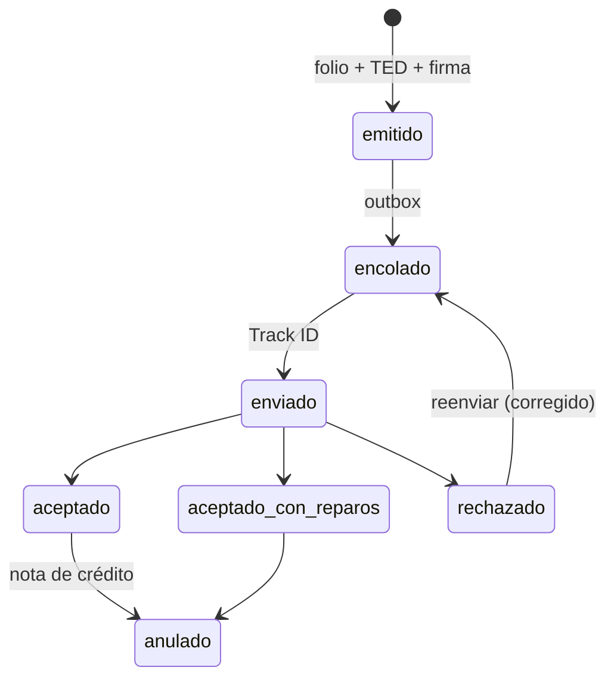

# 09 - Contrato de la API REST

Este documento separa con claridad lo **implementado hoy** de lo **planificado** (diseño propuesto, sin código). Todo lo planificado es una propuesta coherente con las entidades reales (`apps/api/src/**/entities`), con el bosquejo de API de la sección 3 de `docs/01-opciones-arquitectura-y-pruebas.md` y con el modelo de datos de `apps/api/src/database/README.md`.

## 1. Implementado hoy

Fuente: `apps/api/src/main.ts`, `app.controller.ts`, `app.service.ts`, `health/health.controller.ts`.

- Prefijo global `v1` con **exclusión** de `/` y `/health` (`app.setGlobalPrefix('v1', { exclude: ['health', '/'] })`). Hoy no existe ningún recurso bajo `/v1`.
- Puerto: `PORT` (por defecto 3000). Sin autenticación, sin CORS configurado, sin validación de DTO global, sin Swagger/OpenAPI propio.
- Cierre ordenado habilitado (`enableShutdownHooks`).

### 1.1 `GET /`

Información de la API. Sin autenticación.

```http
GET / HTTP/1.1
Host: localhost:3000
```

```json
{
  "nombre": "api-sii",
  "version": "0.0.1",
  "ambienteSii": "certificacion"
}
```

- `version` se lee de `apps/api/package.json`.
- `ambienteSii` proviene de `SII_AMBIENTE` (`certificacion` | `produccion`), el valor por defecto de la aplicación (cada empresa tendrá el suyo).
- Cubierto por `src/app.controller.spec.ts` y `test/app.e2e-spec.ts`.

### 1.2 `GET /health`

Salud de la aplicación vía `@nestjs/terminus` (`pingCheck('database')` sobre PostgreSQL).

```json
{
  "status": "ok",
  "info": { "database": { "status": "up" } },
  "error": {},
  "details": { "database": { "status": "up" } }
}
```

Con la base de datos caída, Terminus responde `503 Service Unavailable`:

```json
{
  "status": "error",
  "info": {},
  "error": { "database": { "status": "down", "message": "..." } },
  "details": { "database": { "status": "down", "message": "..." } }
}
```

(Forma estándar de Terminus; el texto de `message` depende del error del driver.) Cubierto solo en el e2e con base de datos (`describe.skipIf`).

## 2. Planificado: contrato `/v1`

> **Propuesta de diseño.** Nada de esta sección existe en el código. Los nombres de campos JSON siguen la convención en español del proyecto.

### 2.1 Convenciones generales

| Tema | Decisión propuesta |
|---|---|
| Base | `/v1`; JSON UTF-8 (`application/json`). Los XML se descargan con `application/xml; charset=ISO-8859-1` |
| Identificación de empresa | `{rut}` en la ruta con formato `76086428-5` (sin puntos). Internamente se resuelve a `empresas.id` (UUID). Recursos hijos (`documentos`, `envios`) se consultan por UUID y se filtran por la empresa de la credencial |
| Autenticación | `Authorization: Bearer <api-key>`; cada clave pertenece a una empresa (o a un integrador con varias). Ver `08-seguridad.md` |
| Fechas | Calendario: `yyyy-mm-dd`. Instantes: ISO 8601 UTC con `Z` (`timestamptz`) |
| Montos | Enteros en CLP (los `bigint` de BD se exponen como `number`) |
| Identificadores | UUID v4 (`gen_random_uuid()`) |
| Idempotencia | Header `Idempotency-Key` en `POST` de emisión (ver 2.4) |
| Versionado | Prefijo de ruta `/v1`; cambios compatibles (campos nuevos opcionales) sin cambiar versión; cambios incompatibles en `/v2` con ventana de convivencia; `Deprecation`/`Sunset` en headers |
| Trazabilidad | `X-Request-Id` aceptado o generado y devuelto en todas las respuestas |
| Límites | `429 Too Many Requests` con `Retry-After` por empresa |

### 2.2 Modelo de errores

Formato `application/problem+json` (RFC 9457):

```json
{
  "type": "https://api-sii.example/errores/folios-agotados",
  "title": "Sin folios disponibles",
  "status": 409,
  "code": "SIN_FOLIOS_DISPONIBLES",
  "detail": "Sin folios disponibles para la empresa 6d0f... y tipo de DTE 33",
  "requestId": "9c3b1a52-...",
  "errors": [{ "campo": "detalle[0].cantidad", "mensaje": "la cantidad debe ser mayor que 0" }]
}
```

| HTTP | `code` | Origen en el código actual |
|---|---|---|
| 400 | `VALIDACION` | DTO inválido (planificado: `class-validator`) |
| 401 | `NO_AUTENTICADO` | Falta o es inválida la API key |
| 403 | `NO_AUTORIZADO` | La credencial no pertenece a la empresa |
| 404 | `NO_ENCONTRADO` | Recurso inexistente o de otra empresa |
| 409 | `SIN_FOLIOS_DISPONIBLES` | `SinFoliosDisponiblesError` (`folios.errors.ts`) |
| 409 | `IDEMPOTENCIA_CONFLICTO` | Misma `Idempotency-Key` con cuerpo distinto |
| 409 | `ESTADO_INVALIDO` | Operación no válida para el estado del documento (p. ej. reenviar un aceptado) |
| 422 | `DOCUMENTO_INVALIDO` | `ErrorValidacionDte` (`dte-core`): folio fuera de rango, DV incorrecto, límites 60/1000, etc. |
| 422 | `CAF_INVALIDO` | `CafInvalidoError` (rango inválido o solapado) y `Error('CAF inválido: ...')` de `parsearCaf` |
| 422 | `CERTIFICADO_INVALIDO` | `cargarPfx` (contraseña incorrecta, sin clave, vencido) |
| 429 | `LIMITE_EXCEDIDO` | Límite propio de la API |
| 502 | `SII_NO_DISPONIBLE` | `SiiServidorError`, `SiiRedError`, `SiiLimiteExcedidoError` agotados |
| 502 | `SII_RECHAZO` | `SiiEnvioDteError`, `SiiPeticionInvalidaError` |
| 503 | `NO_DISPONIBLE` | Base de datos caída |

### 2.3 Paginación y filtros

Paginación por cursor (estable con inserciones concurrentes):

```
GET /v1/empresas/76086428-5/documentos?tipoDte=33&estado=aceptado&desde=2026-11-01&hasta=2026-11-30&limite=50&cursor=eyJ...
```

```json
{
  "datos": [ { "id": "..." } ],
  "paginacion": { "limite": 50, "siguienteCursor": "eyJjcmVhZG9fZW4iOiIyMDI2LTExLTE3VDEyOjAwOjAwWiIsImlkIjoiLi4uIn0", "hayMas": true }
}
```

`limite` por defecto 50, máximo 200. Orden por `creadoEn` descendente.

### 2.4 `Idempotency-Key`

- Obligatorio (recomendado) en `POST /documentos` y `POST /documentos/{id}/reenviar`; string de hasta 100 caracteres (coincide con `documentos.clave_idempotencia varchar(100)`).
- Unicidad por empresa: índice parcial `uq_documentos_empresa_idempotencia (empresa_id, clave_idempotencia) WHERE clave_idempotencia IS NOT NULL`.
- Misma clave y mismo cuerpo: devuelve la **misma respuesta** (`200`, header `Idempotent-Replayed: true`) sin consumir otro folio. Misma clave con cuerpo distinto: `409 IDEMPOTENCIA_CONFLICTO`.
- Los folios nunca se reutilizan: un fallo tras asignar el folio deja el documento persistido en estado recuperable, no se numera dos veces.

### 2.5 Empresas

Entidad `Empresa` (`empresas`): `rut` + `dv`, `razonSocial` (100), `giro` (80), `actecos` (int[]), `direccion` (70), `comuna` (20), `ciudad` (20), `codigoSucursalSii?`, `telefono?`, `correoIntercambio?`, `nroResolucionSii?`, `fechaResolucionSii?`, `ambienteSii`, `activa`.

| Método y ruta | Uso | Éxito |
|---|---|---|
| `POST /v1/empresas` | Alta de empresa emisora | 201 |
| `GET /v1/empresas/{rut}` | Detalle | 200 |
| `PATCH /v1/empresas/{rut}` | Actualizar datos, resolución o ambiente | 200 |
| `GET /v1/empresas` | Listar las visibles para la credencial | 200 |

```http
POST /v1/empresas
Content-Type: application/json
```

```json
{
  "rut": "76086428-5",
  "razonSocial": "EMPRESA DE PRUEBA SPA",
  "giro": "Servicios informáticos",
  "actecos": [620200],
  "direccion": "Av. Providencia 1234",
  "comuna": "Providencia",
  "ciudad": "Santiago",
  "correoIntercambio": "dte@empresa.cl",
  "nroResolucionSii": 0,
  "fechaResolucionSii": "2025-01-15",
  "ambienteSii": "certificacion"
}
```

```json
{
  "id": "6d0f2b7e-3c1a-4e9b-8a54-0d5f9c1e7a21",
  "rut": "76086428-5",
  "razonSocial": "EMPRESA DE PRUEBA SPA",
  "giro": "Servicios informáticos",
  "actecos": [620200],
  "ambienteSii": "certificacion",
  "activa": true,
  "creadoEn": "2026-11-17T15:04:05Z"
}
```

Errores: `409` si el RUT ya existe (`uq_empresas_rut`), `422` si el DV es incorrecto. Cambiar `ambienteSii` a `produccion` exige certificado activo y declaración de cumplimiento registrada.

### 2.6 Certificados

Entidad `Certificado`: `rutFirmante`, `dvFirmante`, `nombreFirmante`, `pfxCifrado` y `passwordCifrada` (AES-256-GCM, nunca se devuelven), `validoDesde`, `validoHasta`, `activo`.

| Método y ruta | Uso | Éxito |
|---|---|---|
| `POST /v1/empresas/{rut}/certificado` | Cargar PFX (multipart: `archivo`, `password`); se valida con `cargarPfx` y se cifra al recibirlo | 201 |
| `GET /v1/empresas/{rut}/certificados` | Listar metadatos | 200 |
| `DELETE /v1/empresas/{rut}/certificados/{id}` | Desactivar (`activo=false`; no se borra) | 204 |

```json
{
  "id": "0b8c5d1e-77a2-4d0a-9d6f-3b2e1a4c9f10",
  "rutFirmante": "12345678-5",
  "nombreFirmante": "Firmante de Prueba",
  "validoDesde": "2026-11-16T00:00:00Z",
  "validoHasta": "2027-11-16T00:00:00Z",
  "activo": true
}
```

Al activar uno nuevo se desactiva el anterior de la empresa. `422 CERTIFICADO_INVALIDO` si la contraseña es incorrecta, no hay clave privada o el certificado está vencido.

### 2.7 CAF y folios

Entidad `Caf` (`cafs`): `tipoDte`, `folioDesde`, `folioHasta`, `folioSiguiente`, `fechaAutorizacion`, `fechaVencimiento`, `xml`, `agotado`, `anulado`. Lógica real en `FoliosService` (`registrarCaf`, `asignarSiguienteFolio`, `foliosDisponibles`).

| Método y ruta | Uso | Éxito |
|---|---|---|
| `POST /v1/empresas/{rut}/caf` | Cargar archivo CAF (multipart `archivo` o JSON `{ "xml": "..." }`) | 201 |
| `GET /v1/empresas/{rut}/folios?tipoDte=33` | Disponibilidad por CAF (`ResumenCaf`) | 200 |
| `POST /v1/empresas/{rut}/caf/{id}/anular` | Marcar un CAF como anulado | 200 |

Al cargar: `parsearCaf` + `claveCafCoincide`, verificación de que el RUT del CAF coincide con la empresa y registro con `registrarCaf` (rechaza rangos solapados con `CafInvalidoError`).

```json
{
  "datos": [
    {
      "cafId": "a1f0c2d4-1b3e-4f5a-9c8d-7e6f5a4b3c2d",
      "tipoDte": 33,
      "folioDesde": 1,
      "folioHasta": 100,
      "folioSiguiente": 18,
      "disponibles": 83,
      "fechaVencimiento": "2027-05-17",
      "vencido": false,
      "agotado": false,
      "anulado": false
    }
  ]
}
```

(Campos de `ResumenCaf`, más `tipoDte`.) Folios `disponibles` bajo un umbral configurable generan alerta/webhook `folios.bajo_umbral`.

### 2.8 Documentos

Entidad `Documento`: `tipoDte`, `folio`, `fechaEmision`, receptor, `montoNeto`, `montoExento`, `iva`, `montoTotal`, `estado` (`emitido`, `encolado`, `enviado`, `aceptado`, `aceptado_con_reparos`, `rechazado`, `anulado`), `trackId`, `xmlFirmado`, `ted`, `reparos` (jsonb), `claveIdempotencia`.

| Método y ruta | Uso | Éxito |
|---|---|---|
| `POST /v1/empresas/{rut}/documentos` | Crear y emitir (folio + TED + firma, síncrono) y encolar el envío | 201 |
| `GET /v1/empresas/{rut}/documentos` | Listar con filtros y paginación | 200 |
| `GET /v1/documentos/{id}` | Estado y totales | 200 |
| `GET /v1/documentos/{id}/xml` | XML firmado (ISO-8859-1) | 200 |
| `GET /v1/documentos/{id}/pdf` | Representación impresa (PDF417) | 200 |
| `POST /v1/documentos/{id}/reenviar` | Reintentar el envío al SII | 202 |
| `POST /v1/documentos/{id}/anular` | Emite la nota de crédito de anulación (`codRef` 1) | 201 |

`POST /documentos` (cuerpo = `DocumentoDte` de `dte-core` sin `folio`, que asigna el servidor):

```http
POST /v1/empresas/76086428-5/documentos
Authorization: Bearer ***
Idempotency-Key: b2e7c0a4-5f3d-4a8b-9e21-6c4d8f0a1b37
Content-Type: application/json
```

```json
{
  "idDoc": { "tipoDte": 33, "fechaEmision": "2026-11-17", "formaPago": 1 },
  "receptor": {
    "rut": "12345678-5",
    "razonSocial": "CLIENTE DE PRUEBA LTDA",
    "giro": "Comercio",
    "direccion": "Calle Falsa 123",
    "comuna": "Santiago",
    "ciudad": "Santiago"
  },
  "detalle": [
    { "nombre": "Servicio de prueba", "cantidad": 2, "precioUnitario": 10000 },
    { "nombre": "Servicio exento", "cantidad": 1, "precioUnitario": 5000, "exento": true }
  ],
  "descuentosRecargos": [
    { "tipo": "D", "tipoValor": "%", "valor": 10, "glosa": "Descuento comercial" }
  ],
  "referencias": [],
  "origen": { "sistema": "sap-b1", "docEntry": 4521 }
}
```

El emisor no se envía: se toma de la empresa de la ruta. `origen` es metadato opcional para correlacionar con el ERP.

```json
{
  "id": "f3a9d1c7-2b4e-4c6a-8d0f-1e2b3c4d5e6f",
  "empresa": "76086428-5",
  "tipoDte": 33,
  "folio": 18,
  "fechaEmision": "2026-11-17",
  "estado": "encolado",
  "totales": { "montoNeto": 18000, "montoExento": 5000, "tasaIva": 19, "iva": 3420, "montoTotal": 26420 },
  "trackId": null,
  "reparos": null,
  "enlaces": {
    "xml": "/v1/documentos/f3a9d1c7-2b4e-4c6a-8d0f-1e2b3c4d5e6f/xml",
    "pdf": "/v1/documentos/f3a9d1c7-2b4e-4c6a-8d0f-1e2b3c4d5e6f/pdf"
  },
  "creadoEn": "2026-11-17T15:10:00Z"
}
```

(Cálculo: neto = 20000 - 10% = 18000; IVA = round(18000 x 19%) = 3420; total = 18000 + 5000 + 3420. Ejemplo ilustrativo; los totales reales los calcula `calcularTotales`.)

Códigos: `201` emitido; `200` repetición idempotente; `409 SIN_FOLIOS_DISPONIBLES`; `422 DOCUMENTO_INVALIDO` (con `errors[]`); `422` si no hay certificado activo; `404` empresa inexistente.

Máquina de estados propuesta (el doc 01 incluye `borrador`; la entidad actual no):



### 2.9 Envíos

Entidad `Envio`: `canal` (`dte` | `boleta`), `ambienteSii`, `trackId`, `estado` (código SII), `glosaEstado`, `intentos`, `enviadoEn`, `consultadoEn`; N:M con documentos vía `envio_documentos` (`estado`, `glosa` por documento).

| Método y ruta | Uso | Éxito |
|---|---|---|
| `GET /v1/envios/{trackId}` | Estado del envío y de sus documentos | 200 |
| `GET /v1/empresas/{rut}/envios` | Listar | 200 |
| `POST /v1/envios/{trackId}/consultar` | Forzar consulta de estado al SII | 202 |

```json
{
  "id": "c4d5e6f7-0a1b-4c2d-8e3f-9a8b7c6d5e4f",
  "canal": "boleta",
  "ambienteSii": "certificacion",
  "trackId": "123456789012345",
  "estado": "RPR",
  "glosaEstado": "Aceptado con reparos",
  "esFinal": true,
  "intentos": 1,
  "enviadoEn": "2026-11-17T15:11:00Z",
  "consultadoEn": "2026-11-17T15:21:30Z",
  "documentos": [
    { "documentoId": "f3a9d1c7-...", "tipoDte": 39, "folio": 101, "estado": "RPR",
      "glosa": "Aceptado con reparos", "reparos": [{ "nivel": 2, "codigo": 0, "descripcion": "..." }] }
  ]
}
```

Los campos `estado`, `glosaEstado` y `esFinal` salen directamente del mapeo de `sii-gateway` (doc 07, sección 9). Agrupación de boletas en envíos de hasta 50 (máximo 500).

### 2.10 Webhooks

Aún no hay entidad. Propuesta: tablas `webhooks` (`empresa_id`, `url`, `secreto`, `eventos[]`, `activo`) y `webhook_entregas` (reintentos).

| Método y ruta | Uso | Éxito |
|---|---|---|
| `POST /v1/webhooks` | Suscribir (`url`, `eventos`) | 201 |
| `GET /v1/webhooks` | Listar | 200 |
| `DELETE /v1/webhooks/{id}` | Eliminar | 204 |

```json
{ "url": "https://erp.cliente.cl/hooks/sii", "eventos": ["documento.aceptado", "documento.rechazado", "folios.bajo_umbral"] }
```

Evento entregado (`POST` a la URL del cliente):

```http
X-Signature: sha256=3f1c...      (HMAC-SHA256 del cuerpo con el secreto)
X-Event-Id: 8d2e1f0a-...
```

```json
{
  "id": "8d2e1f0a-9b7c-4d6e-a5f4-3c2b1a0e9d8c",
  "evento": "documento.aceptado",
  "creadoEn": "2026-11-17T15:22:00Z",
  "datos": { "documentoId": "f3a9d1c7-...", "tipoDte": 33, "folio": 18, "estado": "aceptado", "trackId": "1234567890" }
}
```

Entrega "al menos una vez": reintentos con backoff exponencial ante respuestas no 2xx; el receptor deduplica por `id`.

## 3. Resumen implementado vs planificado

| Recurso | Estado |
|---|---|
| `GET /`, `GET /health` | Implementado |
| Prefijo `/v1` | Implementado (configuración); sin recursos |
| Empresas, certificados, CAF/folios, documentos, envíos, webhooks | Planificado. Existe el modelo de datos y `FoliosService` (sin controlador), y la lógica de `dte-core` y `sii-gateway` |
| Autenticación, idempotencia, paginación, errores `problem+json`, OpenAPI propio | Planificado |
