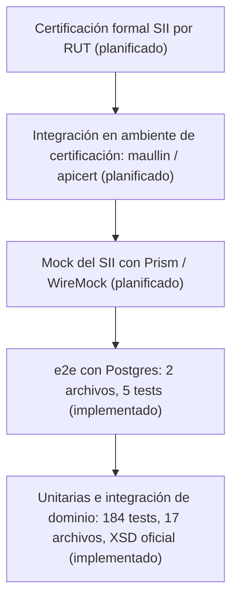

# 10 - Estrategia de pruebas

Distingue lo **implementado** (medido el 2026-11-17/18 ejecutando los comandos) de lo **planificado**. Sección de referencia: `docs/01-opciones-arquitectura-y-pruebas.md`, sección 4.

## 1. Comandos

Todos desde `apps/api/` (scripts de `package.json`):

| Comando | Qué hace |
|---|---|
| `npm test` | `vitest run` (config `vitest.config.ts`: `include: ['**/*.spec.ts']`, `globals: true`) |
| `npm run test:watch` | `vitest` en modo watch |
| `npm run test:cov` | `vitest run --coverage` (`@vitest/coverage-v8`) |
| `npm run test:e2e` | `vitest run --config ./vitest.config.e2e.ts` (`include: ['**/*.e2e-spec.ts']`) |
| `npm run test:debug` | `vitest --inspect-brk --no-file-parallelism` |
| `npm run lint` | `oxlint --type-aware src/ test/` (reglas: `typescript/no-floating-promises: error`, `no-explicit-any: off`) |
| `npx tsc --noEmit -p tsconfig.json` | Chequeo de tipos |

Para el núcleo: `npx vitest run src/dte-core`.

## 2. Resultado real de la última ejecución

`cd apps/api && npx vitest run`:

```
Test Files  17 passed (17)
     Tests  184 passed (184)
  Duration  ~8.6 s
```

`npm run lint`: terminó sin diagnósticos.

`npm run test:e2e` en la máquina de la medición (con `.env` presente pero sin un PostgreSQL de la aplicación disponible): 1 test pasó (`GET /`), 4 se omitieron y ambos archivos fallaron por *timeout* del hook `beforeAll` (10 s) al conectar con la base. Es decir: **`describe.skipIf(!process.env.DATABASE_HOST)` solo omite cuando la variable no está definida**; con un `.env` cargado y sin base arriba, los suites con BD fallan en lugar de omitirse. No se midió cobertura (`test:cov`).

## 3. Pirámide de pruebas



| Nivel (doc 01) | Estado |
|---|---|
| 1. Unitarias de `dte-core` | Implementado |
| 2. Validación XSD en CI | Implementado (dentro de los tests; no hay pipeline de CI en el repositorio) |
| 3. Contratos con mock del SII | Planificado; hoy los clientes se prueban con `fetch` simulado |
| 4. Ambiente de certificación | Planificado |
| 5. Certificación formal | Planificado |
| 6. Carga y resiliencia | Parcial (backoff y 405 con `fetch` simulado); resto planificado |
| 7. E2E con SAP B1 | Planificado (doc 14) |

## 4. Qué valida cada archivo de test

| Archivo | Tests | Qué valida |
|---|---|---|
| `src/app.controller.spec.ts` | 1 | `AppController.getInfo` devuelve nombre, versión y ambiente SII |
| `src/dte-core/caf/caf.spec.ts` | 7 | Parseo del CAF (campos, `xmlCaf` textual), error con XML incompleto, vigencia parametrizable y cálculo de fin de mes, `cafVigente`, `folioEnRango`, `claveCafCoincide` |
| `src/dte-core/ted/ted.spec.ts` | 5 | Orden de tags sin espacios, truncado de `RSR`/`IT1` a 40 sobre texto crudo, `FRMT` verifica con la clave pública del CAF, detecta alteraciones, timestamp por defecto en hora de Chile |
| `src/dte-core/firma/firma.spec.ts` | 9 | `Signature` último hijo y sin prefijo, algoritmos exactos y `URI #id`, orden de `KeyInfo`, verificación positiva y negativa (documento y `SignatureValue` alterados), firma de `SetDTE` conservando la firma interna del DTE, `idReferencia` inválido |
| `src/dte-core/xml/xml.util.spec.ts` | 4 | Escape, ISO-8859-1 con declaración y reemplazos, fechas en hora de Chile, RUT |
| `src/dte-core/xsd/xsd.spec.ts` | 10 | Localización de la carpeta XSD, validación mínima contra `RespSII`, `Buffer` Latin-1, errores legibles con nombre de elemento, elemento faltante/desconocido, XML mal formado sin lanzar |
| `src/dte-core/certificado/certificado.spec.ts` | 3 | `cargarPfx` con RUT del SAN, contraseña incorrecta/archivo inválido, certificado sin SAN |
| `src/dte-core/documento/totales.spec.ts` | 18 | Redondeo (mitades arriba), IVA, neto desde bruto, `calcularMontoLinea`, mezcla afecto/exento, globales `%`/`$` y recargos, impuestos adicionales, 34, nota con monto cero, boletas 39/41 con IVA incluido |
| `src/dte-core/documento/construir-dte.spec.ts` | 27 | DTE 33, 34, 52, 56, 61 y boletas 39/41 completos: XSD, firma y TED; truncados; tildes/ñ en Latin-1; referencia `SET`; DTE dentro de un sobre; todos los errores de negocio (folio, CAF, Acteco, referencias, límites 60/1000, RUT, genérico) |
| `src/dte-core/envio/envio.spec.ts` | 6 | `construirEnvioDte` (varios tipos, `SubTotDTE`, XSD y firmas de sobre y DTE), `rutReceptor` de intercambio, sobres vacíos o con documentos inválidos; `construirEnvioBoleta` (39+41), rechazo de no boletas, 500 aceptadas y 501 rechazadas |
| `src/dte-core/integracion.spec.ts` | 1 | CAF de prueba -> TED -> DTE -> firma -> ida y vuelta ISO-8859-1 -> `DTE_v10.xsd` |
| `src/sii-gateway/ambientes.spec.ts` | 3 | Hosts y rutas por ambiente, host alternativo de envío, `User-Agent` |
| `src/sii-gateway/comun/comun.spec.ts` | 16 | `errorDesdeHttp` por código, `conReintentos` (no reintenta lo no reintentable, respeta `maxIntentos` y `factor`), `GestorToken` (deduplicación, separación por tipo/ambiente/RUT), utilidades XML (RUT, escape, parseo, `comoArreglo`, codificación latin1/utf8) |
| `src/sii-gateway/boleta/boleta-api.client.spec.ts` | 39 | Semilla, token (dos líneas firmadas, caché, expiración por TTL, sin caché), envío multipart, codificación ISO-8859-1, host alternativo, renovación de token ante 401 (una vez), backoff ante 405/5xx/red, errores tipados, estado de envío (`esFinal`, estado desconocido, 404, `trackId` inválido), estado de boleta (query, fecha) |
| `src/sii-gateway/dte/dte-sii.client.spec.ts` | 27 | SOAP `getSeed`/`getToken` (escape de `pszXml`), SOAP Fault, 500 reintentado, caché de token, upload (palena en producción, STATUS 7 con `ERROR`, STATUS 5 y 401 renuevan, STATUS 0 sin TRACKID), `getEstUp` (ESTADO 002 renueva), `getEstDte` (parámetros, fecha `ddmmyyyy`) |
| `src/seguridad/cifrado.service.spec.ts` | 6 | AES-256-GCM: ida y vuelta, IV distinto en cada cifrado, blob alterado, versión desconocida o blob corto, clave distinta, clave que no es de 32 bytes |
| `src/folios/folios.service.spec.ts` | 2 | `aFechaSql`; `registrarCaf` rechaza rangos inválidos sin tocar la base |
| `test/app.e2e-spec.ts` | 2 | `GET /` con `supertest` (módulo mínimo, sin BD: 1 test); `GET /health` con `AppModule` completo (requiere BD) |
| `test/folios.e2e-spec.ts` | 3 | Con PostgreSQL real: 50 asignaciones concurrentes entregan folios únicos 1..50 y la 51 falla con `SinFoliosDisponiblesError`; CAF solapado rechazado; paso al siguiente CAF y omisión de vencidos |

Los 17 archivos `*.spec.ts` suman 184 tests (1+7+5+9+4+10+3+18+27+6+1+3+16+39+27+6+2). Los e2e (5 tests) tienen su propia configuración y no entran en `npm test`.

## 5. Certificados y CAF sintéticos

`src/dte-core/testing/` (no se exporta desde `index.ts`; se importa explícitamente):

| Utilidad | Qué genera |
|---|---|
| `generarCertificadoPrueba({ nombre?, rut?, dias?, desde? })` | Certificado autofirmado RSA 2048 (SHA-256) con `node-forge`; si se pasa `rut` lo incluye en el SAN como `otherName` con OID `1.3.6.1.4.1.8321.1` (el DER se construye a mano porque forge no soporta `otherName`). Devuelve PEM de certificado, clave privada (PKCS#1) y clave pública |
| `generarPfxPrueba(password, opciones?)` | PKCS#12 (3DES) con el certificado anterior |
| `generarCafPrueba({ tipoDte, folioDesde, folioHasta, rutEmisor, ... })` | Archivo CAF XML con **par RSA 2048 real** y `FRMA` aleatorio. Sirve para firmar y verificar el TED localmente, pero **jamás sería aceptado por el SII** |
| `cafDePrueba(tipo, desde?, hasta?)` | CAF parseado para el emisor de prueba `76086428-5` |
| `documentoDePrueba(tipo, folio?)` | `DocumentoDte` mínimo y válido por tipo (una línea de $1.000) |
| `src/sii-gateway/comun/testing.ts` | `crearFetchSimulado`, `resp`, `respJson`, `crearFirmadorFalso`, `almacenNuevo`, `sinEspera` (usa `vi` global) |

Los tests de `dte-core` generan los certificados y CAF en memoria (RSA 2048 tarda ~100-800 ms por par; se cachean por tipo dentro de cada archivo).

## 6. Validación contra XSD oficiales en los tests

- Los XSD viven en `apps/api/resources/sii/xsd/`: `DTE_v10.xsd`, `EnvioDTE_v10.xsd`, `SiiTypes_v10.xsd`, `xmldsignature_v10.xsd` (paquete fechado 2026-02-19), `EnvioBOLETA_v11.xsd` (2024-12-05), `RespSII_v10.xsd`, `RespuestaEnvioDTE_v10.xsd`.
- `validarXsd(xml, esquema)` (motor `libxml2-wasm`) se invoca en `construir-dte.spec.ts` para cada tipo (33, 34, 52, 56, 61 contra `DTE`; 39 y 41 dentro de un sobre `EnvioBOLETA`), en `envio.spec.ts` (sobres `EnvioDTE` y `EnvioBOLETA`, hasta 500 boletas) y en `integracion.spec.ts` sobre los **bytes ISO-8859-1**, de modo que también se valida la codificación.
- Los helpers fallan con el listado de errores (`línea N [xpath]: mensaje`), lo que facilita detectar el cambio de orden u obligatoriedad al actualizar el XSD.
- Brecha: los tests no incluyen aún *golden files* (XML de referencia por tipo) ni casos del set de pruebas oficial del SII.

## 7. Pruebas e2e con PostgreSQL

- Requieren `docker compose up -d postgres` (puerto de host 5432 o `POSTGRES_HOST_PORT=5433`), `.env` con `DATABASE_*` y las migraciones aplicadas (`npm run migration:run`).
- Cada archivo usa `describe.skipIf(!process.env.DATABASE_HOST)`; `folios.e2e-spec.ts` carga `.env.local`/`.env` con `process.loadEnvFile`. Ver el matiz de la sección 2 (con `.env` y sin base, fallan por *timeout*).
- Datos: RUT de empresa aleatorio (90000000 + n) y limpieza en `afterAll`, para convivir con otros datos.
- Cubren el punto más delicado de concurrencia: unicidad de folios bajo 50 asignaciones simultáneas y el bloqueo `FOR UPDATE` sin `LIMIT`.

## 8. Planificado

### 8.1 Mock del SII con Prism

- Boletas: `npx @stoplight/prism-cli mock docs/referencias-sii/openapi/sii_boleta_electronica_openapi_v1.0.5.json` (o la copia idéntica en `apps/api/resources/sii/openapi/`). **Aviso**: al intentar parsear esa especificación con `JSON.parse` de Node falla (`Bad control character in string literal`, línea 96 columna 656, dentro de la descripción de `boleta.electronica.envio`). Antes de usar Prism hay que verificar que lo tolera o sanear una copia de trabajo.
- Los `BASES_BOLETA` del gateway deberán poder apuntarse al mock (hoy son constantes; añadir override por configuración o `fetchImpl`).
- DTE (SOAP): stubs con WireMock (o un servidor `fetch` de pruebas) para `CrSeed`, `GetTokenFromSeed`, `QueryEstUp`, `QueryEstDte` y el upload, con respuestas reales anonimizadas capturadas en certificación.
- Escenarios: semilla -> token -> envío -> estado `REC`/`PRD`/`EPR`/`RPR`/`RCH`; STATUS 5 y 7 del upload; 405 con `X-Retry-After`; 5xx intermitente.

### 8.2 Ambiente de certificación (smoke)

- Requisitos: empresa postulante, certificado digital real de un firmante y folios de certificación.
- Prueba de humo diaria: semilla -> token -> envío de un DTE/boleta -> consulta de estado, contra `maullin.sii.cl` (DTE) y `apicert.sii.cl`/`pangal.sii.cl` (boletas). El SII elimina del ambiente a quien no registra actividad en 6 meses.
- Primeros objetivos: confirmar firma de `getToken` (`URI=""`), `KeyInfo`, `SOAPAction`/namespace de las operaciones y formatos de respuesta (supuestos del doc 07, sección 11).

### 8.3 Checklist de certificación SII

**DTE** (`maullin.sii.cl/cvc/dte/certificacion_dte.html`):

- [ ] Postulación y obtención de folios de certificación (CAF de prueba reales).
- [ ] Set de pruebas: cada DTE con primera referencia `SET` y número de caso (ya soportado: `tipoDocRef: 'SET'`), glosas exactas con acentos, orden de líneas, IVA vigente; envíos sin rechazos ni reparos.
- [ ] Simulación: envío de volumen representativo.
- [ ] Intercambio de información (envío/recepción de `EnvioDTE`, `RecepcionDTE`, `EnvioRecibos`, `ResultadoDTE`): requiere el módulo de intercambio (no implementado).
- [ ] Muestras impresas: PDF con PDF417 de todos los documentos del set (no implementado).
- [ ] Declaración de cumplimiento de requisitos.

**Boleta electrónica** (`www4.sii.cl/certBolElectDteInternet/`):

- [ ] El representante legal solicita el set de pruebas (revisión de 10 a 15 días hábiles).
- [ ] Envíos de prueba por la API REST de certificación (`apicert`/`pangal`) con los casos del set; boleta con referencia `SET` sin `FchRef` (ya cubierto en tests).
- [ ] Muestras de representación impresa o digital y sitio de consulta disponible; leyenda "verifique en www.sii.cl".
- [ ] Datos del proveedor de software en el XML (`RutProvSW`, `RznSocProvSW`): **no implementados** en `construirDte`.
- [ ] Declaración de cumplimiento.

### 8.4 Carga y resiliencia

- Límites del SII: 500 boletas por envío (recomendado 50), 405 "límite excedido", token de 1 hora, caídas del SII.
- Pruebas de cola y backoff contra el mock (cuando exista la capa de envíos), con inyección de fallos (chaos testing del `sii-gateway`: latencia, 5xx, cortes de red, tokens expirados a mitad de lote).
- Carga de emisión síncrona: objetivo de folio + XML + firma + PDF por debajo de un segundo; el costo dominante hoy es la firma RSA y la validación XSD (cargar el validador es costoso la primera vez, por eso se cachea).
- Concurrencia de folios con varias réplicas (extender el e2e actual) y pruebas de reintentos que no dupliquen envíos (consultar estado antes de reenviar).

### 8.5 Otras brechas de calidad

- Pipeline de CI (tests + lint + `tsc` + XSD) y umbrales de cobertura con `test:cov`.
- Golden files de XML por tipo de documento.
- Pruebas de contrato de la API REST propia (cuando exista) contra su OpenAPI.
- Prueba de integración de la unión `dte-core` + `sii-gateway` (firmador real) una vez escrito el adaptador.

## 5. Actualización WP9 (2026-11-19): API de emisión y set de pruebas

- Los e2e ahora comprueban la base con un helper compartido (`test/helpers/db.ts`, `postgresDisponible()`, timeout de 1,5 s): sin Postgres los suites se **omiten en segundos** en lugar de fallar por timeout.
- `test/emision.e2e-spec.ts`: empresa, PFX, CAF (RSA 512, `src/testing/caf-realista.ts`), emisión 33/39 con idempotencia (incluida concurrencia), folio no consumido ante error, XML válido contra XSD, PDF, envío DTE y de boletas (lotes de 50) y consulta de estado con el SII simulado (`src/testing/sii-simulado.ts`, inyectado por `SII_FETCH`).
- `test/certificacion.e2e-spec.ts`: la herramienta del set en modo simulado (sin consumir folios) y real (idempotente).
- Guía operativa: `docs/certificacion/GUIA-CERTIFICACION.md`.
