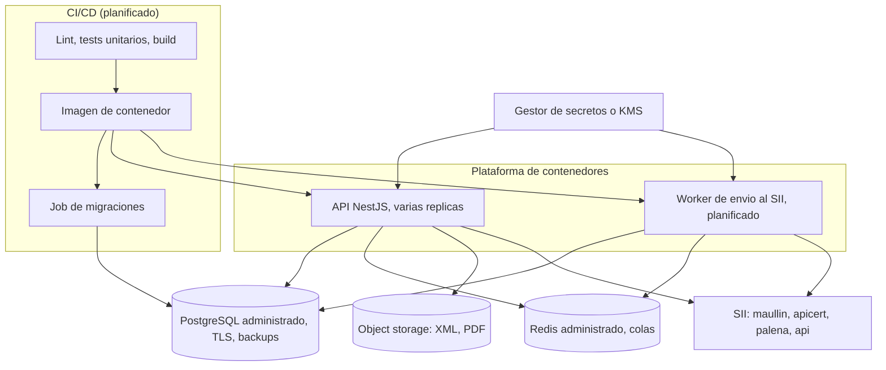

# 11. Operación y despliegue

Guía para levantar el proyecto en desarrollo, configurarlo, gestionar el esquema, observarlo y desplegarlo. Distingue
lo **implementado** (existe en el repositorio) de lo **planificado** (diseño objetivo sin artefactos todavía: no hay
`Dockerfile` ni pipeline de CI/CD en el repositorio).

## 1. Requisitos

| Requisito | Versión | Nota |
|---|---|---|
| Node.js | 24 (el código usa `process.loadEnvFile`, que exige Node 20.12 o superior, y `fetch` nativo) | `package.json` no declara `engines`. |
| npm | 11 | |
| Docker con Docker Compose | reciente | Para PostgreSQL 16 y Redis 7 de desarrollo. |
| Certificado PFX y CAF reales | | Sólo para hablar con el SII. No son necesarios para pruebas: los tests generan certificados y CAF sintéticos. |

## 2. Entorno de desarrollo, paso a paso

Todos los comandos de `npm` se ejecutan en `apps/api`; `docker compose` se ejecuta en la raíz del repositorio (donde
está `docker-compose.yml`).

### 2.1 Levantar PostgreSQL

```bash
docker compose up -d postgres
```

El servicio `postgres` (`postgres:16-alpine`) crea la base con las credenciales `api_sii` / `api_sii` / `api_sii`
(usuario, contraseña, base), publica el puerto del host `5432`, guarda los datos en el volumen `postgres_data` y tiene
un `healthcheck` (`pg_isready`). Redis (`redis:7-alpine`, puerto `6379`) también está definido pero **no se usa
todavía** (se usará para colas BullMQ en una fase posterior); no hace falta levantarlo.

**Si el puerto 5432 del host está ocupado** (por ejemplo, otro PostgreSQL local), usa el 5433:

```bash
POSTGRES_HOST_PORT=5433 docker compose up -d postgres
```

En PowerShell (Windows):

```powershell
$env:POSTGRES_HOST_PORT = '5433'; docker compose up -d postgres
```

Comprueba que está sano:

```bash
docker compose ps
```

El estado debe ser `healthy`. Detalles importantes de Compose:

- Compose lee las variables `DATABASE_USER`, `DATABASE_PASSWORD`, `DATABASE_NAME`, `POSTGRES_HOST_PORT` y
  `REDIS_HOST_PORT` del **entorno de la shell o de un `.env` ubicado junto a `docker-compose.yml` (raíz)**, **no** de
  `apps/api/.env`. Si cambias el usuario o la contraseña sólo en `apps/api/.env`, el contenedor no se entera.
- Las credenciales se aplican **sólo la primera vez** que se crea el volumen. Cambiarlas después exige
  `docker compose down -v` (que **borra los datos**).

### 2.2 Crear el `.env`

```bash
cd apps/api && cp .env.example .env
```

(PowerShell: `Copy-Item .env.example .env`.) Ajustes habituales:

1. Si usaste el puerto alternativo, pon `DATABASE_PORT=5433`.
2. Genera tu propia clave maestra y reemplaza `CERTIFICADOS_MASTER_KEY`:

   ```bash
   openssl rand -base64 32
   ```

   La clave del `.env.example` es de ejemplo y conocida: sirve sólo para desarrollo local.
3. Deja `SII_AMBIENTE=certificacion`.

`.env` y `.env.*` están en `.gitignore` (salvo `.env.example`). La aplicación lee `.env` y `.env.local` desde el
**directorio de trabajo**, por lo que debe iniciarse desde `apps/api`.

### 2.3 Instalar, migrar y arrancar

```bash
cd apps/api && npm install
cd apps/api && npm run migration:run
cd apps/api && npm run start:dev
```

### 2.4 Verificar

| Petición | Respuesta esperada |
|---|---|
| `GET http://localhost:3000/` | `{ "nombre": "api-sii", "version": "<versión del package.json>", "ambienteSii": "certificacion" }` |
| `GET http://localhost:3000/health` | `{ "status": "ok", ... "database": { "status": "up" } }` |

Los recursos de negocio vivirán bajo el prefijo `/v1` (`main.ts` lo configura con `setGlobalPrefix('v1', { exclude: ['health', '/'] })`);
**aún no existe ninguno**.

### 2.5 Pruebas y calidad

| Comando | Qué hace |
|---|---|
| `npm test` | Pruebas unitarias con Vitest (no requieren base ni red; el `fetch` del SII está simulado). |
| `npm run test:e2e` | Pruebas e2e (`test/*.e2e-spec.ts`). Necesitan PostgreSQL con migraciones aplicadas. Se **omiten** si no hay `DATABASE_HOST` (`describe.skipIf`). |
| `npm run test:cov` | Cobertura (`@vitest/coverage-v8`). |
| `npm run lint` | `oxlint --type-aware src/ test/`. |
| `npm run format` | Prettier sobre `src` y `test`. |
| `npm run build` | `nest build` (genera `dist/`, borra el directorio de salida antes). |

Atención: `docker compose down` conserva los datos; `docker compose down -v` los borra. Un reinicio de la máquina no
afecta al volumen (`restart: unless-stopped` vuelve a levantar el contenedor al iniciar Docker).

## 3. Variables de entorno

La validación está en `apps/api/src/config/env.validation.ts` (Joi): **la aplicación no arranca** si falta una variable
obligatoria o si una es inválida. Se cargan desde `.env` y `.env.local` (`config.module.ts`) y del entorno real.
Las claves desconocidas no se rechazan.

| Variable | Obligatoria | Default | Descripción |
|---|---|---|---|
| `NODE_ENV` | no | `development` | `development`, `production` o `test`. |
| `PORT` | no | `3000` | Puerto HTTP (1-65535). |
| `DATABASE_HOST` | **sí** | | Host de PostgreSQL. |
| `DATABASE_PORT` | no | `5432` | Puerto de PostgreSQL (use `5433` con el puerto alternativo de Docker). |
| `DATABASE_USER` | **sí** | | Usuario de la base. |
| `DATABASE_PASSWORD` | **sí** | | Contraseña de la base. |
| `DATABASE_NAME` | **sí** | | Nombre de la base. |
| `DATABASE_SSL` | no | `false` | `true` activa TLS en la conexión. Hoy con `rejectUnauthorized: false` (no verifica el certificado del servidor; ver `08-seguridad.md`). |
| `SII_AMBIENTE` | no | `certificacion` | `certificacion` o `produccion`. Es el ambiente **por defecto** que informa `GET /`. El ambiente efectivo de cada emisión será el de `empresas.ambiente_sii`. |
| `CERTIFICADOS_MASTER_KEY` | **sí** | | Clave maestra AES-256 de **exactamente 32 bytes en base64** para cifrar PFX. Se genera con `openssl rand -base64 32`. Joi la valida y `CifradoService` la vuelve a validar. |

Variables adicionales que **no pasan por Joi** (se leen directamente del entorno):

| Variable | Dónde se usa | Descripción |
|---|---|---|
| `SII_XSD_DIR` | `dte-core/xsd/xsd.ts` | Carpeta con los XSD del SII. Si no se define se busca hacia arriba `resources/sii/xsd` desde el código (sirve en `src/` y `dist/`). Si se define y no existe, lanza error. |
| `POSTGRES_HOST_PORT` | `docker-compose.yml` | Puerto del host para PostgreSQL (default `5432`). |
| `REDIS_HOST_PORT` | `docker-compose.yml` | Puerto del host para Redis (default `6379`). |

Notas:

- `apps/api/.env.example` incluye `PORT`, `NODE_ENV`, las variables `DATABASE_*`, `SII_AMBIENTE` y
  `CERTIFICADOS_MASTER_KEY`.
- **Prioridad entre `.env` y `.env.local` (incoherencia)**: la aplicación Nest (`ConfigModule.forRoot` con
  `envFilePath: ['.env', '.env.local']`) da prioridad al **primer** archivo de la lista, es decir `.env` gana sobre
  `.env.local`. En cambio la CLI de migraciones (`data-source.ts` carga primero `.env.local` y luego `.env`, sin
  sobrescribir) da prioridad a `.env.local`. Si defines la misma variable con valores distintos en ambos archivos, la
  app y las migraciones pueden apuntar a bases distintas. Recomendación: usar **un solo archivo** por entorno.
- En ambos casos, una variable ya exportada en el entorno real **tiene prioridad** sobre los archivos.
- `data-source.ts` tiene defaults de desarrollo (`localhost`, `5432`, `api_sii`...) para la CLI; la app, en cambio,
  exige las variables.

## 4. Migraciones

La base se gestiona **sólo con migraciones** (`synchronize: false`). Las migraciones están en
`apps/api/src/database/migrations/` (hoy: `1794643366818-Inicial.ts`, que crea los tres enums, las seis tablas y las
FK). Los scripts usan la CLI de TypeORM 1.x en modo ESM (`typeorm-ts-node-esm -d src/database/data-source.ts`, con `ts-node`).

| Acción | Comando (desde `apps/api`) |
|---|---|
| Ver estado | `npm run migration:show` |
| Aplicar pendientes | `npm run migration:run` |
| Generar desde las entidades | `npm run migration:generate -- src/database/migrations/NombreCambio` |
| Revertir la última | `npm run migration:revert` |

Requisitos: PostgreSQL arriba y las variables `DATABASE_*` en el `.env` (o el entorno). El `DataSource` de la CLI
descubre las entidades con el patrón `**/*.entity.{ts,js}`, así que toda entidad nueva debe llamarse `*.entity.ts`.

**Advertencias** (de `apps/api/src/database/README.md`), después de `migration:generate` hay que **revisar a mano** el
archivo:

1. Los archivos de migración deben importar `MigrationInterface` y `QueryRunner` con **`import type`**: Vitest no
   elimina los imports de tipos y fallaría al cargar la migración.
2. TypeORM 1.1 **re-detecta como cambio** los `DEFAULT gen_random_uuid()` y las FK en cada `migration:generate`
   (ruido: `DROP/SET DEFAULT` y `DROP/ADD CONSTRAINT` sin cambio real). Si la migración generada sólo contiene eso,
   **descártala**.
3. Si un enum se comparte entre tablas, verifica que `CREATE TYPE` aparezca **una sola vez** (`ambiente_sii_enum` lo
   comparten `empresas` y `envios`).
4. Ajustar valores de enum existentes requiere `ALTER TYPE ... ADD VALUE`; TypeORM no siempre lo genera bien.
5. Una migración aplicada **no se edita**: se crea otra nueva.

Buenas prácticas:

- Ejecutar `migration:run` **antes** de arrancar la versión nueva de la aplicación, y escribir cambios compatibles hacia
  atrás (agregar columnas nulas o con default, no renombrar ni borrar en el mismo despliegue).
- Probar `migration:revert` en un entorno de prueba antes de depender de él.
- Respaldar la base antes de migraciones destructivas.

## 5. Health checks y observabilidad

### 5.1 Health

`GET /health` (`apps/api/src/health/health.controller.ts`, `@nestjs/terminus`) ejecuta `pingCheck('database')` con
`TypeOrmHealthIndicator`. Responde `200` con `status: "ok"` si la base responde y `503` con `status: "error"` si no.
Está **fuera** del prefijo `/v1`.

| Uso | Recomendación |
|---|---|
| Liveness | No existe un endpoint separado; si se necesita, agregar uno que no consulte la base (para que una caída de la BD no provoque reinicios en cadena). |
| Readiness | `/health` sirve como readiness porque verifica la base. |
| Redis, SII | **No** se verifican (Redis no se usa aún; la salud del SII no debe tumbar la API). |

`app.enableShutdownHooks()` está activo: ante `SIGTERM` Nest cierra conexiones ordenadamente.

### 5.2 Logs

No hay configuración de logging propia: se usa el `Logger` por defecto de NestJS, que escribe en **stdout/stderr**
(líneas de texto con colores en desarrollo). Recomendaciones:

- Recoger stdout con el orquestador y centralizar en el agregador de logs.
- **Planificado**: logs estructurados en JSON con `request_id`, `empresa_id`, `track_id` y `folio` para trazar un
  documento de punta a punta; métricas de rechazos, reparos, 405 y latencia al SII.
- **No registrar** PFX, contraseñas, claves privadas, tokens ni el cuerpo completo de respuestas de token
  (`SiiError.cuerpo`); ver `08-seguridad.md`.
- `AGENTS.md` de `apps/api` indica que la telemetría de producción iría a NestJS Observe (`ObserveModule`), **aún no
  registrado** en `app.module.ts`.

### 5.3 Docker

`docker compose logs -f postgres` muestra los logs de la base. Ambos servicios tienen `healthcheck`
(`pg_isready` y `redis-cli ping`).

## 6. Despliegue objetivo (planificado)

No existen aún `Dockerfile`, manifiestos ni pipeline. El diseño objetivo es:



Lineamientos:

1. **Contenedores**: una imagen multi-etapa (`npm ci`, `nest build`, y en la imagen final sólo dependencias de
   producción y `dist/`, más `resources/sii/xsd`, que **debe** viajar con la imagen porque la validación XSD los lee en
   tiempo de ejecución). Comando de arranque: `node dist/main` (`npm run start:prod`). Ejecutar como usuario no root.
   Node 24.
2. **Migraciones**: ejecutarlas como paso previo del despliegue (job único), no al arrancar cada réplica
   (`migrationsRun` está en `false` a propósito). La CLI actual usa `ts-node` (dependencia de desarrollo); en
   producción hay que ejecutar la CLI de TypeORM sobre el `data-source.js` compilado
   (`dist/database/data-source.js`), o ejecutar el job desde una etapa de construcción con dependencias de desarrollo.
   *Esto no está empaquetado ni probado todavía.*
3. **PostgreSQL administrado**: versión 13 o superior (se usa `gen_random_uuid()` nativo; el proyecto desarrolla con
   16), con TLS (`DATABASE_SSL=true`), respaldos automáticos con restauración probada, y usuarios separados para la
   aplicación y para migraciones. Antes de producción: configurar la verificación de la CA del servidor (hoy
   `rejectUnauthorized: false`), RLS y política de retención (`04-modelo-de-datos.md`).
4. **Secretos**: `CERTIFICADOS_MASTER_KEY`, `DATABASE_PASSWORD` y similares provienen del gestor de secretos del
   orquestador o de un KMS/Vault, nunca de la imagen ni del repositorio; una clave distinta por ambiente.
   Evolución planificada: cifrado de sobre con KMS en lugar de una clave maestra única.
5. **Redis y worker** (planificado): cola BullMQ para el envío al SII y el polling de estados. Mientras el token del SII
   se cachea **en memoria por proceso**, cada réplica pide el suyo; con varias réplicas conviene compartir el almacén
   de tokens (`cacheToken.almacen`) o limitar la concurrencia de envíos por empresa.
6. **Almacenamiento de objetos** (planificado): XML firmado, sobres y PDF fuera de la base.
7. **Red**: salida HTTPS a `maullin.sii.cl`, `palena.sii.cl`, `apicert.sii.cl`, `api.sii.cl` (y `pangal`/`rahue` para
   el POST de boletas si se usa el host alternativo). TLS 1.2 como mínimo. Entrada sólo por el balanceador con TLS.
8. **Ambientes por empresa**: el ambiente del SII (`certificacion` o `produccion`) se guarda en cada empresa
   (`empresas.ambiente_sii`), por lo que un **mismo despliegue** atiende a empresas en certificación y producción:
   - Las empresas nuevas parten en `certificacion` (default de la columna) y se pasan a `produccion` sólo después de
     completar la certificación ante el SII (set de pruebas, y proceso propio de la boleta electrónica).
   - Los certificados y CAF de certificación y de producción **son distintos**: no mezclarlos.
   - `SII_AMBIENTE` es sólo un valor por defecto informativo; no obliga a un ambiente por despliegue.
   - Para separar riesgos puede mantenerse además un entorno completo de staging con su propia base y su propia clave
     maestra.
9. **Seguridad operativa**: ver `08-seguridad.md` (autenticación de clientes, RLS, rotación y auditoría antes de
   exponer `/v1` a Internet).

Pendientes: pipeline de CI (lint, `npm test`, build, escaneo de dependencias y secretos), imagen oficial, manifiestos
de despliegue, estrategia de respaldo y recuperación con prueba periódica, y alertas (vencimiento de certificados y
CAF, 405/5xx, folios disponibles bajo umbral).

## 7. Runbook de problemas comunes

### 7.1 `docker compose up` falla: puerto ocupado

Síntoma: `Bind for 0.0.0.0:5432 failed: port is already allocated` (o error equivalente en Windows).
Causa: otro PostgreSQL usa el 5432 del host.
Solución:

```bash
POSTGRES_HOST_PORT=5433 docker compose up -d postgres
```

y pon `DATABASE_PORT=5433` en `apps/api/.env`. Para identificar quién ocupa el puerto: en Windows
`netstat -ano | findstr :5432`; en Linux o macOS `lsof -i :5432`.

### 7.2 La API no inicia: `EADDRINUSE` en el puerto 3000

Otro proceso usa el puerto. Cambia `PORT` en `.env` o detén el proceso. No es un fallo de la aplicación.

### 7.3 Docker apagado o no disponible

Síntoma: `Cannot connect to the Docker daemon` (Linux) o `error during connect ... dockerDesktopLinuxEngine`
(Windows).
Solución: iniciar Docker Desktop (o el servicio `docker`) y reintentar. Si no puedes usar Docker: las pruebas
unitarias (`npm test`) **no necesitan** base de datos; las e2e se omiten solas sin `DATABASE_HOST`. Para la API se
necesita un PostgreSQL 13+ accesible con las variables `DATABASE_*`.

### 7.4 La API no arranca por configuración

Síntoma: `Config validation error: ...` al iniciar.
Causas y solución:

| Mensaje | Solución |
|---|---|
| `"DATABASE_HOST" is required` (u otra obligatoria) | Completar el `.env` (partir de `.env.example`) y ejecutar desde `apps/api`. |
| `CERTIFICADOS_MASTER_KEY debe ser una clave de 32 bytes en base64 (openssl rand -base64 32)` | Regenerarla con `openssl rand -base64 32`. Ojo: cambiar la clave de un entorno que ya tiene certificados cifrados los vuelve **ilegibles**. |
| `"SII_AMBIENTE" must be one of [certificacion, produccion]` | Corregir el valor. |

### 7.5 Error de conexión a la base

| Síntoma | Causa probable |
|---|---|
| `ECONNREFUSED` | Contenedor apagado o puerto distinto (`DATABASE_PORT` 5432 frente a 5433). `docker compose ps`. |
| `password authentication failed` | El volumen se creó con otras credenciales (ver 2.1). Alinear `.env` o `docker compose down -v` (borra datos). |
| `relation "empresas" does not exist` | Faltan migraciones: `npm run migration:run`. |
| Falla SSL | `DATABASE_SSL=true` contra un servidor sin TLS, o al revés. |

### 7.6 Token del SII inválido o autenticación rechazada

Síntomas: `SiiAutenticacionError` con mensajes como `SII rechazó token: ESTADO <código> - <glosa>`, `Boleta: ... HTTP 401`,
`Upload DTE: No está autenticado` (STATUS 5) o `token inválido (ESTADO 001/002/003)` en consultas DTE. El cliente ya
renueva el token **una vez** ante 401/STATUS 5/ESTADO 001-003; si el error persiste, la causa no es el vencimiento del token.
Revisar, en este orden:

1. **Ambiente equivocado**: un token de `maullin` no sirve en `palena` (ni el de DTE en la API de boletas: son
   distintos). Verificar `empresas.ambiente_sii`.
2. **Certificado**: vencido (`valido_hasta`), contraseña incorrecta, o el **titular no está autorizado** como firmante
   de esa empresa en el SII (el `rutUsuario`/`rutSender` debe ser el titular del PFX). El RUT de la empresa y el del
   usuario van **sin DV** y el DV en parámetro aparte.
3. **Semilla expirada**: la semilla vale ~2 minutos; hay que firmarla y canjearla enseguida. Reloj del servidor
   desfasado (usar NTP).
4. **Formato del documento firmado**: el token se firma con exactamente dos líneas (`<?xml ...?>` y `<getToken>...`) sin
   salto final; firma del documento completo (`URI=""`), rsa-sha1, c14n 2001, enveloped. Verificar que el `FirmadorXml`
   inyectado respete esto (`sii-gateway/README.md`).
5. **Caché obsoleta tras rotar certificado**: la caché es en memoria por (tipo, ambiente, rut) con TTL de 50 minutos;
   reinicia el proceso o invalida (`GestorToken.invalidar`).
6. Si el SII responde con un error genérico, revisar la glosa y los PDF de `docs/referencias-sii/`
   (`SII_WS_Autenticacion_CrSeed_GetTokenFromSeed.pdf`).

### 7.7 HTTP 405 "Límite excedido" desde el SII

`SiiLimiteExcedidoError`: el SII limita la tasa de la API. El cliente ya reintenta con backoff exponencial (3
intentos, esperas de 500 y 1000 ms). Si persiste:

1. **Reducir la frecuencia**: no consultar estados antes de ~10 minutos desde el envío; dejar de consultar al
   llegar a un estado final (`esFinal`).
2. **Agrupar**: en boletas, sobres de hasta 50 (máximo 500), en vez de muchos envíos pequeños.
3. Aumentar `reintentos.maxIntentos`/`esperaBaseMs` en los clientes o limitar la concurrencia en el worker (planificado).
4. Pendiente de código: respetar las cabeceras `X-Retry-After` y `X-RateLimit-*`.
5. Para envíos de boletas, el SII ofrece hosts temporales (`pangal`/`rahue`) para el POST de envío:
   `usarHostEnvioAlternativo: true`.

Un 5xx o error de red recibe el mismo tratamiento. Un 400 **no** se reintenta: es un problema del documento (esquema,
firma o carátula); corregirlo y reenviar.

### 7.8 CAF agotado, vencido o sin cargar

Síntoma: `SinFoliosDisponiblesError: Sin folios disponibles para la empresa <id> y tipo de DTE <n>`.
Diagnóstico: `FoliosService.foliosDisponibles(empresaId, tipoDte)` devuelve por CAF `disponibles`, `vencido`,
`agotado`, `anulado`. O por SQL:

```sql
SELECT id, tipo_dte, folio_desde, folio_hasta, folio_siguiente, fecha_vencimiento, agotado, anulado
FROM cafs WHERE empresa_id = '<uuid>' AND tipo_dte = 33 ORDER BY fecha_autorizacion, folio_desde;
```

| Situación | Acción |
|---|---|
| **Agotado** (`folio_siguiente > folio_hasta`) | Solicitar un CAF nuevo en el sitio del SII (certificación o producción, según corresponda) y registrarlo con `registrarCaf`. |
| **Vencido** (`fecha_vencimiento < hoy`; los CAF de documentos con crédito fiscal vencen a los 6 meses de la autorización) | La asignación lo excluye automáticamente. Solicitar un CAF nuevo y registrarlo; anular en el SII los folios no usados del CAF vencido (*alcance a verificar*). |
| **Sin CAF cargado** | Registrar uno con `registrarCaf`. |
| `CafInvalidoError: El rango ... se solapa con otro CAF` | Ya existe un CAF no anulado con folios en común: verificar que no se está cargando dos veces el mismo; si el anterior es inválido, marcarlo `anulado = true`. |
| `CafInvalidoError: Rango de folios inválido` | El CAF tiene `folioDesde < 1` o `folioHasta < folioDesde`: archivo corrupto. |

Prevención (planificado): alertas por umbral de folios disponibles y por proximidad de vencimiento, que son los
datos que entrega `foliosDisponibles`. **Nunca** modificar `folio_siguiente` manualmente salvo con una transacción
cuidadosa: el SII exige que los folios no se reutilicen.

### 7.9 Rechazos del SII al enviar

| Señal | Causa probable | Dónde mirar |
|---|---|---|
| Upload DTE `STATUS 7` / boleta `RSC` | XML no cumple el esquema | Validar con `validarXsd` antes de enviar; revisar orden de tags y largos en `dte-core/README.md`. |
| Upload DTE `STATUS 8` / boleta `RFR` | Firma inválida | Verificar con `verificarFirmaXml`; revisar `KeyInfo`, C14N y que el DTE no se haya re-serializado dentro del sobre. |
| `RCT` | Carátula errónea | RUT emisor y de quien envía, resolución, `RutReceptor`. |
| `RPT` | Envío repetido | Ya se había enviado (por ejemplo, tras un reintento por 5xx); consultar el estado del primer envío. |
| Problemas con acentos o `ñ` | Codificación | El documento debe viajar en ISO-8859-1 (`aIso88591`); no enviar UTF-8 sin declarar. |
| `STATUS 6` / empresa no autorizada | La empresa no está habilitada para emitir en ese ambiente | Completar enrolamiento y certificación en el SII. |

### 7.10 Pruebas e2e no se ejecutan

Se omiten silenciosamente si no hay `DATABASE_HOST` en el entorno ni en `.env`. Levanta PostgreSQL, aplica
migraciones y define las variables.

## 8. Lista de verificación antes de operar contra el SII real

- [ ] Certificado PFX vigente cargado, titular autorizado como firmante en el SII.
- [ ] CAF vigentes cargados y con rango suficiente; alertas de umbral configuradas.
- [ ] Empresa en el ambiente correcto (`certificacion` hasta aprobar el proceso de certificación).
- [ ] `CERTIFICADOS_MASTER_KEY` propia del ambiente, respaldada por separado de la base.
- [ ] Autenticación de clientes y RLS habilitadas (ver `08-seguridad.md`), si la API es accesible desde fuera.
- [ ] Verificación de la CA de la base de datos activada (`DATABASE_SSL=true` con certificado verificado).
- [ ] Respaldos de la base con restauración probada.
- [ ] Hora del servidor sincronizada (semillas de 2 minutos, `TmstFirma` y `TSTED`).
- [ ] Pruebas contra el ambiente de certificación real (`maullin`/`apicert`): **aún no realizadas**, es el siguiente
      hito del proyecto.
