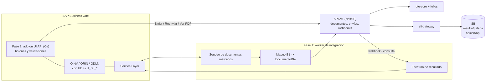
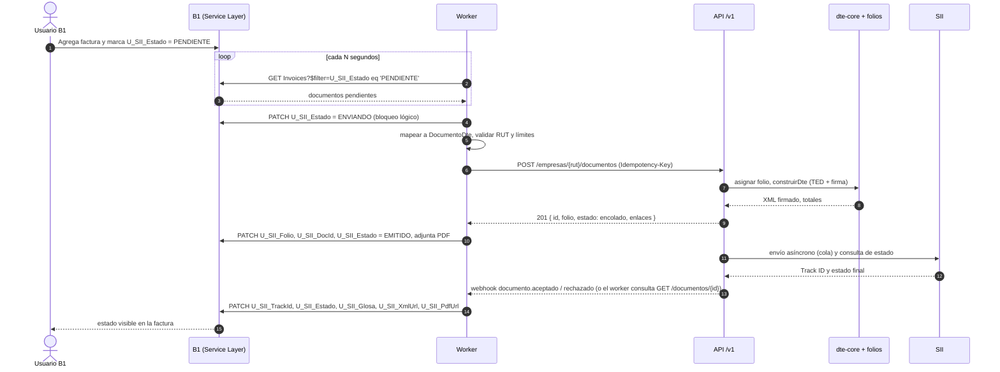
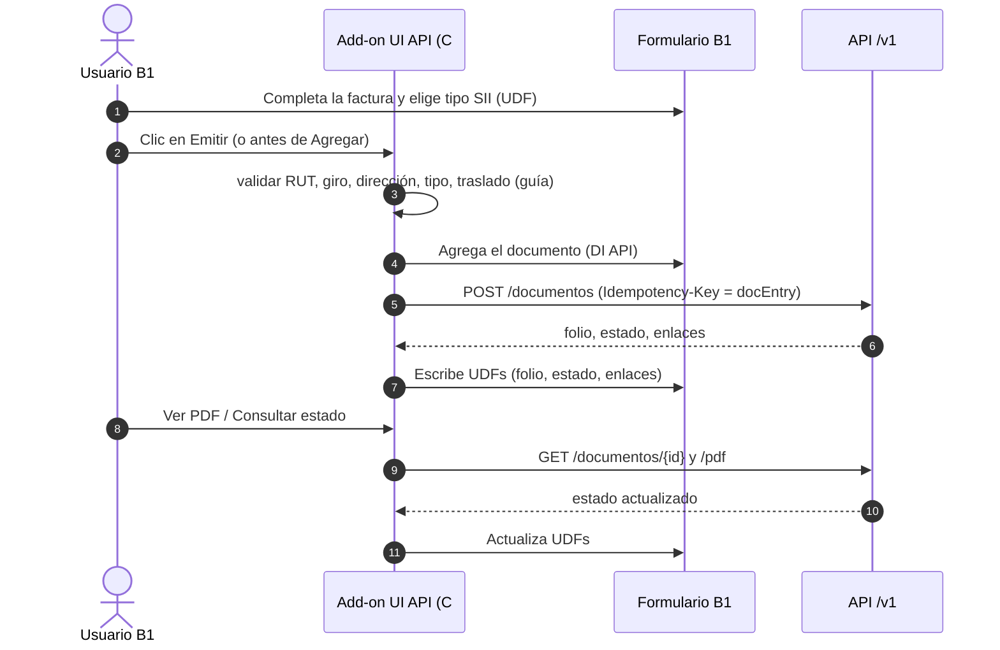

# 14 - Integración con SAP Business One

Estado: **Fase 1 implementada (`apps/sap-b1-worker`, ver su README). Fase 2 (add-on UI API/DI API en C#, `apps/sap-b1-addon`) implementada en código, sin compilar ni probar contra un B1 real: el núcleo se prueba con fakes; la capa SAP nunca se compiló contra el SDK.** Base: sección 5 de `docs/01-opciones-arquitectura-y-pruebas.md`. Dependencias: la API `/v1` de documentos y envíos (doc 09), que ya existe (`apps/api`) y usa `dte-core` y `sii-gateway`. La fase 1 se probó sólo contra un Service Layer y una API **simulados**; nada se ha ejecutado aún contra un B1 real. Los puntos tomados de fuentes secundarias o no confirmados con el partner están marcados *(verificar)*.

Diferencias entre este diseño y lo implementado en la fase 1:
- **No hay webhooks** en la API: el worker sondea (`POST /v1/documentos/:id/consultar-estado`), con un intervalo mínimo por documento.
- **No hay cola automática de envíos al SII**: el worker dispara `POST /v1/empresas/:rut/envios` con `{ documentoIds }` (boletas y DTE por separado) para los documentos `EMITIDO`.
- El worker es una **app independiente** (`apps/sap-b1-worker`, Node/TypeScript, sin dependencias de runtime), una instancia por company de B1 y RUT emisor.
- UDFs adicionales a los de la sección 4: `U_SII_CodRef`, `U_SII_RazonRef`, `U_SII_TipoDocRef`, `U_SII_FolioRef` (referencias de notas) y `U_SII_Giro` en el socio de negocios (`OCRD`).
- La nota de débito (56) se modela como factura de deudores con `U_SII_TipoDTE = 56`.

## 1. Principio rector

**La API es la autoridad tributaria y de folios.** SAP B1 solo entrega datos del documento comercial y recibe de vuelta folio, estado, Track ID, XML y PDF. Ninguna lógica tributaria (totales, redondeo, TED, firma, CAF) vive en B1: eso evita duplicar reglas y numerar dos veces un folio.

## 2. Opciones del SDK de B1

| Mecanismo | Qué es | Pros | Contras | Uso en este proyecto |
|---|---|---|---|---|
| **UI API + DI API** (`SAPbouiCOM`, `SAPbobsCOM`, COM, C#/.NET Framework, x64 en 10.0) | Add-on dentro del cliente B1 | Experiencia integrada (botones, validaciones antes de "Agregar", estado en el formulario) | Solo cliente Windows de escritorio; instalación por puesto; sensible a versión de B1 (el `AddOnRegDataGen` debe coincidir) | **Fase 2** (add-on delgado) |
| **Service Layer** (REST/OData sobre HANA y MSSQL desde 10.0 PL01; OData v4 preferido) | Acceso a objetos de negocio por HTTP con sesión | Sin instalar nada en los clientes; funciona con Web Client y cloud; lectura de documentos, escritura de UDFs y adjuntos | Sin eventos nativos: hay que sondear o usar un disparador | **Fase 1** (worker) |
| **B1if** (Integration Framework) | Flujos low-code disparados por eventos (B1i Event Sender) | Evento real al agregar documento | Curva de aprendizaje y depuración difíciles; depende de que el partner lo opere | Alternativa si el cliente ya usa B1if |
| **Extensiones del Web Client** (UI API framework desde FP 2405, `.mtar`) | Vistas y botones en el Web Client | Botones en Web Client | Requiere FP reciente y herramientas de extensión | Complemento a la fase 2 si hay usuarios de Web Client |

La localización Chile de B1 aporta campos de folio, RUT y retenciones, pero **no hay documentación oficial de SAP con formatos DTE chilenos ni conectividad con el SII** (doc 01, 5.2). Confirmar con el partner qué incluye el paquete de localización instalado en cada cliente antes de comprometer alcance.

## 3. Arquitectura elegida

- **Fase 1 - worker sobre Service Layer.** Implementada como servicio separado (`apps/sap-b1-worker`). Detecta documentos nuevos (`OINV`, `ORIN`, `ODLN`) marcados para emisión, arma el payload, llama a la API y escribe el resultado en UDFs y adjuntos. Sin instalación en los puestos de trabajo; sirve a clientes Windows, Web Client y cloud.
- **Fase 2 - add-on UI API en C# delgado.** Validaciones previas al "Agregar" (RUT y giro del receptor, dirección, tipo de documento SII elegido en un UDF, campos de traslado en entregas), botones Emitir / Reenviar / Ver PDF / Consultar estado y estado visible en el formulario. Solo orquesta y muestra; llama a la misma API.
- Ambas fases usan el mismo contrato (doc 09); el worker sigue siendo el mecanismo de respaldo y de conciliación.

Decisión de disparo en la fase 1 (sin eventos nativos): el worker sondea cada N segundos los documentos con `U_SII_Estado = 'PENDIENTE'` (UDF que el usuario o una regla marca) mediante consultas de Service Layer (`$filter` sobre la entidad `Invoices`/`CreditNotes`/`DeliveryNotes`; las consultas SQL requieren FP 2011 o superior *(verificar)*). Alternativa de menor latencia: B1if con B1i Event Sender llamando a un endpoint del worker.

## 4. UDFs propuestos

En las cabeceras de `OINV`, `ORIN`, `ODLN` (y `ORDN` si se devuelven mercaderías). Prefijo `U_SII_`.

| UDF | Tipo | Tamaño | Quién lo escribe | Uso |
|---|---|---|---|---|
| `U_SII_TipoDTE` | Alfanumérico | 3 | Usuario / regla | Tipo SII a emitir (33, 34, 39, 41, 52, 56, 61); por defecto derivado del documento |
| `U_SII_Estado` | Alfanumérico | 20 | Worker | `PENDIENTE`, `ENVIANDO`, `EMITIDO`, `ENVIADO`, `ACEPTADO`, `REPAROS`, `RECHAZADO`, `ERROR` |
| `U_SII_Folio` | Número | - | Worker | Folio asignado por la API |
| `U_SII_TrackId` | Alfanumérico | 20 | Worker | Track ID del envío (coincide con `documentos.track_id varchar(20)`) |
| `U_SII_Glosa` | Memo | - | Worker | Glosa del estado o del error; reparos |
| `U_SII_DocId` | Alfanumérico | 36 | Worker | UUID del documento en la API (correlación) |
| `U_SII_XmlUrl` | Alfanumérico | 254 | Worker | URL de descarga del XML firmado |
| `U_SII_PdfUrl` | Alfanumérico | 254 | Worker | URL del PDF |
| `U_SII_IdemKey` | Alfanumérico | 100 | Worker | `Idempotency-Key` usada (p. ej. `b1:{empresa}:{objType}:{docEntry}`) |
| `U_SII_IndTraslado` | Alfanumérico | 1 | Usuario | Solo `ODLN`: indicador de traslado |
| `U_SII_Transporte` | Alfanumérico | 254 | Usuario | Solo `ODLN`: datos de traslado (patente, transportista, chofer, destino) según Res. Ex. 144/2026 *(estructura por definir con la normativa)* |

Notas: el folio también puede escribirse en los campos de folio de la localización Chile (`FolioPrefixString`/`FolioNumber`) si el cliente los usa; la API sigue siendo la fuente. El PDF se adjunta además por `Attachments2`.

## 5. Mapeo de documentos B1 -> DTE

| Documento B1 | DTE | Observaciones |
|---|---|---|
| Factura de deudores (`OINV`) a empresa | 33 afecta / 34 exenta | Código de impuesto B1 -> ítems afectos o `exento: true`; el 34 si todos los ítems son exentos; `impuestosAdicionales` por código de impuesto específico |
| Factura de deudores a consumidor final o venta POS | 39 / 41 | Precios con IVA incluido; `medioPago` (1-5); `CorreoRecep`/`TelefonoRecep` para entrega digital; proveedor de software en el XML (**pendiente en `dte-core`**); receptor genérico `66666666-6` |
| Nota de crédito de deudores (`ORIN`) | 61 | Referencia obligatoria al documento original (`tipoDocRef`, `folioRef`, `fechaRef`, `codRef` 1/2/3); el folio original sale de `U_SII_Folio` del documento base |
| Nota de débito | 56 | Según cómo la modele la localización o la empresa; misma regla de referencia |
| Entrega (`ODLN`) | 52 guía de despacho | `indTraslado` y datos de traslado (Res. Ex. 144/2026); enviar al SII antes del traslado; prioridad alta en la cola |
| Factura de proveedores (`OPCH`) | Recepción de DTE de compras | Fase posterior: intercambio y aceptación/reclamo |

Mapeo de campos (hacia el `DocumentoDte` de `dte-core`; el emisor lo aporta la empresa de la API):

| Campo B1 | Campo `DocumentoDte` |
|---|---|
| `DocDate` | `idDoc.fechaEmision` |
| `DocDueDate` | `idDoc.fechaVencimiento` |
| `PaymentGroup`/condición de pago | `idDoc.formaPago` (1 contado, 2 crédito) |
| `CardCode` -> `OCRD.LicTradNum` | `receptor.rut` y `dv` (validar DV antes de llamar) |
| `CardName`, giro (UDF o campo de socio), `Address` | `receptor.razonSocial`, `giro`, `direccion`, `comuna`, `ciudad` |
| Líneas (`Lines`): `ItemDescription`, `Quantity`, `UnitPrice` (neto o bruto según tipo), `DiscountPercent`, `TaxCode` | `detalle[]`: `nombre`, `cantidad`, `precioUnitario`, `descuentoPorcentaje`, `exento` |
| `DiscountPercent` de cabecera | `descuentosRecargos[]` |
| `BaseType/BaseEntry` del documento base | `referencias[]` |

Límites a respetar antes de llamar (los valida `dte-core`, pero conviene avisar en B1): 60 líneas en facturas/notas/guías, 1000 en boletas; textos truncados (`NmbItem` 80 caracteres). Para el tipo 33/39 debe existir al menos un ítem afecto; descripciones claras en `NmbItem` (Res. Ex. 36/2024).

## 6. Secuencia de emisión desde B1

### 6.1 Fase 1: worker sobre Service Layer

### 6.2 Fase 2: add-on UI API

## 7. Manejo de errores y reintentos

| Situación | Respuesta de la API | Acción en la integración |
|---|---|---|
| Datos inválidos (`ErrorValidacionDte`: DV, folio, límites, falta de ítem afecto) | `422 DOCUMENTO_INVALIDO` con `errors[]` | `U_SII_Estado = ERROR`, `U_SII_Glosa` con el detalle; **no** reintentar hasta que el usuario corrija |
| Sin folios o CAF vencido | `409 SIN_FOLIOS_DISPONIBLES` | `ERROR` con glosa; alertar al administrador; reintentar al cargar un CAF |
| Sin certificado activo / vencido | `422` | `ERROR`; alerta |
| API caída o timeout | 5xx / red | Reintento con backoff exponencial (mismo `Idempotency-Key`: sin folio doble); el documento permanece `ENVIANDO` hasta resolver |
| SII caído o límite (`SII_NO_DISPONIBLE`) | Ocurre dentro de la API (cola + `sii-gateway`: 3 intentos, backoff 500 ms x2; 405, 5xx, red) | El worker no interviene: espera el webhook o consulta `GET /documentos/{id}` |
| Rechazo del SII | `estado = rechazado` con `reparos` | `RECHAZADO` y glosa; el usuario corrige y se emite un documento nuevo (o `POST /reenviar` si el motivo es transitorio) |
| Aceptado con reparos | `estado = aceptado_con_reparos` | `REPAROS`; mostrar reparos (Res. Ex. 121/2026) |
| Respuesta perdida tras emitir | - | La repetición con la misma `Idempotency-Key` devuelve el documento ya emitido (`200`, `Idempotent-Replayed`) |
| Caída del worker a mitad | - | Al arrancar, concilia: documentos en `ENVIANDO` se consultan por `U_SII_IdemKey`/`U_SII_DocId` |

Reglas:
- Un documento B1 se emite **una sola vez**: la clave de idempotencia deriva de empresa + tipo de objeto + `DocEntry`. Ningún reintento puede consumir otro folio.
- Una vez emitido (con folio), el documento B1 queda inmutable en campos tributarios; las correcciones van por nota de crédito/débito (ORIN) con referencia.
- Sesión de Service Layer: autenticar, reutilizar la sesión (timeout de 30 min por defecto *(verificar)*), reautenticar ante 401 y respetar la concurrencia de sesiones de la licencia.
- Conciliación periódica (por ejemplo cada hora): comparar documentos B1 con `U_SII_Estado` no final contra `GET /documentos` de la API.
- Notificación al usuario de estados no felices mediante alertas de B1 o correo.

## 8. Plan de pruebas

| Nivel | Qué | Cómo |
|---|---|---|
| Mapeo | B1 -> `DocumentoDte` por tipo (33, 34, 39, 41, 52, 56, 61) con montos conocidos | Pruebas unitarias del mapeador con documentos B1 en JSON (fixtures), verificando totales contra `calcularTotales` |
| Contrato | Worker contra la API | Mock de la API o API real en certificación; casos 201, 200 idempotente, 409, 422, 5xx |
| Service Layer | Lectura de pendientes, escritura de UDFs, adjuntos, reautenticación | Instancia de Service Layer de pruebas |
| E2E | Factura -> folio -> estado final visible en B1 | Base demo **localizada Chile** (SAP publicó demos para 10.0 FP 2011), API en ambiente de certificación del SII |
| Resiliencia | Caída de API/SII/worker a mitad; reintentos sin folio doble | Inyección de fallos; verificar unicidad de folios |
| Add-on (fase 2) | Validaciones, botones, UDFs; instalación por `.ard`/Extension Manager | Matriz de versiones (10.0 FP, MSSQL y HANA), copia de la company del cliente, depuración adjuntando Visual Studio al proceso del cliente B1 |
| Aceptación | Set de pruebas del SII con documentos generados desde B1 | Dentro de la certificación formal (doc 10, 8.3) |

## 9. Riesgos y pendientes

1. Diversidad de versiones (FP), bases (MSSQL/HANA) y paquetes de localización: validar con el partner antes de comprometer alcance.
2. **Pendiente.** Falta en `dte-core` el proveedor de software (`RutProvSW`, `RznSocProvSW`) de boletas y el bloque de traslado de la guía (Res. Ex. 144/2026): bloquean el mapeo completo de `ODLN` y de boletas. El worker ya envía `indTraslado` y el texto de `U_SII_Transporte` (en `origen.transporte`).
3. **Resuelto en parte.** La API `/v1` de documentos y envíos ya existe y el worker la consume. Sigue sin haber webhooks ni cola automática de envíos: el worker sondea y dispara los envíos él mismo.
4. **Pendiente.** Definir la estructura exacta de los UDFs de traslado cuando se tenga el XSD actualizado.
5. Quién gestiona la certificación SII de cada empresa cliente (por RUT) y el ambiente por empresa.
6. **Resuelto en parte.** Seguridad: credenciales por variables de entorno (nunca en logs), API key por empresa con permisos mínimos, TLS verificado (CA propia vía `NODE_EXTRA_CA_CERTS`, sin desactivar la verificación). Pendiente: gestor de secretos en producción y permisos mínimos reales del usuario de B1 (a validar con un B1 real).
7. **Pendiente (verificar con un B1 real).** Supuestos de la fase 1 no comprobados sin SAP: nombres de campos de Service Layer (`PriceAfterVAT`, `BPAddresses.County` como comuna, `AttachmentEntry`, `Attachments2` multipart), `$select` y `$orderby` en las lecturas, formato de `odata.nextLink`, versión `v1`/`v2` y permisos de actualizar UDFs en documentos cerrados.
8. **Pendiente.** Facturas de proveedores (`OPCH`), intercambio y aceptación/reclamo quedan para una fase posterior.
