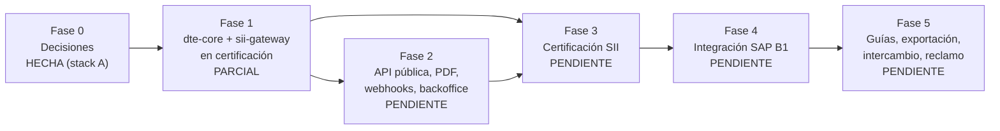

# 15. Estado y roadmap

Fecha de verificación: 2026-11-17, sobre el commit `b91f3a1` (rama `master`, árbol limpio al iniciar). Los conteos de pruebas salen de ejecutar `cd apps/api && npx vitest run`.

## 1. Qué está implementado hoy

### 1.1 Resultado de las pruebas

| Ejecución | Resultado |
|---|---|
| `npx vitest run` (unitarias) | **17 archivos, 184 pruebas, todas pasan** (duración aproximada: 24 s) |
| `npx vitest run --config ./vitest.config.e2e.ts` | 5 pruebas e2e: 1 sin base de datos (`GET /`) pasa; 4 requieren PostgreSQL (`/health` y 3 de folios) y fallaron en esta verificación porque no había PostgreSQL levantado; no es una regresión del código |

Desglose de las 184 pruebas unitarias:

| Área | Archivo | Pruebas |
|---|---|---|
| `dte-core` | `caf/caf.spec.ts` | 7 |
| | `certificado/certificado.spec.ts` | 3 |
| | `documento/construir-dte.spec.ts` | 27 |
| | `documento/totales.spec.ts` | 18 |
| | `envio/envio.spec.ts` | 6 |
| | `firma/firma.spec.ts` | 9 |
| | `integracion.spec.ts` | 1 |
| | `ted/ted.spec.ts` | 5 |
| | `xml/xml.util.spec.ts` | 4 |
| | `xsd/xsd.spec.ts` | 10 |
| | **Subtotal `dte-core`** | **90** |
| `sii-gateway` | `ambientes.spec.ts` | 3 |
| | `boleta/boleta-api.client.spec.ts` | 39 |
| | `comun/comun.spec.ts` | 16 |
| | `dte/dte-sii.client.spec.ts` | 27 |
| | **Subtotal `sii-gateway`** | **85** |
| Resto | `folios/folios.service.spec.ts` | 2 |
| | `seguridad/cifrado.service.spec.ts` | 6 |
| | `app.controller.spec.ts` | 1 |
| | **Subtotal resto** | **9** |
| **Total** | 17 archivos | **184** |

No se midió cobertura (existe `npm run test:cov`, sin ejecutar).

### 1.2 Inventario por componente

| Componente | Estado | Evidencia |
|---|---|---|
| Andamiaje NestJS 12 (ESM, TS estricto, Vitest, oxlint, prettier) | Implementado | `apps/api/package.json`, `tsconfig.json`, `.oxlintrc.json` |
| Configuración validada con Joi (`PORT`, `DATABASE_*`, `SII_AMBIENTE`, `CERTIFICADOS_MASTER_KEY`) | Implementado | `apps/api/src/config/` |
| `GET /` (nombre, versión, ambiente) y `GET /health` (ping a la BD) | Implementado | `apps/api/src/app.controller.ts`, `apps/api/src/health/` |
| Prefijo global `/v1` (sin endpoints de negocio que lo usen) | Implementado | `apps/api/src/main.ts` |
| Conexión TypeORM y migración inicial (6 tablas, 3 enums) | Implementado | `apps/api/src/database/` |
| Entidades `Empresa`, `Certificado`, `Caf`, `Documento`, `Envio`, `EnvioDocumento` y sus módulos (sólo registro) | Implementado | `apps/api/src/*/entities/` |
| `FoliosService` (registrar CAF, asignar folio, resumen) | Implementado | `apps/api/src/folios/folios.service.ts` |
| `CifradoService` AES-256-GCM | Implementado | `apps/api/src/seguridad/cifrado.service.ts` |
| `dte-core`: CAF, TED, firma, XML/RUT/ISO-8859-1, XSD, PFX, totales, `construirDte`, sobres | Implementado | `apps/api/src/dte-core/` |
| Tipos soportados por el constructor: 33, 34, 39, 41, 52, 56, 61 | Implementado | `apps/api/src/dte-core/documento/tipos.ts` |
| `sii-gateway`: cliente de boletas (semilla, token, envío, estados) y de DTE (semilla, token, upload, estados), caché de token, reintentos, errores | Implementado (sin cablear a Nest) | `apps/api/src/sii-gateway/` |
| Caso de uso de emisión, endpoints `/v1/...`, autenticación | **Implementado** | API keys con permisos y aislamiento por empresa (`src/auth/`) |
| Colas, worker, polling de estados | **No existe** | Redis sólo en `docker-compose.yml`; BullMQ ausente de `package.json` |
| PDF, PDF417, entrega digital, webhooks | **No existe** | sin dependencias ni código |
| Servicio de empresas y de certificados (alta, carga de PFX) | **No existe** | los módulos sólo registran las entidades |
| Integración SAP B1 | **No existe** | solo diseño en `docs/01-…` sección 5 |
| Prueba contra el SII real (certificación) | **No realizada** | `README.md` |

## 2. Brechas conocidas

Recopiladas de los README y de la revisión del código.

### 2.1 `dte-core` (`apps/api/src/dte-core/README.md`)

- Guía de despacho con datos de traslado (Res. Ex. 144/2026: `Transporte`, `IndTraslado` ampliado).
- Exportación (110/111/112), liquidaciones (43), factura de compra (46).
- Retenciones e `IVANoRet`; `impuestosAdicionales` sólo suma al total.
- `SubTotInfo`, `Comisiones`, `OtraMoneda`, ítem espectáculo e `InfoTicket` de boletas.
- Validación de vigencia del CAF dentro del constructor.
- El CAF de prueba tiene `FRMA` aleatorio (no sirve contra el SII real) y `parsearCaf` no verifica `FRMA` (requiere la clave pública del SII por `IDK`).
- Validar firma y `KeyInfo` (formato exacto y espacios en blanco) contra certificación.
- Los CAF reales usan RSA de 1024 bits y los tests 2048; sin soporte de certificados no RSA ni de PFX con cadena intermedia como salida.
- Nuevos campos de impuestos específicos (IEC, ILA/IABA) no están en el XSD de 2026-02-19; el constructor es código y no una definición versionada.

### 2.2 `sii-gateway` (`apps/api/src/sii-gateway/README.md`)

- `QueryEstDteAv` (consulta avanzada de estado).
- Web services de aceptación y reclamo (`ws1`/`ws2.sii.cl`, REGISTRORECLAMODTE) y consulta de eventos.
- Catálogos `globales/boleta.electronica.*`.
- Respeto de `X-Retry-After` y `X-RateLimit-*`; circuit breaker.
- Verificar contra maullin y apicert los formatos de respuesta.
- Supuestos no confirmados: envelopes SOAP sin namespace de método, nombres de parámetros de `getEstUp` (`RutCompania`, `DvCompania`, `TrackId`, `Token`), cookie `TOKEN` además del parámetro, STATUS 5 del upload tratado como autenticación fallida.
- No se valida el tope de 500 boletas por envío (responsabilidad del dominio).
- La caché de token es por proceso.

### 2.3 Base de datos (`apps/api/src/database/README.md`)

- Retención legal de DTE y envíos (6 años, a verificar), purga y archivado de `envios.xml_envio` y `respuesta`.
- Object storage para XML firmado, XML de envío y PDF (hoy `text` en la BD).
- Cifrado de sobre con KMS/Vault y rotación de clave maestra.
- Particionado de `documentos` y auditoría de cambios.

### 2.4 Proyecto (`README.md`)

- Caso de uso de emisión y API `/v1/empresas/{rut}/documentos`.
- Colas de envío.
- Representación impresa (PDF con PDF417) y entrega digital de boletas.
- Certificación ante el SII.
- Integración con SAP B1 (worker sobre Service Layer y add-on UI API).

### 2.5 Hallazgos de la revisión del código

| Hallazgo | Ubicación | Impacto |
|---|---|---|
| TLS a PostgreSQL con `rejectUnauthorized: false` cuando `DATABASE_SSL=true` | `apps/api/src/database/database.module.ts` | No valida el certificado del servidor; debe endurecerse antes de producción |
| Tipo `AmbienteSii` definido dos veces | `apps/api/src/config/sii.config.ts` y `apps/api/src/sii-gateway/ambientes.ts` | Riesgo de divergencia; unificar al cablear el gateway |
| `CifradoService` y `dte-core`/`sii-gateway` no están importados por ningún módulo Nest | `apps/api/src/app.module.ts` | Hoy son piezas aisladas; falta la capa de aplicación |
| `FoliosService.aFechaSql` usa la fecha local del servidor (`getFullYear`, `getMonth`) y no `America/Santiago` | `apps/api/src/folios/folios.service.ts` | El vencimiento de CAF podría evaluarse con un día de diferencia si el servidor no está en hora chilena; `dte-core` sí usa `America/Santiago` |
| `documentos.xml_firmado` y `envios.xml_envio` en `text` dentro de la BD | migración inicial | Crecimiento de tabla; ver object storage |
| No hay `Dockerfile`, CI ni `.dockerignore` | raíz del repositorio | Despliegue y verificación continua pendientes |
| `apps/api/README.md` es la plantilla de Nest y `apps/api/AGENTS.md` recomienda NestJS Observe | `apps/api/` | Documentación genérica; la guía real está en el `README.md` raíz |
| El archivo `apps/api/.env` existe en el árbol de trabajo (ignorado por git, `.gitignore` línea 4) | `apps/api/.env` | Correcto; confirmar que no contenga secretos reales (la clave de `.env.example` es sólo de desarrollo) |

### 2.6 Incoherencias entre los documentos existentes y el código

| Documento | Afirmación | Realidad en el código |
|---|---|---|
| `docs/01-…` sección 2 (opción A) | Validación XSD con `libxmljs2`; PDF417 con `bwip-js`; PDF con `pdfmake`/Puppeteer; SOAP con `soap` o `fetch` crudo | XSD con `libxml2-wasm`; sin dependencias de PDF/PDF417; SOAP con `fetch` y envelopes a mano |
| `docs/01-…` sección 3 | Caché de token "por empresa y ambiente", circuit breaker y registro de cada llamada en el gateway | Caché por (tipo, ambiente, RUT empresa) implementada; circuit breaker y registro de llamadas no |
| `docs/01-…` sección 3 | `envios` como worker con cola y outbox | `EnviosModule` sólo registra entidades |
| `README.md` raíz | "Los recursos de negocio vivirán bajo `/v1`" | Correcto: el prefijo está configurado pero no hay recursos |
| `apps/api/src/sii-gateway/README.md` | Título "(WP4)" y "el integrador las envuelve en un módulo" | No existe tal módulo todavía |
| `README.md` raíz | `SII_AMBIENTE` "por defecto" y ambiente por empresa | El valor por empresa existe en la columna, pero nada lo lee aún |

## 3. Riesgos

| Id | Riesgo | Prob. | Impacto | Mitigación |
|---|---|---|---|---|
| R-01 | El SII rechaza la firma, el TED o el XML en certificación por detalles no cubiertos por el XSD (`KeyInfo`, espacios, canonización) | Alta | Alto | Prioridad 1: pruebas contra maullin/apicert con certificado y CAF reales; comparar con una implementación de referencia (LibreDTE, sólo lectura) |
| R-02 | Cambios normativos 2026 (Res. 121/2026 por fases, campos de impuestos, Res. 144/2026) | Alta | Medio | XSD versionado; constructor extensible; seguimiento de novedades; considerar definición versionada de formato |
| R-03 | Fuga de datos entre empresas por una consulta sin `empresa_id` | Media | Alto | **Mitigado:** RLS forzada, rol `api_sii_app` sin `BYPASSRLS` y `test/rls.e2e-spec.ts` |
| R-04 | Compromiso de `CERTIFICADOS_MASTER_KEY` o de la base expone todos los PFX | Baja | Crítico | KMS/Vault con cifrado de sobre; rotación; no registrar secretos; acceso mínimo |
| R-05 | Huecos de folio por fallas entre la asignación y la persistencia | Media | Medio | Asignar el folio dentro de la transacción de emisión; política de anulación de folios ante el SII |
| R-06 | CAF vencido o sin folios en medio de la operación | Media | Alto | Alertas por umbral y vencimiento; el servicio ya omite CAF vencidos y falla con `SinFoliosDisponiblesError` |
| R-07 | Límites del SII (405) y caídas del servicio degradan la emisión | Media | Medio | Emisión desacoplada del envío; backoff (ya) y circuit breaker, cola, límite de 50 boletas por sobre |
| R-08 | Caché de token por proceso con varias réplicas multiplica las autenticaciones | Media | Bajo | `almacen` compartido (Redis) |
| R-09 | Certificación por RUT depende del SII y de cada cliente (4 a 8 semanas) | Alta | Medio | Planificarla desde la fase 1; definir quién acompaña el proceso |
| R-10 | Licenciamiento: copiar código de LibreDTE (AGPL) | Baja | Alto | Usarlo sólo como referencia |
| R-11 | SAP B1: diversidad de versiones, bases (MSSQL/HANA) y localizaciones | Media | Medio | Validar con el partner antes de comprometer alcance |
| R-12 | Falta de CI: regresiones sin detectar y XSD desactualizado | Media | Medio | Pipeline con lint, tipos, pruebas y validación XSD |
| R-13 | Datos normativos sin verificar (entrega digital de boletas, RVD, retención de 6 años) | Media | Medio | Confirmar con el texto oficial de las resoluciones |

## 4. Roadmap por fases

Coherente con la sección 6 de `docs/01-opciones-arquitectura-y-pruebas.md` (duraciones estimadas allí). La columna de estado refleja el repositorio hoy.



| Fase | Entregable (según `docs/01-…`) | Estado | Qué falta |
|---|---|---|---|
| **0** | Decisiones de stack, alcance, multiempresa, hosting y quién gestiona la certificación | Hecha en lo técnico (ADR-001, ADR-002); hosting y responsable de certificación sin decidir | Decidir hosting, gestión de la certificación y alcance comercial de documentos |
| **1** | `dte-core` + `sii-gateway` funcionando en certificación: factura 33, nota 61 y boleta 39 con TED, firma, envío y estados | **Parcial**: construcción, TED, firma, XSD, sobres y clientes listos y probados con mocks; sin prueba real | (a) Caso de uso de emisión que orqueste folios + `dte-core` + persistencia; (b) módulo Nest del gateway con firmador sobre el certificado de la empresa; (c) servicios de empresa, certificado y CAF; (d) primeras pruebas en maullin/apicert con certificado y CAF reales; (e) mapear estados y reparos a `documentos`/`envios` |
| **2** | API pública (OpenAPI), PDF/PDF417, entrega digital, webhooks, backoffice mínimo de CAF y certificados | **Pendiente** (sólo el prefijo `/v1` y las tablas) | Endpoints `/v1`, autenticación por empresa, idempotencia, cola y worker (Redis/BullMQ), PDF con PDF417, entrega digital, webhooks, documentación OpenAPI, cifrado de sobre, object storage |
| **3** | Certificación SII de la primera empresa (DTE y boleta en paralelo) | **Pendiente** | Set de pruebas, simulación, intercambio, muestras impresas, declaración de cumplimiento; sitio de consulta de boletas |
| **4** | Integración SAP B1: worker Service Layer, luego add-on UI API | **Pendiente** | Diseño de mapeo B1 a DTE, UDFs, adjuntos, pruebas con base localizada Chile |
| **5** | Guías con trazabilidad, exportación, intercambio, recepción de compras, aceptación y reclamo | **Parcial**: recepción de DTE de proveedores, respuestas de intercambio, recibo Ley 19.983 y RegistroReclamoDTE implementados (`apps/api/src/recepcion`); guías y facturas con traslado según la Res. 144/2026 implementadas (IndTraslado 10-12 desactivados hasta que el SII publique el XSD); falta exportación | Res. 144/2026, tipos 110/111/112/43/46, buzón de intercambio, REGISTRORECLAMODTE |

### 4.1 Siguiente hito recomendado

El `README.md` fija como siguiente hito probar contra la certificación real. Antes de eso, el orden mínimo de trabajo es:

1. Servicio de emisión que una `FoliosService`, `construirDte` y la persistencia de `documentos` (con clave de idempotencia).
2. Módulo Nest del gateway, unificando el tipo `AmbienteSii` y alimentando el firmador con el certificado descifrado (`CifradoService` + `cargarPfx`).
3. Servicios de alta de empresa, certificado y CAF (con validación del CAF por `parsearCaf`).
4. Script de smoke test contra maullin/apicert (factura 33 y boleta 39) y lectura de estados.
5. Pipeline de CI (lint, tipos, pruebas unitarias, e2e con PostgreSQL, validación XSD).
6. Endurecimiento previo a exponer la API: TLS verificado a PostgreSQL, política de logs sin secretos.

## 5. Cómo reproducir los números

```bash
docker compose up -d postgres          # sólo para las e2e con base de datos
cd apps/api && npm run migration:run   # sólo para las e2e con base de datos
cd apps/api && npx vitest run          # 17 archivos, 184 pruebas
cd apps/api && npm run test:e2e        # 5 pruebas e2e (4 requieren PostgreSQL)
cd apps/api && npm run lint
```
